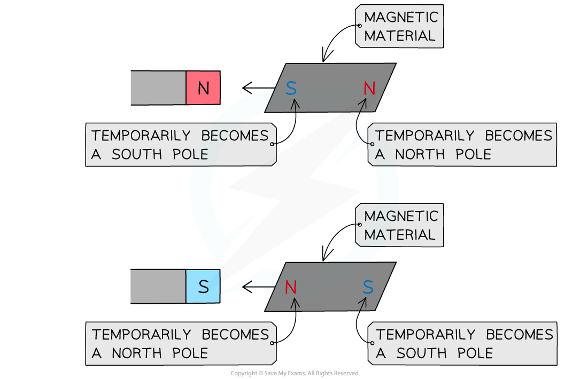

# Magnets

## Induced magnetism

> **Spec point** — `spcpt_8J7FPVW5kWDxVbbj` · - Describe induced magnetism
 - State the differences between the properties of temporary magnets (made of soft iron) and the properties of permanent magnets (made of steel)
 - State the difference between magnetic and non-magnetic materials
Describe the forces between magnetic poles and between magnets and magnetic materials, including the use of the terms:
 -  north pole (N pole), 
 - south pole (S pole), 
 - attraction and repulsion, 
 - magnetised and unmagnetised

## Induced magnetism

### Magnetic materials

- Very few metals in the periodic table are magnetic
- The magnetic metals are:

  - iron
  - cobalt
  - nickel
  - steel is an alloy which contains iron, so it is also magnetic

*Magnetic materials are attracted to a magnet; non-magnetic materials are not*

- Magnetic materials (which are not magnets) will always be **attracted** to the magnet, regardless of which pole is held close to it

*Magnetic materials are attracted to both poles of a permanent magnet*

- Bringing a material close to a known magnet will determine if the material is magnetic, non-magnetic or if it is a magnet itself

  - It is a **magnet **if it is **repelled **by the known magnet
  - It is a **magnetic material** if it is **attracted **to the known magnet
  - It is a **non-magnetic material** if it is **neither **attracted nor repelled by the known magnet

### Types of magnets

- There are two types of magnets:

  - permanent magnets
  - induced (also called temporary) magnets

#### Permanent magnets

- Permanent magnets are made out of permanent magnetic materials, for example, **steel**
- A permanent magnet will **produce its own magnetic field**

  - It will not lose its magnetism

#### Temporary (induced) magnets

- An **induced magnet** is a material with a **soft iron core** that **becomes **a magnet **temporarily **when it is placed in a magnetic **field**

  - Induced magnetism always causes a force of **attraction **between the **permanent magnet** creating the magnetic field and the induced magnet
  - When this happens it is said that the material has been **magnetised**
  - This means that the end of the material closest to the magnet will have the **opposite **pole to that of the magnet pole closest to the material

- When removed from the magnetic field, the material will **lose **its induced magnetism **quickly **and become **unmagnetised**

  - Some objects such as paperclips or needles (made from steel) can be magnetised and will remain magnetic for a while
  - Other objects, such as electromagnets or transformers (which are made from **soft iron**) will be **unmagnetised **(no longer magnetised) as soon as the cause of the induced magnetism is **removed**

*Inducing magnetism in a magnetic material*

> **Worked Example**
> The diagram below shows a magnet held close to a piece of metal suspended by a light cotton thread. The piece of metal is attracted towards the magnet.
> 
> 
> 
> Which of the following rows in the table gives the correct type of pole at X and the correct material of the suspended piece of metal?
> 
> |   | Type of pole at X | Material of suspended piece of metal |
> |---|---|---|
> | A | North | Nickel |
> | B | South | Nickel |
> | C | North | Aluminium |
> | D | South | Aluminium |
> 
> [1]
> 
> **Answer: **
> 
> - The correct answer is **A ****[1 mark]**
> - X must be a north pole
> 
>   - The piece of metal is being attracted towards the magnet
>   - The law of magnetism states that opposite poles attract
> 
> - The material of the suspended piece of metal is nickel
> 
>   - Nickel is a magnetic material (it will experience a force when it is placed in a magnetic field, in this case it is attracted towards the magnet)
> 
> - **B** is incorrect because X cannot also be a south pole (and hence is a north pole)
> 
>   - If the pole at X was a south pole then the piece of metal would be repelled from the magnet because the law of magnetism states that like poles repel
> 
> - **C** and **D** are incorrect because aluminium is not a magnetic material
> 
>   - A non-magnetic material would be unaffected by the magnetic field produced by the magnet

## Induced magnetism video

> **Spec point** — `spcpt_Vhp8fBKWtpvXTPbQ` · nan

##
