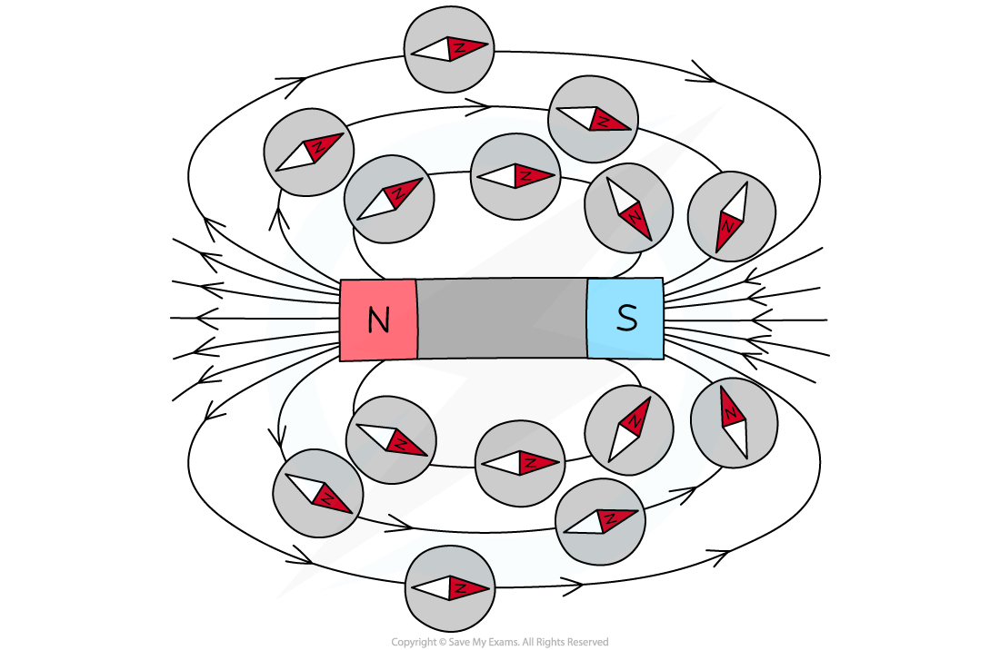

# Plotting Magnetic Fields

## Plotting magnetic field lines

> **Spec point** — `spcpt_wG98kTxMskKqfJdT` · Describe the plotting of magnetic field lines with:
 -  a compass or 
- iron filings 
and the use of a compass to determine the direction of the magnetic field

## Plotting magnetic field lines

- Examination questions may ask for a method of plotting the magnetic field around a bar magnet
- There are two principal ways of doing this:

  - using iron filings
  - using plotting compasses

### Using iron filings

1. Place a piece of paper on top of the magnet
2. Gently sprinkle iron filings on top of the paper
3. Now carefully tap the paper to allow the iron filings to settle on the field lines

#### Magnetic field lines using iron filings

*Iron filings can be used to plot a magnetic field*

### Using plotting compasses

1. Place the magnet on top of a piece of paper
2. Draw a dot at one end of the magnet (near its corner)
3. Place a plotting compass next to the dot, so that one end of the needle of the compass points towards the dot
4. Use a pencil to draw a new dot on the other side of the compass needle
5. Now move the compass so that it points towards the new dot, and repeat the above process
6. Keep repeating until a chain of dots runs from one end of the magnet to the other
7. Remove the compass, and link the dots using a smooth curve
8. This is a magnetic field line, where the direction of the field lines goes from the **north pole** to the **south pole** of the magnet

  - This is the same as the direction of the north arrow on the plotting compass, which points towards the south pole
9. Repeat the process to create other magnetic field lines around the bar magnet

#### Using a compass to create magnetic field lines

*Compasses can be used to plot the magnetic field around a bar magnet*
