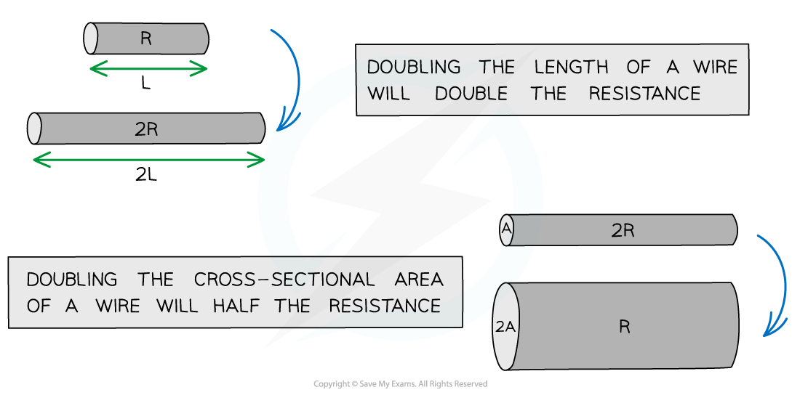

# Resistance of a Wire

## Resistance of a wire

> **Spec point** — `spcpt_npSDh2xxf8J5kgg4` · State, qualitatively, the relationship of the resistance of a metallic wire to its length and to its cross-sectional area

## Resistance of a wire

- As electrons pass through a wire, they **collide** with the metal ions in the wire
- These collisions transfer energy away from the kinetic store of the electrons, which causes them to **slow down**
- The energy from the electrons is transferred to the kinetic store of the vibrating metal ions

  - This causes the vibration of the ions to increase (increased temperature)
  - As the vibration of the ions increases, the more the electrons collide with them (increased resistance)

#### Electron collisions in a metal wire

*Electrons collide with metal ions, which resist their flow*

- If the wire is longer, each electron will collide with more ions, and so there will be more resistance:

  - **The longer a wire, the *****greater***** its resistance**

- If the wire is thicker (greater diameter) there is more space for the electrons and so more electrons can flow:

  - **The thicker a wire, the *****smaller***** its resistance**

## Proportionality relationships for electrical conductors

> **Spec point** — `spcpt_rtsV395dDn4KY23m` · Recall and use the following relationship for a metallic electrical conductor:
   (a) resistance is directly proportional to length
   (b) resistance is inversely proportional to cross-sectional area

## Proportionality relationships for electrical conductors

### Extended Tier Only

- The relationship between resistance, length and cross-sectional area can be represented mathematically

- Resistance is **directly** proportional to **length**

  - Doubling the length will double the resistance and vice versa

$R\proptoL$

- Resistance is **inversely** proportional to **cross-sectional area** (width or thickness)

  - Doubling the cross-sectional area will halve the resistance

$R\propto\frac{1}{A}$

#### Effect of length and cross-sectional area on resistance

*The mathematical relationship between length and width of the wire and the resistance*
