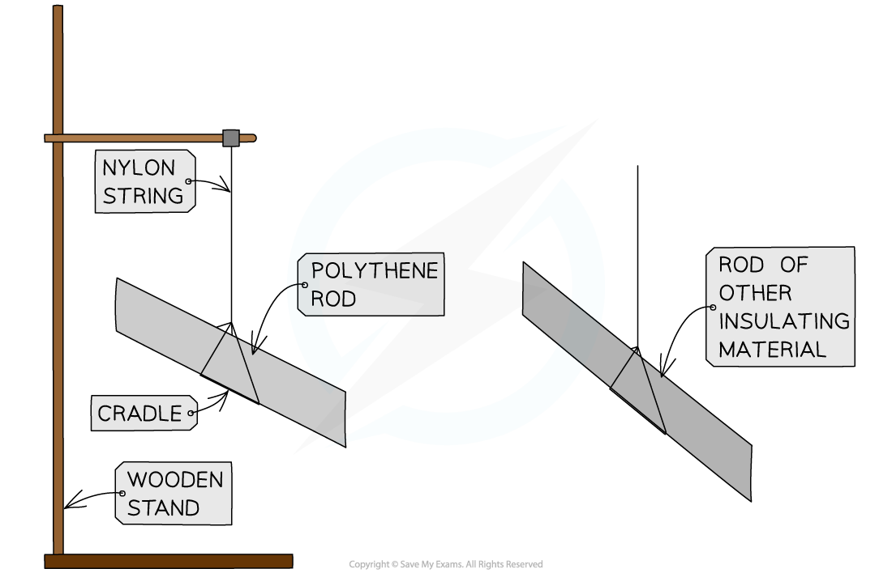
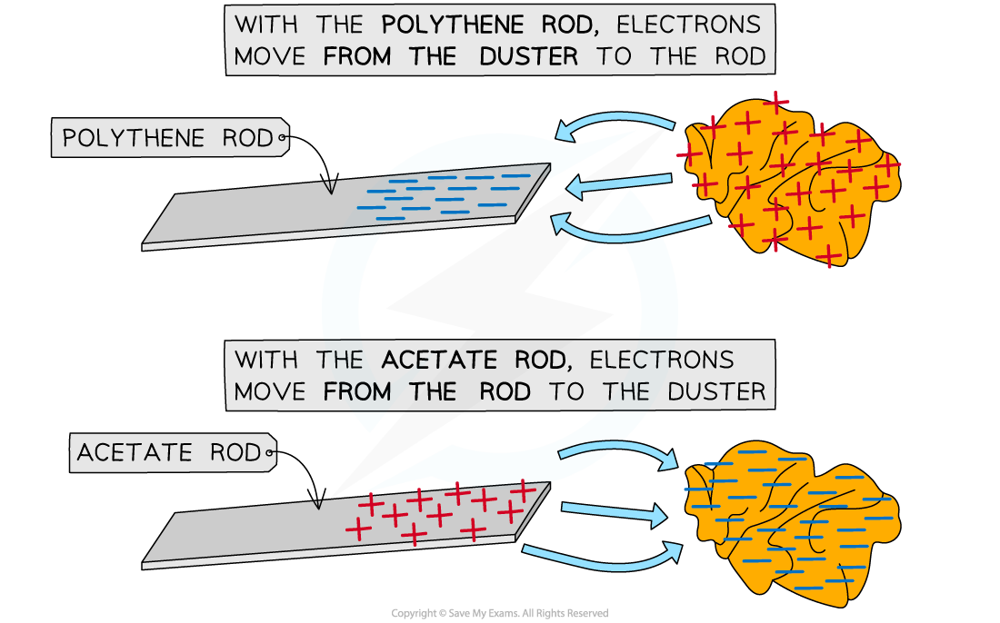
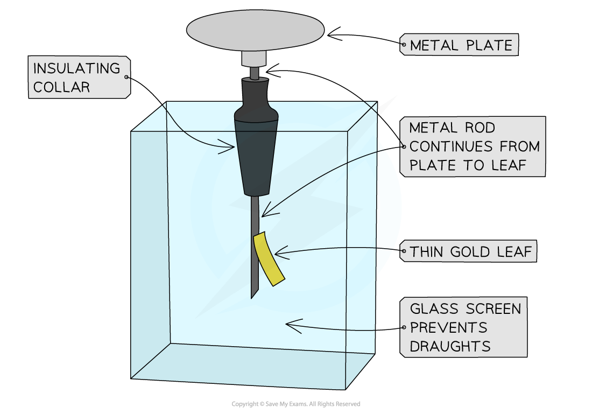

# Demonstrating Electric Charges

## Charging by friction

> **Spec point** — `spcpt_jwCdmsXchsH6ZShH` · - Explain that charging of solids by friction involves only a transfer of negative charge (electrons)

## Charging by friction

- When certain insulating solids are rubbed against each other, they can become **electrically charged**

  - This is called **charging by friction**

- The charges remain on the insulators and cannot immediately flow away

  - One gains a net **positive charge** and the other gains a net **negative charge**

- An example of this is a plastic or polythene rod being charged by rubbing it with a cloth

  - Both the rod and cloth are insulating materials

#### Charging solids by friction

*A polyethene rod may be given a charge by rubbing it with a cloth*

- When an uncharged cloth is rubbed against an uncharged polythene rod:

  - **Electrons** are **transferred** away **from** the **cloth to** the **rod**
  
    - The cloth has lost electrons so it becomes positively charged
    - The polythene rod has gained electrons so it becomes negatively charged
  - These **oppositely charged **objects are also **attracted** to each other
- When an uncharged cloth is rubbed against an uncharged acetate plastic rod:

  - **Electrons** are **transferred** away **from **the acetate **rod to** the **cloth**
  
    - The cloth has gained electrons so it becomes negatively charged
    - The rod has lost electrons so it becomes positively charged

*Electrons are transferred away from the acetate rod to the cloth but transferred away from the cloth to the polythene rod*

> **Exam Hint**
> At this level, if you are asked to explain how charge is gained or lost, you must reference **electrons**. If an object gains electrons, it gains negative charge and if it loses electrons it loses negative charge (and hence, gains positive charge)
> 
> Remember when charging by friction, it is only the **electrons** that can move, not any 'positive' charge, therefore if an insulator gains a negative charge, the other insulator must have gained a positive charge

## Demonstrating electrostatic charges

> **Spec point** — `spcpt_NZSHKHGnC8qP6sjb` · - Describe simple experiments to show the production of electrostatic charges by friction and to show the detection of electrostatic charges

## Demonstrating electrostatic charges

### Experiment 1: investigating electrostatic charging by friction

- The aim of this experiment is to investigate how insulating materials can be charged by friction

#### Variables

- ***Independent variable*** = Rods of different material
- ***Dependent variable*** = Charge on the rod
- Control variables:

  - Time spent rubbing the rod
  - Using the same type of cloth
  - Using the same length of rod

#### Equipment

#### Equipment list

| Equipment | Purpose |
|---|---|
| Polythene rod | To charge and hang from a cradle to test against each material |
| Rods of different materials (acrylic, acetate, glass, wood) | To observe the effects of these on the polythene rod |
| Cloths (one per material) | To rub the materials to charge them |
| Cradle | To suspend rods from, allowing them to move freely when subjected to a force |
| Nylon string | To hang the rods |
| Wooden stand | To suspend the string and cradle from |

#### Method

*Apparatus for investigating charging by friction*

1. Take a polythene rod, hold it at its centre and rub both ends with a cloth
2. Suspend the rod, without touching the ends, from a stand using a cradle and nylon string
3. Take a second polythene rod and rub one end with a different cloth
4. Bring the second polythene rod close to the suspended rod
5. Record any observations of the suspended rod's motion, i.e. whether it is attracted or repelled by the second rod
6. Repeat using an acetate rod and rods of different materials

#### Example results table

| Charged material 1 | Charged material 2 | Attracted or repelled |
|---|---|---|
| Polythene | Polythene |   |
| Polythene | Acetate |   |

#### Analysis of results

- When two insulating materials are rubbed together, negative charge (electrons) will transfer from one insulator to the other
- A polythene rod gains a **negative **charge when rubbed with a cloth

  - This is because electrons are transferred to the polythene from the cloth

- An acetate rod gains a **positive **charge when rubbed with a cloth

  - This is because electrons are removed from the acetate by the cloth

#### Transfer of electrons between charged insulators

*Electrons are transferred to the polythene rod giving it a negative charge, and they move from the acetate rod giving it a positive charge*

- If the material is **repelled** by the polythene rod, then the materials have the **same charge**

  - For example, the polythene rod would be repelled by a second polythene rod, as they have the same charge

- If the material is **attracted** to the polythene rod, then they have **opposite charges**

  - For example, the polythene rod would be attracted to an acetate rod, as they have opposite charges

#### Evaluating the experiment

- Reduce the effects of environmental factors (e.g. close windows to reduce drafts) to ensure the motion of the polythene rod is due to electric forces only
- Make sure not to touch the ends of the rods once they have been charged (if the ends are touched, the rods will **discharge **and the forces will no longer be present)
- Produce greater deflections by rubbing the rods for a longer period to transfer more charge (ensuring that the time spent rubbing each rod is the same)

### Experiment 2: detecting charge using a gold-leaf electroscope

- The aim of this experiment is to detect charge using a gold leaf electroscope

#### Variables

- ***Independent variable*** = Rods of different material
- ***Dependent variable*** = Charge on the rod

#### Equipment

#### Equipment list

| Equipment | Purpose |
|---|---|
| Gold-leaf electroscope | To detect charge |
| Polythene and acetate rods (or strips) | To observe the effects of these on the gold-leaf electroscope when charged |
| Cloths (one per material) | To charge the rods (or strips) by rubbing them |

#### Method

*The gold-leaf electroscope is a device consisting of a metal plate, a metal stem and a thin gold leaf. The stem and leaf are housed in an airtight container to prevent draughts*

1. Before beginning the experiment, ensure the plate of the electroscope is uncharged by touching it with your finger. The leaf should hang straight down next to the stem
2. Charge a polythene rod by rubbing it with a cloth
3. Bring the charged rod towards the plate of the electroscope and record any observations
4. Bring the charged rod away from the plate of the electroscope and record any observations
5. Touch the charged rod to the plate of the electroscope and record any observations
6. Repeat using an acetate rod

#### Example results table

| Charged material | Action | Gold leaf rises or falls | Movement of electrons |
|---|---|---|---|
| Polythene | Moved towards plate |   |   |
| Polythene | Moved away from plate |   |   |
| Polythene | Touched plate |   |   |
| Acetate | Moved towards plate |   |   |
| Acetate | Moved away from plate |   |   |
| Acetate | Touched plate |   |   |

#### Analysis of results

- When a charged object is brought near the plate of the electroscope, the leaf **rises**

  - The negatively charged polythene rod **repels **electrons away from the surface of the plate down the stem and leaf, giving them a **negative **charge, hence, they repel
  - The positively charged acetate rod **attracts **electrons to the surface of the metal plate from the stem and leaf, giving them a **positive **charge, hence, they repel

- When the charged object is moved away from the plate, the leaf **falls**

  - Electrons in the electroscope are no longer repelled or attracted by the rod so they redistribute themselves
  - The stem and leaf become electrically **neutral**

- When a charged object **touches **the plate of the electroscope, the leaf **stays risen**

  - The charge from the rod is transferred to the metal plate and travels down the stem and leaf of the electroscope
  - The stem and leaf therefore carry the **same charge** and repel each other
  - The electroscope has been **charged**

- When a finger touches the plate, the leaf **falls**

  - The charge from the electroscope is transferred to the person and travels to the earth
  - The stem and leaf become electrically neutral
  - The electroscope has been **discharged**

#### Evaluating the experiment

- Make sure not to touch the ends of the rods once they have been charged (if the ends are touched, the rods will **discharge**)
- When the electroscope is charged by contact with a rod, it should stay risen. If it doesn't, repeat the process but ensure to press harder and draw the rod along the edge of the plate

> **Exam Hint**
> Experimental demonstrations, such as the one above, are different from experiments in which you have to take measurements. In the case of this demonstration your results are your **observations**.
> 
> When describing a demonstration you should **state a conclusion** – in other words, explain what you expect to happen and what it means.

## Charging by friction video

> **Spec point** — `spcpt_SW7PC2bvj3GQgSs3` · nan

##
