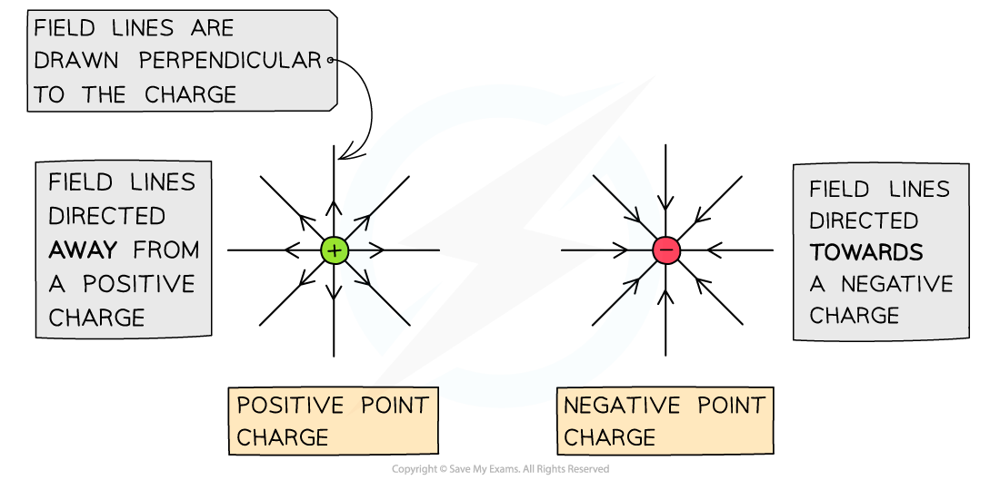
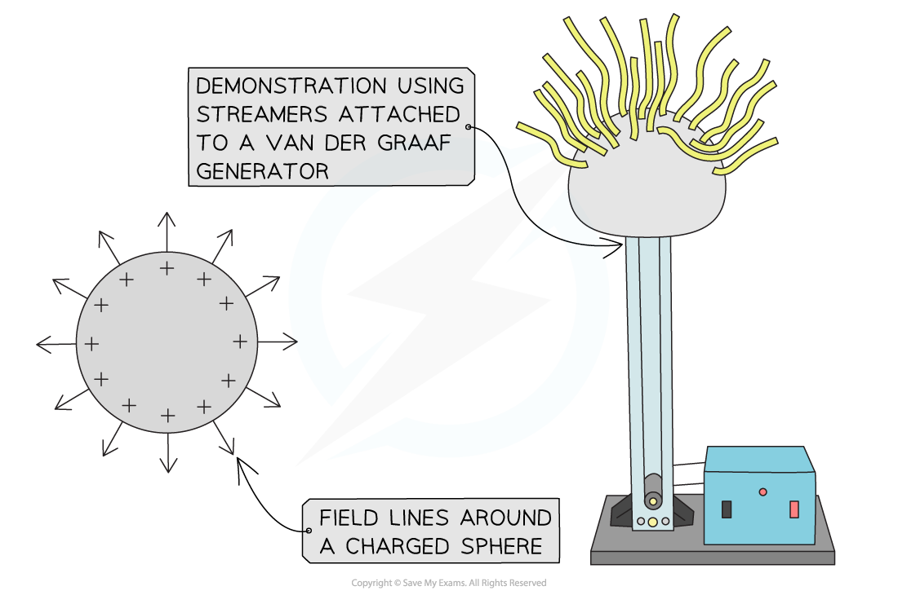
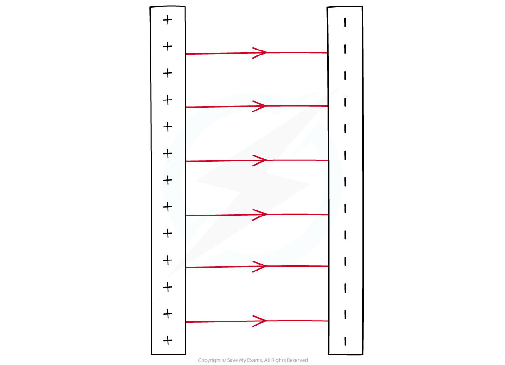

# Electric Fields

## Electric fields

> **Spec point** — `spcpt_7Y2zX4yJY8xdcC2c` · - Describe an electric field as a region in which an electric charge experiences a force 
- State that the direction of an electric field at a point is the direction of the force on a positive charge at that point 

## Electric fields

### Extended Tier Only

- An electric field is defined as:

**A region of space in which an electric charge experiences a force**

- The direction of an electric field at a point is defined as:

**The direction of the force on a positive charge at that point**

- Charged objects **create** electric fields around themselves

  - This is similar to how magnets create magnetic fields

- An electric field is a **vector** quantity as it has both **magnitude** (strength) and **direction**

## Electric field patterns

> **Spec point** — `spcpt_6bhBpbgtNYDvGgct` · Describe simple electric field patterns, including the direction of the field:
(a) around a point charge
(b) around a charged conducting sphere
(c) between two oppositely charged parallel conducting plates (end effects will not be examined)

## Electric field patterns

### Extended Tier Only

- Electric field lines are:

  - used to represent the **direction** and **magnitude **of an electric field
  - always directed from the **positive** charge **to** the **negative** charge

### Electric field around a point charge

- Around a ***point charge***, the electric field lines are directly radially inwards or outwards:

  - If the charge is **positive** (+), the field lines are radially **outwards**
  - If the charge is **negative** (-), the field lines are radially **inwards**

#### Electric field lines around positive and negative point charges

*Electric field lines around a point charge are directed away from a positive charge and towards a negative charge*

### Electric field around a charged conducting sphere

- The field lines around a charged conducting sphere are similar to that of a point charge

  - This is because the charges on the surface of the sphere will be evenly distributed
  - The charges are the same, so they repel
  - The surface is conducting, allowing them to move

- Field lines are **always perpendicular** (at right angles)** **to the surface of a conducting sphere

#### Electric field lines around a positively charged sphere

*The electric field pattern around a conducting sphere can be demonstrated using a Van de Graaff generator*

### Electric field between two parallel plates

- The electric field between two parallel plates is a **uniform electric field**
- The field lines are:

  - directed from the **positive** to the **negative** plate
  - parallel
  - straight lines

#### Electric field lines between two oppositely charged parallel plates

*Electric field lines between two parallel plates are directed from the positive to the negative plate. A uniform electric field has equally spaced field lines*

## Electric fields video

> **Spec point** — `spcpt_ryqXJ76DCjKcF4Bg` · nan

##
