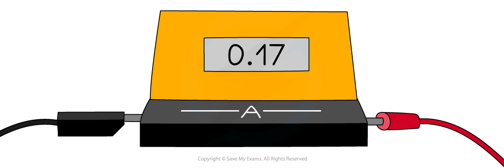

# Current

## Current

> **Spec point** — `spcpt_5qs34kz32C82hdKj` · - Know that electric current is related to the flow of charge

## Current

- Electric current is defined as:

**The rate of flow of electric charge**

- Current flows:

  - when a **circuit **is formed e.g. when a wire connects the two oppositely charged terminals of a cell
  - from the **positive** terminal to the **negative** terminal of a cell

*Charge flows from the positive terminal to the negative terminal*

## Measuring current

> **Spec point** — `spcpt_YSnhZwpQmkV2NrfZ` · Describe the use of ammeters (analogue and digital) with different ranges

## Measuring current

- Current can be measured using an **ammeter**
- Ammeters must be connected in **series **with the component being measured

*An ammeter can be used to measure the current around a circuit*

- Ammeters can be:

  - digital (with an electronic read out)
  - analogue (with a needle and scale)

### Analogue ammeters

- Typical ranges are 0.1-1.0 A and 1.0-5.0 A for analogue ammeters

  - Always double-check exactly where the marker is before an experiment
  - If it is not at zero, this value will need to subtracted from all measurements
  - They should be checked for ***zero errors*** before using

- They are also subject to ***parallax error***

  - Always read the meter from a position directly perpendicular to the scale

*An analogue ammeter scale*

### Digital ammeters

- Digital ammeters can measure very small currents, in mA or µA
- Digital displays show the measured values as digits and are more accurate than analogue displays
- They’re easy to use because they give a specific value and are capable of displaying more precise values

  - However digital displays may 'flicker' back and forth between values and a judgement must be made as to which to write down

- Digital ammeters should be checked for ***zero error***

  - Make sure the reading is zero before starting an experiment, or subtract the “zero” value from the end results

*A digital ammeter display*

## Electrical conduction in metals

> **Spec point** — `spcpt_wmdWxmVwzHdvyXZ6` · Describe electrical conduction in metals in terms of the movement of free electrons

## Electrical conduction in metals

- The wires in an electric circuit are made of **metal** because it is a [good conductor](https://www.savemyexams.com/igcse/physics/cie/23/revision-notes/4-electricity-and-magnetism/4-2-electrical-quantities/4-2-4-investigating-conductors-and-insulators/?_ai=internal-linking) of electric **current**
- In the wires, the current is a flow of **negatively** **charged** **electrons**

*In metal wires, the current is a flow of negatively charged electrons. When a potential difference is applied, electrons flow through the lattice of metal ions*

## Calculating current

> **Spec point** — `spcpt_HSpsJfgGT49ghYqn` · - Define electric current as the charge passing a point per unit time; recall and use the equation I = Q/t (E)

## Calculating current

### Extended Tier Only

- Electric current can be defined more precisely as:

**The charge passing a point in a circuit per unit time**

- Current is measured in units of **amperes **or **amps (A)**

  - 1 amp is equivalent to a charge of 1 coulomb flowing in 1 second, or 1 A = 1 C/s

- This means the size of an electric current is the amount of charge passing through a component each second
- Current, charge and time are related by the equation:

$I=\frac{Q}{t}$

- Where:

  - $I$ = current, measured in amps (A)
  - $Q$ = charge, measured in coulombs (C)
  - $t$ = time, measured in seconds (s)

> **Worked Example**
> When will 8 A of current pass through an electrical circuit?
> 
> **A**. When 8 J of energy is used by 1 C of charge
> 
> **B**. When a charge of 4 C passes in 0.5 s
> 
> **C**. When a charge of 8 C passes in 0.1 s
> 
> **D**. When a charge of 1 C passes in 8 s
> 
> [1]
> 
> **Answer:**
> 
> - The equation relating current, charge and time is:
> 
> $Q=I\timest$
> 
> - Rearrange to make current *I* the subject of the equation:
> 
> $I=\frac{Q}{t}$
> 
> - Consider option **B**, where *Q* = 4 C and *t* = 0.5 s:
> 
> $I=\frac{4}{0.5}=8A$
> 
> - Therefore, the correct answer is **B** **[1 mark]**
> 
> **A** is incorrect as this is the definition of a voltage of 8 V between two points and does not describe current
> 
> **C **is incorrect as $I=\frac{8}{0.1}=80A$
> 
> **D **is incorrect as $I=\frac{1}{8}=0.125A$

> **Exam Hint**
> Electric currents in everyday circuits tend to be quite small, so it's common for examiners to throw in a **unit** **prefix** like 'm' next to quantities of current, e.g. 10 mA (10 milliamperes). Make sure you can convert these into standard units, e.g. $10\mathrm{mA}=10\times10^{-3}A$.

## Conventional current

> **Spec point** — `spcpt_6SFv4HxnpHKGDhtH` · State that conventional current is from positive to negative and that the flow of free electrons is  from negative to positive

## Conventional current

### Extended Tier Only

- Current is the flow of **positive **charge i.e. from the **positive** terminal **to** the **negative **terminal of a cell

  - This is known as** conventional current**

- This is in the opposite direction to **electron flow**

  - Electrons are negatively charged, so they flow from the **negative** terminal **to** the **positive** terminal of a cell

#### Conventional current and electron flow

*By definition, conventional current always goes from positive to negative. This is in the opposite direction to the flow of electrons*
