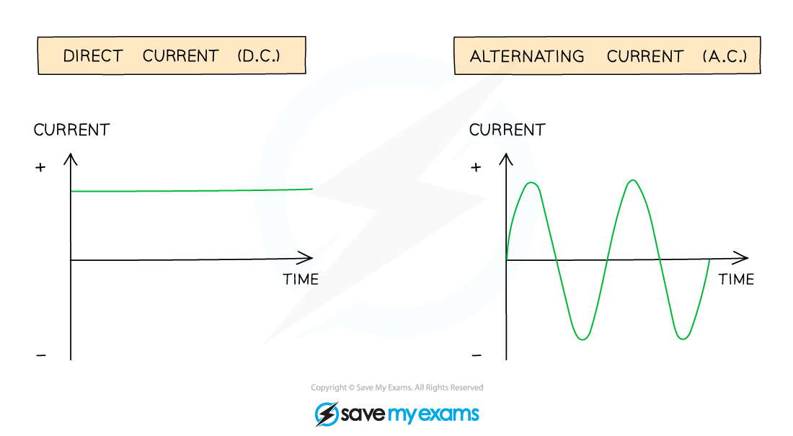

# Direct & Alternating Current

## Direct & alternating current

> **Spec point** — `spcpt_3Zv3gdK8DFcCbKvw` · Know the difference between direct current (d.c.) and alternating current (a.c.)

## Direct & alternating current

- There are **two** types of current:

  - direct current (d.c.)
  - alternating current (a.c.)

### Direct current

- A direct current (d.c.) is defined as:

**A steady current, constantly flowing in the same direction in a circuit, from positive to negative**

- The potential difference across a cell in a d.c. circuit travels in **one direction only**

  - The current travels from the positive terminal to the negative terminal

- A d.c. power supply has a **fixed** positive terminal and a fixed negative terminal
- Electric **cells**, or **batteries**, produce direct current (d.c.)

### Alternating current

- An alternating current (a.c.) is defined as:

**A current that continuously changes its direction, going back and forth around a circuit**

- An alternating current power supply has two identical terminals that **change** from positive to negative and back again

  - The alternating current always travels from the positive terminal to the negative terminal
  - Therefore, the current **changes direction** as the polarity of the terminals changes

- The **frequency** of an alternating current is the number of times the current changes direction back and forth each second

  - In the UK, **mains electricity** is an **alternating** current with a frequency of 50 Hz and a potential difference of around 230 V

#### Graphs of direct current and alternating current

*Two graphs showing the variation of current with time for alternating current and direct current*

### Comparing direct and alternating current

- The following table summarises the differences between d.c. and a.c.

| Direct current (d.c.) | Alternating current (a.c.) |
|---|---|
| Continuous and in one direction | Constantly changing direction |
| Produced by cells and batteries | Produced by electrical generators (mains electricity) |
| Involves a positive and negative terminal | Involves two identical terminals |

> **Exam Hint**
> If asked to explain the difference between alternating and direct current, sketch the graphs shown above: a well-sketched (and labelled) graph can earn you full marks.

## AC & DC current video

> **Spec point** — `spcpt_fFQTymXNX2Gd2Vmy` · nan

##
