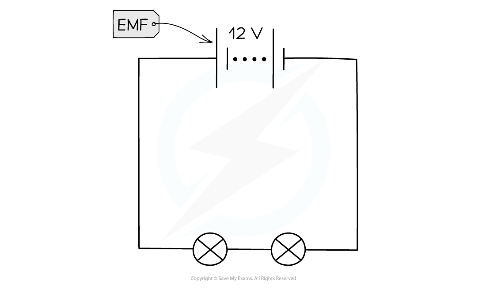

# Electromotive Force

## Electromotive force

> **Spec point** — `spcpt_fn9BvdzGckw5tcpd` · - Define electromotive force (e.m.f.) as the electrical work done by a source in moving a unit charge around a complete circuit (C)
 - Know that e.m.f. is measured in volts (V) (Core)

## Electromotive force

- Electromotive force (e.m.f.) is the name given to the potential difference of the power source in a circuit
- It is defined as:

**The electrical work done by a source in moving a unit charge around a complete circuit**

- Electromotive force (e.m.f.) is measured in volts (V)

*The e.m.f. is the voltage supplied by a power supply: 12 V in the above case*

## Calculating electromotive force

> **Spec point** — `spcpt_Bk2Qg4XJzk8RXTzN` · - Recall and use the equation for e.m.f. E = W/Q (E)

## Calculating electromotive force

### Extended Tier Only

- The definition of e.m.f. can also be expressed using the equation:

$E=\frac{W}{Q}$

- Where:

  - $E$ = electromotive force (e.m.f.), measured in volts (V)
  - $W$ = energy transferred **to the charges** from the power source, measured in joules (J)
  - $Q$ = charge moved, measured in coulombs (C)

- This equation should be compared to the definition of potential difference as the two are closely related
