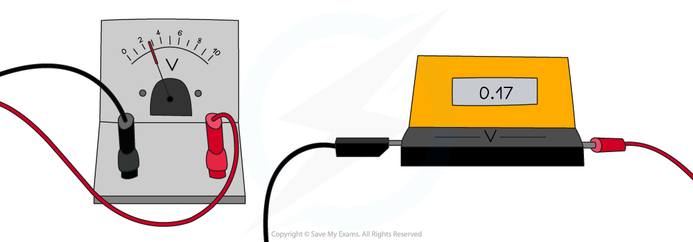

# Potential Difference

## Potential difference

> **Spec point** — `spcpt_QCmM59mJdpMdFZjy` · - Define potential difference (p.d.) as the work done by a unit charge passing through a component (Core)

## Potential difference

- Potential difference is defined as:

**The work done by a unit charge passing through a component**

- Potential difference is measured in units of **volts (V)**

- The potential difference between two points in a circuit is related to the amount of **energy transferred** between those points

*The potential difference is the difference in the electrical potential across each component: 5 volts for the bulb (on the left) and 7 volts for the resistor (on the right)*

- As electrons flow through a cell, they **gain **energy

  - For example, in a 12 V cell, every coulomb of charge passing through gains 12 J of energy

- As electrons flow through a circuit, they **lose **energy

  - For example, after leaving the 12 V cell, each coulomb of charge will transfer 12 J of energy to the wires and components in the circuit

## Measuring potential difference

> **Spec point** — `spcpt_R3r2K7GkW3gDDmW8` · - Know that the p.d. between two points is measured in volts (V)
- Describe the use of voltmeters (analogue and digital) with different ranges

## Measuring potential difference

- Potential difference can be measured using a **voltmeter**
- Voltmeters must be set up in **parallel** with the component being measured

  - This is because potential difference is the **difference** in electrical potential between two points
  - Therefore, a voltmeter has to be connected to **two points** in the circuit

*Potential difference can be measured by connecting a voltmeter in parallel between two points in a circuit*

- Voltmeters can be:

  - digital (with an electronic read-out)
  - analogue (with a needle and scale)

### Analogue voltmeters

- Analogue voltmeters are subject to ***parallax error***

  - Always read the meter from a position directly perpendicular to the scale

- Typical ranges are 0.1-1.0 V and 0-5.0 V for analogue voltmeters although they can vary

  - Always double-check exactly where the marker is before an experiment
  - If it is not at zero, this value must be subtracted from all measurements
  - They should be checked for ***zero errors*** before using

*Voltmeters can be either analogue (with a scale and needle) or digital (with electronic read-out)*

### Digital voltmeters

- Digital voltmeters** **can measure very small potential differences, in mV or µV
- Digital displays show the measured values as digits and are more accurate than analogue displays
- They’re easy to use because they give a specific value and are capable of displaying more precise values

  - However digital displays may 'flicker' back and forth between values and a judgement must be made as to which to write down

- Digital voltmeters should be checked for ***zero error***

  - Make sure the reading is zero before starting an experiment, or subtract the “zero” value from the end results

> **Exam Hint**
> When you are building a circuit in class, always **connect the voltmeter last**. Make the whole circuit first and check it works.
> 
> Only then pick up the voltmeter. Connect two leads to your voltmeter. Now connect the leads so that they are one on each side of the component you are measuring. This will save you a lot of time waiting for your teacher to troubleshoot your circuit!
> 
> You might sometimes see potential difference called voltage. Both mean the same thing, but it is best to use the term potential difference. This can be particularly useful when thinking about voltmeters as the potential difference describes a **difference** between **two **points, therefore the voltmeter has to be connected between **two **points in the circuit.

## Calculating potential difference

> **Spec point** — `spcpt_RwBV6PkWW5yX8MKB` · - Recall and use the equation for p.d. V = W/Q (Extended)

## Calculating potential difference

### Extended Tier Only

- Potential difference, energy transferred and charge are related by the equation:

$V=\frac{W}{Q}$

- Where:

  - $V$ = potential difference, measured in volts (V)
  - $W$ = energy transferred to the components, measured in joules (J)
  - $Q$ = charge moved, measured in coulombs (C)

- One volt is equivalent to the transfer of 1 joule of electrical energy by 1 coulomb of charge, or 1 V = 1 J/C

> **Worked Example**
> The normal operating voltage for a lamp is 6 V.
> 
> Calculate how much energy is transferred in the lamp when 4200 C of charge flows through it.
> 
> [2]
> 
> **Answer:**
> 
> **Step 1: List the known quantities**
> 
> - Voltage, *V =* 6 V
> - Charge, *Q* = 4200 C
> 
> **Step 2: State the equation linking potential difference, energy and charge**
> 
> - The equation linking potential difference, energy and charge is:
> 
> $V=\frac{W}{Q}$
> 
> **Step 3: Rearrange the equation and substitute the known values**
> 
> $W=V\timesQ$* ***[1 mark]**
> 
> $W=6\times4200=25200J$* *
> 
> - Therefore, **25 200 J** of energy is transferred in the lamp **[1 mark]**

> **Exam Hint**
> Don't be confused by the symbol for voltage (the **symbol** *V*) being the same as its unit (the **volt**, V). Remember that one volt is equivalent to 'a joule per coulomb'.
> 
> Make sure to learn this equation and understand how it is similar (and different) to the equation for e.m.f.
