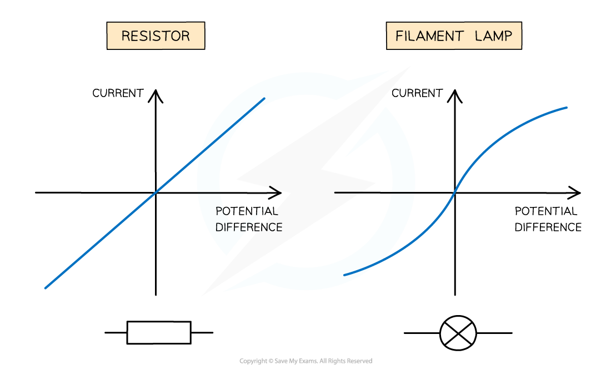
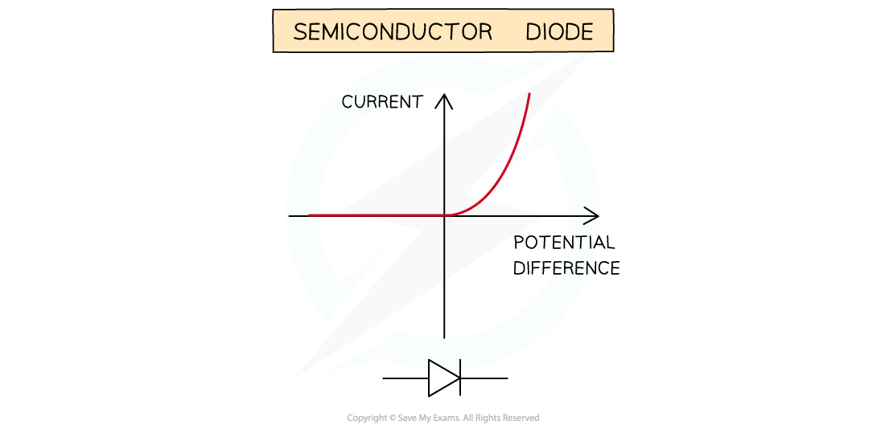

# Resistance

## Ohm's law

> **Spec point** — `spcpt_9ZgWCbrQVhxZdRHp` · Recall and use the equation for resistance R = V/I
Know that the p.d. across an electrical conductor increases as its resistance increases for a constant current

## Ohm's law

### Resistance

- **Resistance **is defined as:

**The opposition to current**

- Resistance occurs because the free **electrons **flowing in the circuit (current) **collide **with the metal ions in the wire
- These collisions **slow down** the electrons, or, in other words, **resist **their flow

  - The **higher **the resistance of a circuit, the **lower **the current
  - This means that good conductors have a **low **resistance and insulators have a **high **resistance

- The resistance of a circuit can be **increased **by [adding resistors](https://www.savemyexams.com/igcse/physics/cie/23/revision-notes/4-electricity-and-magnetism/4-3-electric-circuits-and-electrical-safety/4-3-4-combined-resistance/?_ai=internal-linking) (or variable resistors) to it
- Every electrical component has a resistance, even wires

  - In exam questions, the resistance of the wires and batteries are assumed to be negligible

#### The effect of resistance on the current in a circuit

*When a circuit has a high resistance, a lower current will flow, and vice versa*

### Ohm's law

- Current, $I$, potential difference, $V$*,* and resistance, $R$, all affect one another
- Changing any **one** of these in a circuit, changes **all** of them

- For a constant p.d., current and resistance are **inversely proportional**

  - If the resistance is doubled, current will halve
- This relationship is described by the equation for resistance

$R=\frac{V}{I}$

- Where:

  - $R$ = resistance, measured in ohms (Ω)
  - $V$ = potential difference, measured in volts (V)
  - $I$ = current, measured in amperes or amps (A)

### Consequences of Ohm's law

- Resistors are used in circuits to control either:

  - the current in branches of the circuit (through certain components)
  - the potential difference across certain components
- This is due to the consequences of Ohm's law

  - The current in an electrical conductor decreases as its resistance increases (for a constant p.d.)
  - The p.d. across an electrical conductor increases as its resistance increases (for a constant current)

> **Worked Example**
> A 12 Ω resistor has a current of 0.3 A flowing through it.
> 
> Determine the potential difference across the resistor.
> 
> [2]
> 
> **Answer:**
> 
> **Step 1: List the known quantities**
> 
> - Resistance, $R=12Ω$
> - Current, $I=0.3A$
> 
> **Step 2: Write out the equation for Ohm's law and rearrange to make potential difference the subject**
> 
> $R=\frac{V}{I}$
> 
> $V=IR$ **[1 mark]**
> 
> **Step 3: Substitute in the known values to calculate**
> 
> $V=0.3\times12$
> 
> $V=3.6V$ **[1 mark]**

## Current-voltage graphs

> **Spec point** — `spcpt_K5QV3mfnPkPkbbdC` · Sketch and explain the current–voltage graphs for a resistor of constant resistance, a filament lamp and a diode

## Current-voltage graphs

### Extended Tier Only

- The relationship between current and potential difference of a component can be shown on a current-voltage (*I-V*) graph

- When the relationship between current and potential difference is **linear**:

  - the *I-V* graph is a **straight line **which passes through the** origin**
  - the resistance is **constant**
  - these are known as **ohmic resistors**

- When the relationship between current and voltage is **non-linear**:

  - the *I-V* graph is **not** a straight line
  - the resistance is **not **constant
  - these are known as **non-ohmic resistors**

*Linear I-V graphs are straight lines through the origin, indicating a constant resistance. Non-linear I-V graphs are curved, indicating a variable resistance*

- Components with **linear***** ****I-V* graphs (ohmic resistors) include:

  - fixed resistors (at constant temperature)
  - wires (at constant temperature)

- Components with **non-linear ***I-V* graphs (non-ohmic resistors) include:

  - filament lamps
  - diodes
  - LDRs
  - thermistors

### I-V graph for ohmic conductors

- The relationship between current and voltage for a wire or fixed resistor is linear, or **directly proportional**, which means:

  - the *I-V* graph is a straight line, so voltage and current increase (or decrease) by the **same **amount
  - the slope of the graph is constant, so resistance is **constant**

#### I-V graph for a wire or fixed resistor

*The current is directly proportional to the potential difference (voltage) as the graph is a straight line through the origin*

### I-V graph for a filament lamp

- The relationship between current and voltage for a filament lamp is non-linear, or **not **directly proportional, which means:

  - the *I-V* graph is not a straight line, so voltage and current do **not **increase (or decrease) by the same amount
  - the slope of the graph is not constant, so resistance **changes**

- The *I-V *graph for a filament lamp shows that as voltage increases:

  - the current increases at a proportionally **slower **rate
  - the resistance **increases**;** **the flatter the slope, the higher the resistance

*As current flows through a filament lamp, the lamp heats up; resistance increases with temperature, causing the S-shaped curve*

- As current through a filament lamp increases, the resistance **increases** because:

  - the higher current causes the **temperature** of the filament to increase
  - the higher temperature causes the atoms in the metal lattice of the filament to **vibrate** more
  - this causes an increase in resistance as it becomes more difficult for **free** **electrons** (the current) to pass through
  - since resistance **opposes** the current, this causes it to increase at a **slower** rate

### I-V graph for a diode

- A diode allows current to flow in **one** direction only

  - This is called **forward bias**
- In the reverse direction, the diode has very** high resistance**, and therefore **no** current flows

  - This is called** reverse bias**

- When the current is in the direction of the arrowhead symbol, this is **forward bias**

  - On the *I-V* graph, this is shown by a sharp increase in voltage and current on the right side of the graph
  - This shows the resistance is very **low**

- When the diode is switched around, this is **reverse bias**

  - On the *I-V* graph, this is shown by a zero reading of current or voltage on the left side of the graph
  - This shows the resistance is very **high**

*The current is zero at all potential differences in the negative quadrants because current only flows one way through a diode; this gives the diode I-V graph its distinct shape*

> **Exam Hint**
> In your IGCSE exam, you could be asked to recognise, sketch or explain the I-V graphs for a wire / fixed resistor (ohmic conductors), a filament lamp and a diode.
