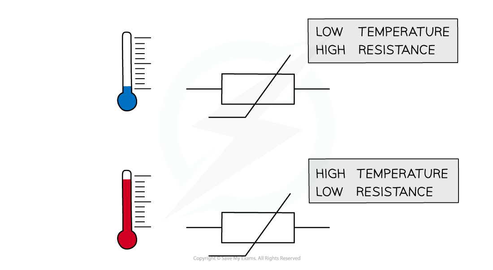
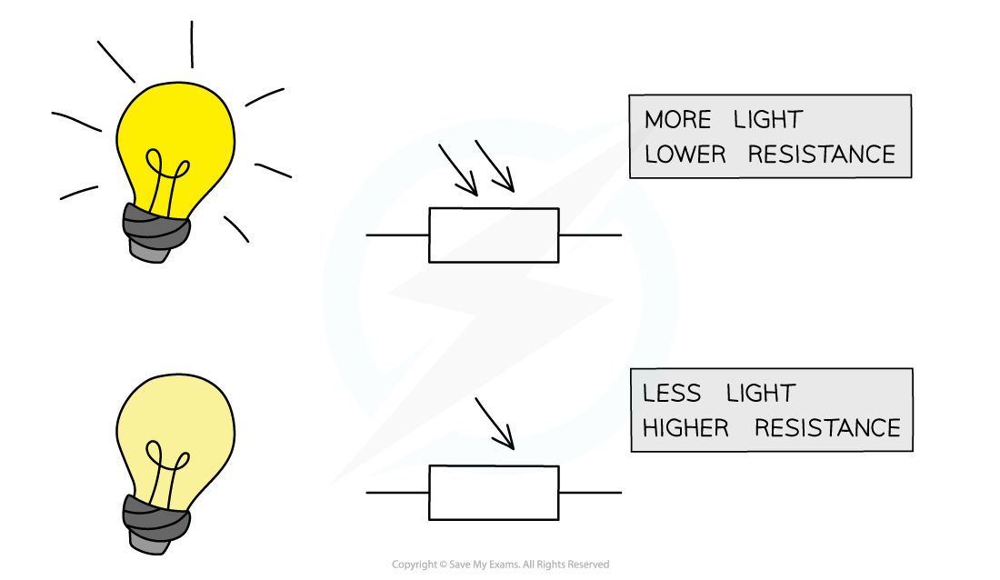
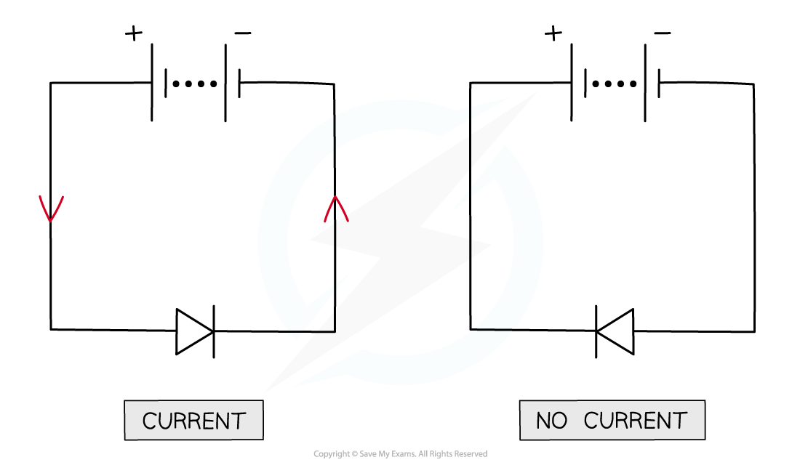

# Circuit Diagrams & Circuit Components

## Circuit components

> **Spec point** — `spcpt_MxxVqzwcxwFDMxdF` · Draw and interpret circuit diagrams containing 
 - cells, batteries, power supplies, generators,
 - potential dividers, resistors (fixed and variable), thermistors (NTC only), light-dependent resistors (LDRs), 
 -  switches, 
 - heaters, 
 - lamps, motors, bells
 - ammeters, voltmeters, 
 - magnetising coils, transformers, fuses and relays, 
and know how these components behave in the circuit

## Circuit components

### What are circuit symbols?

- The diagram below shows the circuit symbols that could be used in circuit diagrams to represent circuit **components**

  - Students are expected to know **what each component is** and **how it behaves** in a circuit

![Table of standard electrical circuit symbols with labels. The left column contains symbols for a cell, battery of cells, power supply, D.C. power supply, A.C. power supply, fixed resistor, variable resistor, thermistor, light-dependent resistor, heater, potential divider, transformer, and magnetising coil. The right column contains symbols for a switch, earth or ground, junction of conductors, lamp, motor, generator, ammeter, voltmeter, diode, light-emitting diode (LED), fuse, relay coil, and electric bell.](../../../assets/625e5652577b-new-4-3-1-circuit-symbols-cie-igcse-23-rn.png)

*Circuit symbols represent these components in circuit diagrams*

### Types of circuit components

#### Power supplies

- Cells, batteries, power supplies and generators all **supply current** to the circuit

#### Resistors

- Potential dividers, fixed and variable resistors, thermistors and light-dependent resistors (LDRs) are all used to **control current**

#### Thermistors

- A thermistor is a [non-ohmic conductor](https://www.savemyexams.com/igcse/physics/cie/23/revision-notes/4-electricity-and-magnetism/4-2-electrical-quantities/4-2-9-resistance/?_ai=internal-linking) and a temperature-dependent resistor
- The resistance of a thermistor changes depending on its **temperature**

  - As the temperature **increases**, the resistance of a thermistor **decreases **and vice versa

*The resistance through a thermistor is dependent on its temperature*

#### Light-dependent resistors

- A light-dependent resistor (LDR) is a non-ohmic conductor and sensory resistor
- Its resistance automatically changes depending on the light energy falling onto it (illumination)
- As the** light intensity increases**, the **resistance** of an LDR **decreases**

*Resistance of an LDR depends on the light intensity falling on it*

#### Meters

- Ammeters and voltmeters are used to measure the current and potential difference

  - Ammeters are always connected in series whilst voltmeters are always connected in parallel

#### Switches and functional components

- Switches open and close a circuit and determine whether current can flow
- Functional components perform specific roles when current passes through them:

  - Motors rotate
  - Lamps emit light
  - Heaters transfer thermal energy
  - Bells emit a sound

#### Electromagnetic components

- Magnetising coils, relays and transformers use electromagnetic effects

  - Relays use a small current in one circuit to switch on a much larger current in another
  - Transformers 'step up' and 'step down' current and potential difference

#### Fuses

- Fuses protect expensive components from current surges and act as a safety measure against fire

## Diodes

> **Spec point** — `spcpt_XWhCfYCcwM442M36` · Draw and interpret circuit diagrams containing diodes and light-emitting diodes (LEDs), and know how these components behave in the circuit

## Diodes

### Extended Tier Only

- In addition to the above, the circuit symbol for a diode must also be recognised and drawn:

*A diode is a component that only allows a current in one direction*

- Diodes are occasionally drawn with a horizontal line running through the middle of them
- Diodes only allow current to flow through them in **one **direction (see the diagram below)

  - This is the direction that the triangle points in the diagram

*When travelling in the same direction as the diode, current can flow. If the diode is flipped, it now prevents current from flowing in the circuit*

- Light-emitting diodes (LEDs) behave in exactly the same way, but they emit light when current flows through them
