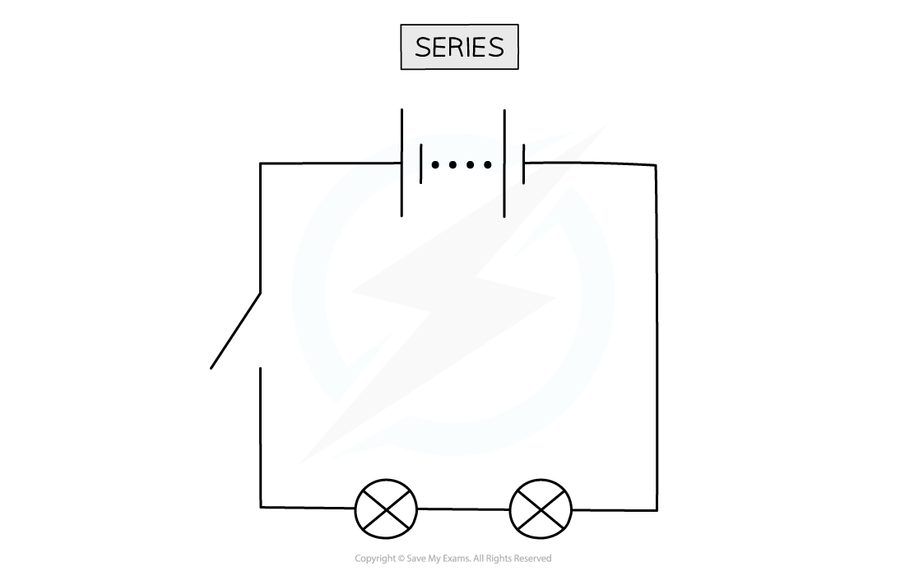
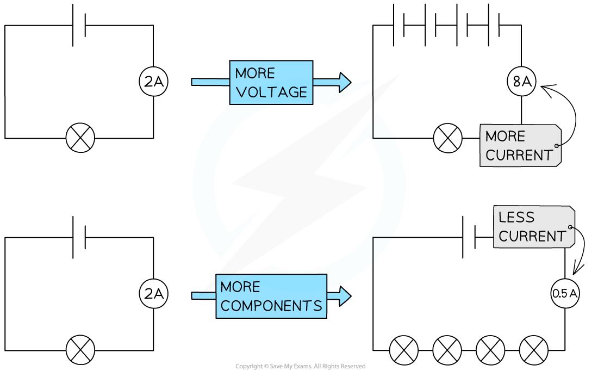
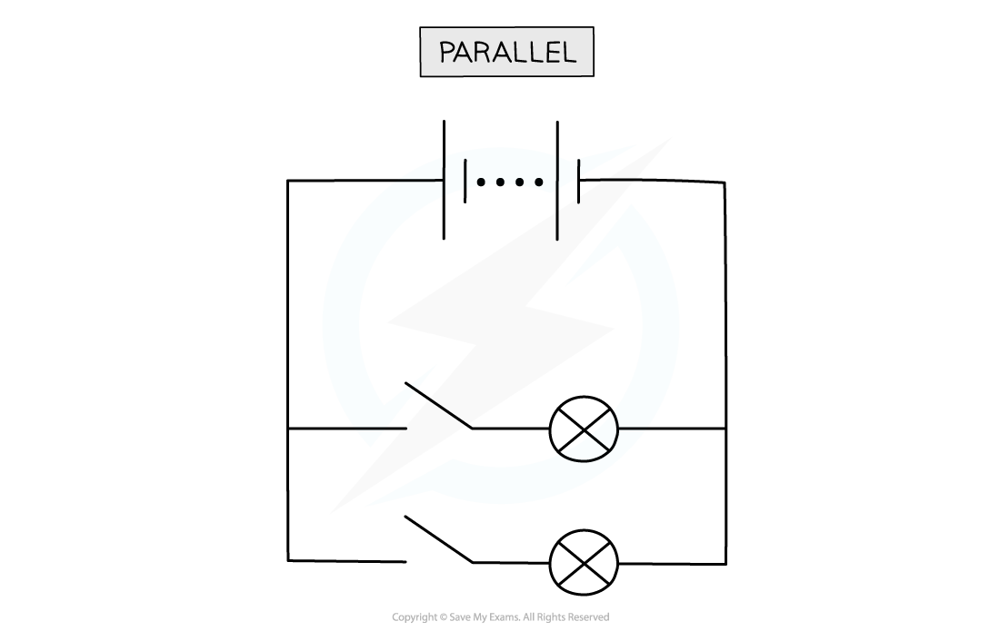
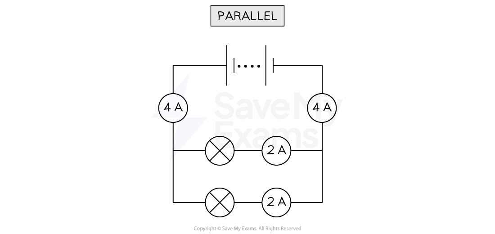
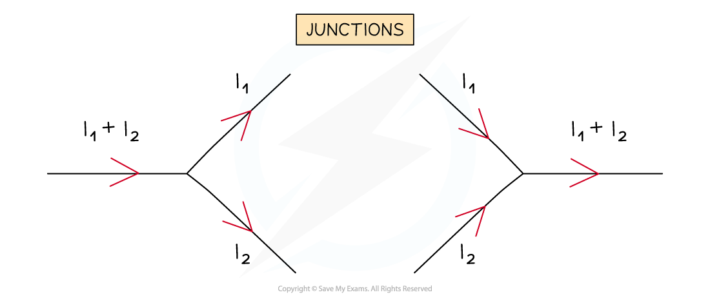

# Current in Circuits

## Current in series circuits

> **Spec point** — `spcpt_YMwdjbKRrpCfvPfb` · Know that the current at every point in a series circuit is the same
Know how to construct and use series circuits

## Current in series circuits

### What is a series circuit?

- A series circuit contains a **single** complete loop

*In this circuit, the switch, battery and both lamps are in a single loop, making it a series circuit*

### Current in a series circuit

- In a series circuit, the current is the **same value at any point**

  - This is because the number of electrons per second that passes through one part of the circuit is the same number that passes through any other part
- This means that **all** components in a closed-loop have the same current

*The current is the same at each point in a series circuit*

### Factors affecting current in a series circuit

- The amount of current flowing around a series circuit depends on two things:

  - The **voltage** of the power source
  - The **resistance** of the components in the circuit

- **Increasing** the **voltage** of the power source drives **more** **current** around the circuit

  - So, decreasing the voltage of the power source reduces the current

- **Increasing** the **number** of components in the circuit **increases** the **total** **resistance**

  - Hence **less** **current** flows through the circuit

*Current will increase if the voltage of the power supply increases, and decreases if the number of components increases (because there will be more resistance)*

## Current in parallel circuits

> **Spec point** — `spcpt_3SNdyyHfW6xf5nvZ` · - State that, for a parallel circuit, the current from the source is larger than the current in each branch
State the advantages of connecting lamps in parallel in a lighting circuit
Know how to construct and use parallel circuits

## Current in parallel circuits

### What is a parallel circuit?

- A parallel circuit consists of multiple loops containing circuit components

*The bulbs are each in a separate loop in this circuit, making it a parallel circuit*

### What is the rule for current in a parallel circuit?

- In a parallel circuit, the current **splits** along each **branch** at a junction

  - Some of it goes down one branch and the rest goes down the other
- This means that the current from the source is **larger** than the current in each branch

### Lighting circuits

- A lighting circuit is used to supply power to multiple light sources

  - Office lights are a common example, as multiple identical bulbs must have the same brightness
- Lighting circuits are constructed in **parallel** because:

  - Bulbs all have the same potential difference and therefore the same brightness
  - If one bulb breaks, the rest continue to function as current passes along each branch independently
  - This also means lamps can be switched off and on individually without breaking the whole circuit

## Calculating current in parallel circuits

> **Spec point** — `spcpt_QY5vfrdmZrYGsNrr` · - Recall and use in calculations, the fact that: 
(a) the sum of the currents entering a junction in a parallel circuit is equal to the sum of the currents that leave the junction (E)
- Explain that the sum of the currents into a junction is the same as the sum of the currents out of the junction (E)

## Calculating current in parallel circuits

### Extended Tier Only

- The current **before** a junction is equal to the **sum** of currents along each branch **after** the junction

*Current from the power supply (4 A) is split along each branch (2 A). These currents combine again at the other side*

- At a **junction** in a **parallel** **circuit** (where two or more wires meet) the current is **conserved**

  - This means the amount of current flowing into the junction is equal to the amount of current flowing out of it

- This is because **charge** is conserved

- Note that the current does not always split equally – often there will be more current in some branches than in others

  - The current in each branch will only be identical if the **resistance** of the components along each branch is **identical**

- Current behaves in this way because it is the **flow of electrons**:

  - Electrons are physical matter – they cannot be created or destroyed
  - This means the total number of electrons (and hence current) going around a circuit must remain the same
  - When the electrons reach a junction, however, some of them will go one way and the rest will go the other

*Current is split at a junction into individual branches*

> **Worked Example**
> In the circuit below, ammeter A0 shows a reading of 10 A, and ammeter A1 shows a reading of 6 A.
> 
> 
> 
> What is the reading on ammeter A2?
> 
> [2]
> 
> **Answer:**
> 
> **Step 1: Recall that at a junction, the current is conserved**
> 
> - This means that the total amount of current flowing into a junction is equal to the total amount flowing out
> 
> **Step 2: Consider the first junction in the circuit where current splits**
> 
> - The diagram below shows the first junction in the circuit
> 
> 
> 
> **Step 3: Calculate the missing amount of current**
> 
> - Since 10 A flows into the junction (the total current from the battery), 10 A must flow out of the junction **[1 mark]**
> - The question says that 6 A flows through ammeter A1 so the remaining current flowing through ammeter A2 must be:
> 
> $10A-6A=4A$
> 
> - Therefore, **4 A** flows through ammeter A2 **[1 mark]**

> **Exam Hint**
> The direction of current flow is important when considering junctions in a circuit. You should remember that current flows from the **positive** terminal to the **negative** terminal of a cell / battery. This will help determine the direction current is flowing round a circuit.
