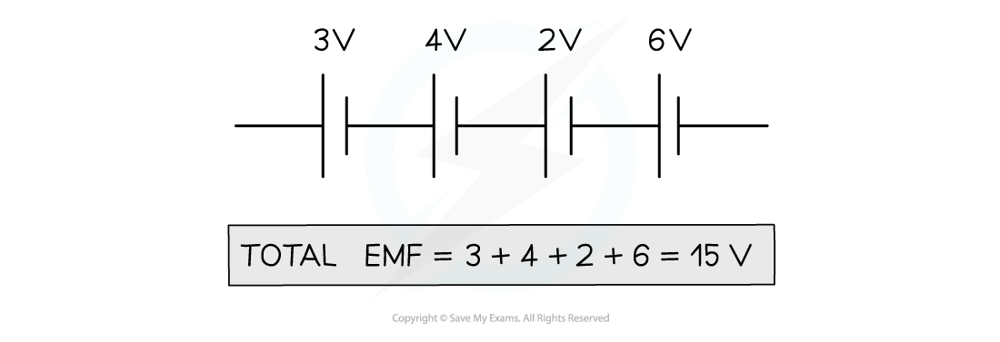

# EMF & Potential Difference in Circuits

## E.m.f. in series

> **Spec point** — `spcpt_2vKHrfTrns9f7Qsv` · Calculate the combined e.m.f. of several sources in series

## E.m.f. in series

- When several cells are connected together in series, their combined e.m.f. is equal to the sum of their individual e.m.f.s

*The total e.m.f. of these cells is equal to the sum of their individual e.m.f.s*

## Potential difference in series circuits

> **Spec point** — `spcpt_B6YRnj2g8SBp6m6k` · Recall and use in calculations, the fact that:
(b) the total p.d. across the components in a series circuit is equal to the sum of the individual p.d.s across each component

## Potential difference in series circuits

### Extended Tier Only

- In a series circuit, the sum of potential differences across the components is equal to the total e.m.f. (electromotive force) of the power supply

*In a series circuit, the components share the e.m.f. of the power supply*

> **Worked Example**
> In the circuit diagram below, the power source has an e.m.f., *E*, of 16 V. There is a potential difference of 10 V across component X. Calculate the potential difference across component Y.
> 
> 
> 
> [2]
> 
> **Answer:**
> 
> **Step 1: Recall the rule for potential difference in series**
> 
> - The sum of potential differences across components in series is equal to the e.m.f. across the power source **[1 mark]**
> 
> **Step 2: Write an equation to determine the potential difference across Y**
> 
> $E=V_{X}+V_{Y}$
> 
> - Where:
> 
>   - $E$ is the e.m.f. of the power source = 16 V
>   - $V_{X}$* *is the potential difference across X = 10 V
>   - $V_{Y}$* *is the potential difference across Y
> 
> **Step 3: Substitute in the known quantities and calculate *****V******Y***
> 
> $16=10+V_{Y}$
> 
> - Therefore, the potential difference across Y is 6 V **[1 mark]**

## Potential difference in parallel circuits

> **Spec point** — `spcpt_fnxyZ4ry448ZmskD` · Recall and use in calculations, the fact that: 
(c) the p.d. across an arrangement of parallel resistances is the same as the p.d. across one branch in the arrangement of the parallel resistances

## Potential difference in a parallel circuit

### Extended Tier Only

- The potential difference across **each **branch of a parallel circuit is the same as the e.m.f. of the power source

*The power source has an e.m.f. of 12 V and there is a potential difference of 12 V across each branch*

- It is important to notice that the potential difference in a parallel circuit is equal across each **branch**

  - In the example above, if one branch in the circuit contained multiple components, the 12 V would be **split** between the components on that branch
