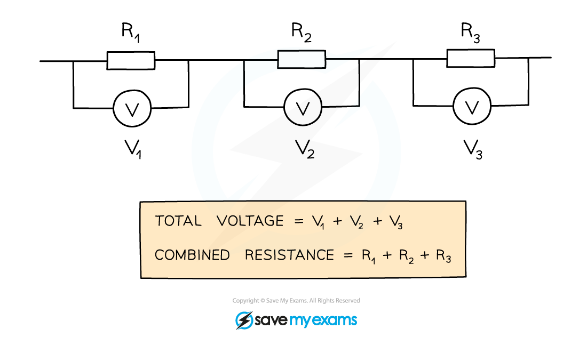

# Combined Resistance

## Resistors in series & parallel

> **Spec point** — `spcpt_JjQkNxTPsCHY3c2v` · - Calculate the combined resistance of two or more resistors in series
- State that the combined resistance of two resistors in parallel is less than that of either resistor by itself

## Resistors in series & parallel

### Combination of resistance in series

- When two or more components are connected in **series**:

  - The **combined** resistance of the components is equal to the **sum** of the individual resistances

*When several components are connected in series, their combined resistance is equal to the sum of their individual resistances*

### Combination of resistance in parallel

- When resistors are connected in parallel, the **combined **resistance is **less than **the resistance of any of the individual components
- If two resistors of equal resistance are connected in parallel, then the combined resistance will halve

*The above resistors will have a combined resistance of 2 Ω – half the value of each resistor in this case*

## Determining resistance in parallel

> **Spec point** — `spcpt_CC8MQdbmQxM72QqC` · Calculate the combined resistance of two resistors in parallel

## Determining resistance in parallel

### Extended Tier Only

- The combined resistance of two resistors connected in **parallel** is found using the equation:

$\frac{1}{R}=\frac{1}{R_{1}}+\frac{1}{R_{2}}$

- Where:

  - $R$ is the combined resistance in ohms, Ω
  - $R_{1}$ is the resistance of resistor 1 in ohms, Ω
  - $R_{2}$ is the resistance of resistor 2 in ohms, Ω

*The combined resistance is always less than the resistance of either resistor individually*

- The method to calculate the resistance:

  - First find the value of $\frac{1}{R}$ (by adding $\frac{1}{R_{1}}+\frac{1}{R_{2}}$)
  - Next find the value of $R$ by using the reciprocal button on a calculator (labelled either $x^{-1}$ or* *$\frac{1}{x}$, depending on the calculator)

## Resistors in series video

> **Spec point** — `spcpt_JKdCWdqWyhtGTTGr` · nan

##
