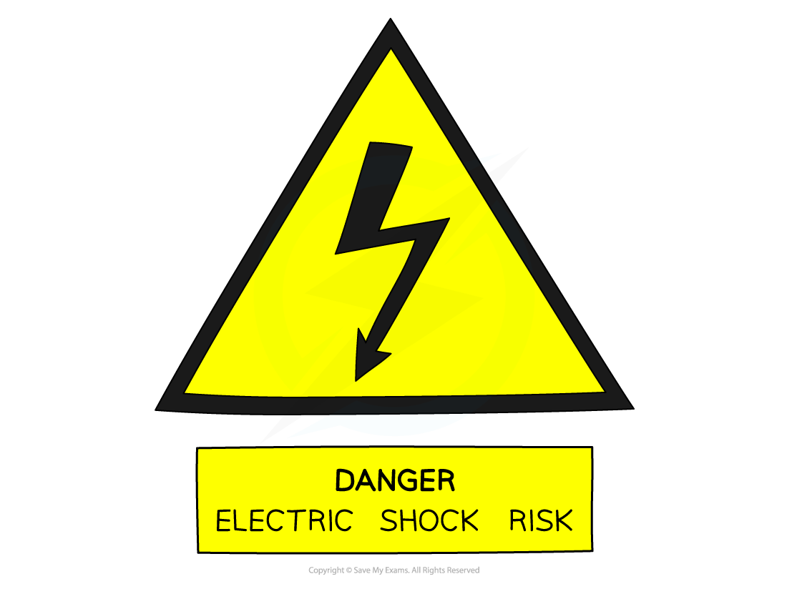
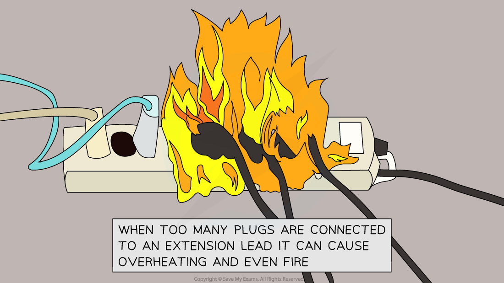
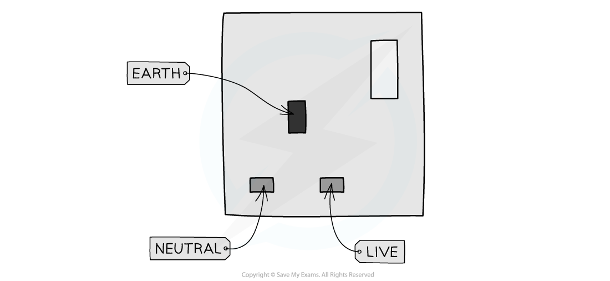
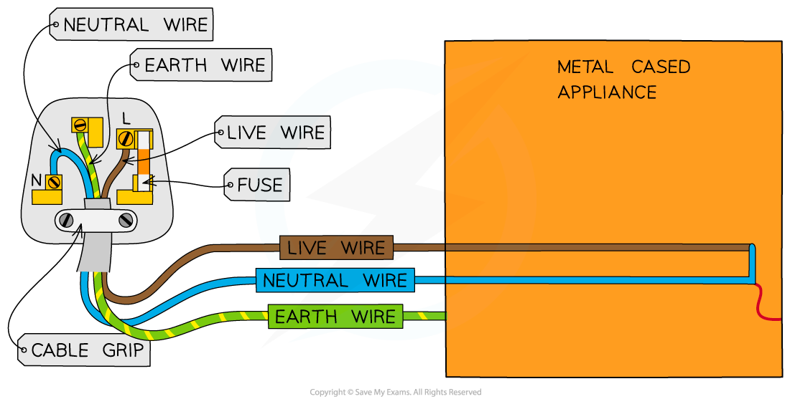

# Electrical Safety

## Electrical hazards

> **Spec point** — `spcpt_38SVNp5VbyRW2Bdt` · State the hazards of:
   (a) damaged insulation
   (b) overheating cables
   (c) damp conditions
   (d) excess current from overloading of plugs, extension leads, single and multiple sockets when using a mains supply

## Electrical hazards

- Mains electricity can be dangerous if safety procedures are not followed

  - Voltages as low as 50 V can pose a serious risk of electrocution

- Common electrical hazards include:

  - damaged insulation
  - overheating cables
  - damp conditions
  - excess current from overloading of plugs, extension leads, single and multiple sockets when using a mains supply

*The risk of electrocution is indicated by hazard signs but other risks which would not be signposted are listed below*

### Damaged insulation

- If the insulation around an electrical cable is damaged, the metal part of the wire may become exposed
- If a person touches the exposed wire, they could be subjected to a lethal electric shock
- There is also a chance that current will flow between the exposed wire and any piece of metal it comes into contact with

### Overheating of cables

- If an excess of current flows in a wire, this can lead to overheating
- This could cause the insulation to melt, or even cause a fire

### Damp conditions

- Damp conditions can be dangerous in the presence of electricity since water is an electrical conductor
- If moisture comes into contact with a live wire, this could set up:

  - a short circuit within the device, which could cause a fire
  - a conductive path for current to flow through a person to the earth, which could cause electrocution

### Excess current from overloading

- An excessive current may flow if too many plugs, extension leads or sockets are connected to the mains supply
- The heat created could cause the insulation to melt, or even cause a fire

#### Electrical fire due to excessive current

*Too many appliances plugged into an extension lead can cause overheating and fire*

## Mains circuits

> **Spec point** — `spcpt_QmWPc8hKTS8kSgnX` · - Know that a mains circuit consists of a live wire (line wire), a neutral wire and an earth wire and explain why a switch must be connected to the live wire for the circuit to be switched off safely
- Explain why the outer casing of an electrical appliance must be either non-conducting (double-insulated) or earthed

## Mains circuits

- All electrical appliances are connected to the mains supply
- A mains circuit consists of:

  - a live wire
  - a neutral wire
  - an earth wire

- The insulation covering each wire is colour-coded for easy identification:

  - Live wire – **brown**
  - Neutral wire – **blue**
  - Earth wire – **green and yellow stripes**

### Live, neutral & earth wires

*A UK plug socket*

*A mains-powered appliance in the UK contains live, neutral and earth wires*

- Every country has a slightly different configuration, with many using two-pin plugs and plug sockets such as in the USA and mainland Europe

  - The earth wire is still present in the two-pin plugs, just more hidden
- The three wires have distinct purposes:

#### The live wire

- The purpose of the live wire is **to carry the** [alternating current](https://www.savemyexams.com/igcse/physics/cie/23/revision-notes/4-electricity-and-magnetism/4-2-electrical-quantities/4-2-6-direct-and-alternating-current/?_ai=internal-linking) **from the mains supply to a circuit**
- It is the most dangerous of the three wires
- If it touches the appliance without the earth wire, it can cause electrocution

#### The neutral wire

- The purpose of the neutral wire is **to form the opposite end of the circuit to the live wire to complete the circuit**
- Because of its lower voltage, it is much less dangerous than the live wire

#### The earth wire

- The purpose of the earth wire is **to act as a safety wire to stop the appliance from becoming live**
- This prevents electric shocks from occurring if the appliance malfunctions or the live wire breaks off and touches the case of the plug

- In order to protect the user or the device, there are several safety features built into domestic appliances, including:

  - double insulation
  - earthing
  - fuses
  - circuit breakers

### Double insulation

- The conducting part of a wire is usually made of copper or some other metal

  - If this comes into contact with a person, this poses a risk of electrocution

- For this reason, wires are covered with an insulating material, such as rubber

*The conducting part of a wire is covered in an insulating material for safety*

- Some appliances do not have metal cases and so there is no risk of them becoming electrified
- Such appliances are said to be **double insulated**, as they have two layers of insulation:

  - Insulation around the wires themselves
  - A non-metallic case that acts as a second layer of insulation

- Double insulated appliances do not require an earth wire or have been designed so that the earth wire cannot touch the metal casing

### Earthing

- Many electrical appliances have metal cases
- This poses a potential safety hazard:

  - If a live wire (inside the appliance) came into contact with the case, the case would become electrified and anyone who touched it would risk being electrocuted
- The earth wire is an additional safety wire that can reduce this risk
- If the case does become live:

  - The earth wire provides a** low resistance path to the earth**
  - It causes a **surge of current in the earth wire** and hence also in the live wire
  - The high current through the fuse causes it to **melt and break**
  - **This cuts off the supply of electricity to the appliance**, making it safe

## Fuses & trip switches

> **Spec point** — `spcpt_8dznjRNxschy42wh` · - Explain the use and operation of trip switches and fuses and choose appropriate fuse ratings and trip switch settings
- State that a fuse without an earth wire protects the circuit and the cabling for a double-insulated appliance

## Fuses & trip switches

- **Fuses** and **trip switches** (circuit breakers) are safety devices designed to **cut off the flow of electricity **to an appliance if the current becomes **too large** (due to a fault or a surge)

### Fuses

- **Fuses** are used to protect **individual appliances**
- Fuses are located in the **plug**
- Fuses usually consist of a glass cylinder containing a thin metal **wire**
- A fuse without an earth wire **protects **the circuit and the cabling for a double-insulated appliance
- If the current in the wire becomes too large:

  - The wire **heats up** and **melts**
  - This causes the wire to **break**, breaking the **circuit **and **stopping **the **current**

#### Circuit symbol of a fuse

*The circuit symbol for a fuse has a wire running through it (not to be confused with a resistor)*

- Fuses have **ratings**, which signify the **maximum current** that can flow through the fuse wire without it melting
- If the current **exceeds** that value, the fuse **wire melts** and the **individual appliance** is **disconnected** from the mains supply
- Fuses come in values of **3 A**, **5 A** and **13 A**
- The correct fuse to use is the value just above the current required for the appliance

#### Choosing the correct fuse

- Suppose an appliance uses 3.1 A:

  - A 3 A fuse would be **too small** — the fuse would blow as soon as the appliance was switched on
  - A 13 A fuse would be **too large** — it would allow an extra 10 A to pass through the appliance before it finally blew
  - A 5 A fuse would be the **most appropriate** choice, as it is the next size up

### Trip switches

- The current enters the house at the **consumer unit **(sometimes referred to as a 'fuse box')
- The consumer unit consists of a series of **trip switches** (or circuit breakers) which control the amount of current supplied to each circuit within the house

  - When the current is too high the switch 'trips' (automatically flicks to the off position)
  - This stops the current flowing in that circuit

#### Example of a domestic circuit

*The consumer unit distributes current to all the circuits in the house*

- The main **advantages** of trip switches are:

  - they provide protection from current surges or faults
  - they can be reset when the problem is fixed
