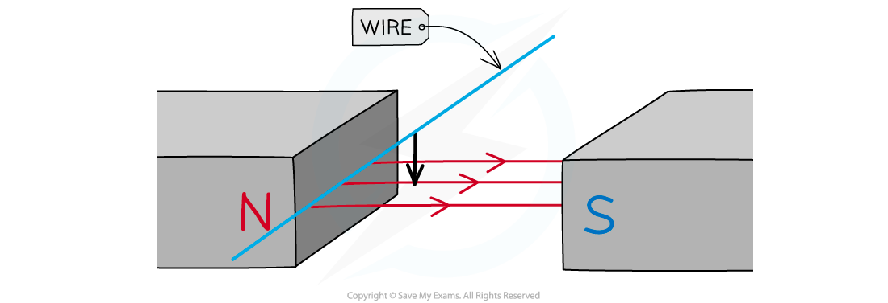
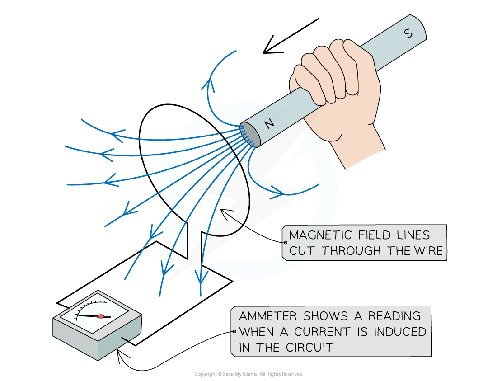
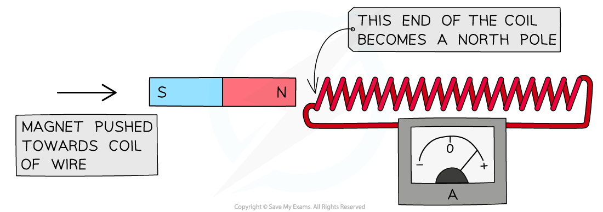
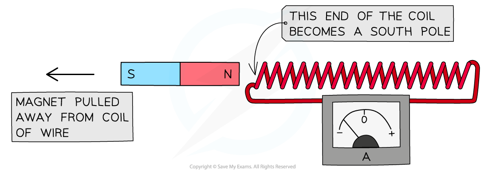

# Electromagnetic Induction

## Induced e.m.f.

> **Spec point** — `spcpt_5snqYqNxskzkGzyJ` · Know that a conductor moving across a magnetic field or a changing magnetic field linking with a conductor can induce an e.m.f. in the conductor

## Induced e.m.f.

- An electromotive force (e.m.f.) is induced in a conductor whenever there is **relative movement** between the conductor and a magnetic field
- This could be when:

  - the conductor moves in a stationary magnetic field
  - the conductor is stationary in a changing magnetic field

### Induced e.m.f. due to a moving conductor

- For an electrical conductor moving in a fixed magnetic field:

  - the conductor (e.g. a wire) **cuts** the field lines
  - an e.m.f. is **induced** in the wire

*When an electrical conductor moves in a magnetic field an e.m.f. is induced*

### Induced e.m.f. due to a moving field

- For a fixed conductor in a changing magnetic field:

  - as the magnet moves through the conductor (e.g. a coil), the field lines **cut** through the turns on the conductor (each individual wire)
  - an e.m.f. is **induced** in the coil

*When a magnet is moved towards a wire, the changing magnetic field induces a current in the coil of wire*

- A **sensitive voltmeter** can be used to measure the size of the induced e.m.f.
- If the conductor is part of a **complete circuit** then a **current** is induced in the conductor

  - This can be detected by an ammeter

> **Worked Example**
> A coil of wire is connected to a sensitive voltmeter.
> 
> When a magnet is pushed into the coil the needle on the voltmeter will deflect to the right as shown in the diagram below.
> 
> 
> 
> What will happen to the pointer on the voltmeter when the magnet is stationary in the centre of the coil?
> 
> **A. **The needle will deflect to the left
> 
> **B. **The needle will deflect to the right
> 
> **C. **There will be no deflection of the needle
> 
> **D. **The needle will deflect to the left and then to the right
> 
> [1]
> 
> **Answer:**
> 
> - There is no relative movement between the coil and the magnetic field when both the magnet and coil are stationary
> - Since no magnetic field lines are being cut, no e.m.f. will be induced
> 
>   - Therefore, the needle will **not **deflect
>   - This means that the correct answer is **C** **[1 mark]**
> 
> - **A**, **B** & **D** are incorrect because a deflection on the voltmeter would indicate that an e.m.f. has been induced
> - This would only happen if there was relative movement between the coil and the magnetic field

## Lenz's law

> **Spec point** — `spcpt_PNxhrpqW3RqDhb46` · Know that the direction of an induced e.m.f. opposes the change causing it

## Lenz's law

### Extended Tier Only

- Lenz's law states:

**The direction of an induced e.m.f. always opposes the change causing it**

- This means that any magnetic field created by an induced e.m.f. will act so that it tries to stop the wire or magnet from moving

#### Demonstrating Lenz's law

- Lenz's law can be demonstrated when a magnet is pushed into, or out of, a coil of wire
- If the magnet is pushed north end first into the coil, the end of the coil closest to the magnet will become a **north pole**
- This happens because:

  - the changing magnetic field induces an **e.m.f.** in the coil
  - the induced e.m.f. causes a current to flow and generates a magnetic field in the coil
  - the magnetic field due to the current **opposes **the magnet being pushed into the coil
  - therefore, the end of the coil closest to the magnet acts as a **north pole**
  - this means it **repels** the north pole of the magnet

*When a magnet is pushed into a coil of wire, the end of the coil closest to the magnet will become a north pole and oppose its motion*

- If a magnet is now pulled away from the coil of wire, the end of the coil closest to the magnet will become a **south pole**
- This happens because:

  - the changing magnetic field induces an **e.m.f.** in the coil
  - the induced e.m.f. causes a current to flow and generates a magnetic field in the coil
  - the magnetic field due to the current **opposes **the magnet being pulled away from the coil
  - therefore, the end of the coil closest to the magnet becomes a **south pole**
  - this means it **attracts** the north pole of the magnet

*When a magnet is pulled away from a coil of wire, the end of the coil closest to the magnet will become a south pole and oppose its motion*

## Right-hand dynamo rule

> **Spec point** — `spcpt_TXtjZ37jKGJssJyx` · State and use the relative directions of force, field and induced current

## Right-hand dynamo rule

### Extended Tier Only

- When moving a wire through a magnetic field, the direction of the induced e.m.f. can be determined using the **right-hand dynamo** rule

- **F**irst **F**inger = **F**ield:

  - Start by pointing the **f**irst **f**inger (on the right hand) in the direction of the **f**ield
- Thu**M**b = **M**otion:

  - Next, point the thu**m**b in the direction that the wire is **m**oving in
- Se**C**ond = **C**urrent:

  - The Se**c**ond finger will now be pointing in the direction of the **c**urrent (or, strictly speaking, the e.m.f.)

*The right-hand dynamo rule can be used to deduce the direction of the induced e.m.f.*

> **Exam Hint**
> Remember that current is always in the direction of positive charge carriers. Therefore, current flows from the positive to the negative terminal of the battery.
