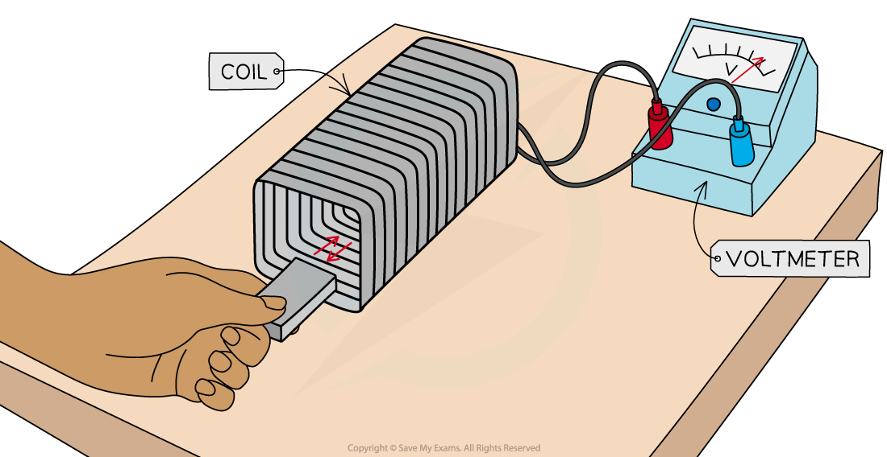
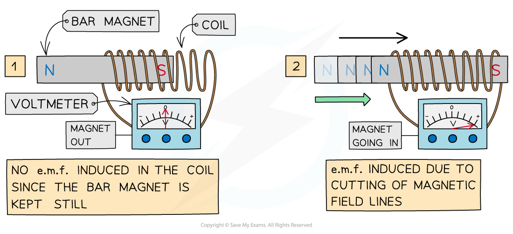
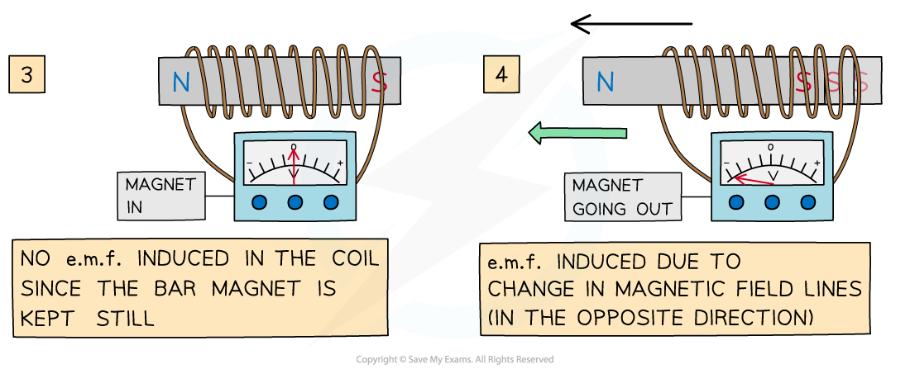

# Demonstrating Induction

## Demonstrating induction

> **Spec point** — `spcpt_PsWPSpbC55HNz9JW` · Describe an experiment to demonstrate electromagnetic induction

## Demonstrating induction

- Electromagnetic induction is used in:

  - electrical generators which convert mechanical energy to electrical energy
  - transformers which are used in electrical power transmission

- The phenomenon of electromagnetic induction can be demonstrated using

  - a magnet and a coil
  - a wire and a U-shaped magnet

### Experiment 1: moving a magnet through a coil

- When a coil is connected to a sensitive voltmeter, a bar magnet can be moved in and out of the coil to induce an e.m.f.

*An e.m.f. is induced in a coil when a bar magnet is moved through it. This can be seen by connecting the coil to a voltmeter*

- The expected results are:

  1. **When the bar magnet is stationary, the voltmeter shows a zero reading**
  
    - When the bar magnet is held still inside, or outside, the coil, there is no cutting of magnetic field lines
    - As a result, **no e.m.f. is induced** in the coil
  2. **When the bar magnet is moved inside the coil, there is a reading on the voltmeter**
  
    - As the bar magnet moves, its magnetic field lines are cut by the coil
    - This induces an **e.m.f.** within the coil, shown momentarily by the reading on the voltmeter
  3. **When the bar magnet is moved back out of the coil, there is a reading on the voltmeter with the opposite sign**
  
    - As the magnet changes direction, the direction of the current changes
    - An e.m.f. is induced in the **opposite direction**,** **shown momentarily by the reading on the voltmeter with the opposite sign

*An e.m.f. is induced only when the bar magnet is moving through the coil*

***An e.m.f. is induced only when the bar magnet is moving through the coil***

- Factors that will increase the induced e.m.f. are:

  - moving the magnet **faster** through the coil
  - adding **more turns** to the coil
  - increasing the **strength** of the bar magnet

### Experiment 2: moving a wire through a magnet

- When a long wire is connected to a voltmeter and moved between two magnets, an e.m.f. is induced
- The pattern of a magnetic field in a wire can be investigated using this setup

  - **Note:** there is no current flowing through the wire to start with

*An e.m.f. is induced in a wire when it is moved between magnetic poles. This can be seen by connecting the wire to a voltmeter*

- The expected results are:

  1. **When the wire is stationary, the voltmeter shows a zero reading**
  
    - When there is no relative motion between the wire and the magnetic field, no field lines are cut
    - As a result, **no e.m.f. is induced** in the wire
  2. **As the wire is moved between the magnetic poles, there is a reading on the voltmeter**
  
    - As the wire moves, it cuts the magnetic field lines of the magnet
    - This induces an **e.m.f.** in the wire, shown momentarily by the reading on the voltmeter
  3. **When the wire is moved back out of the magnet, there is a reading on the voltmeter with the opposite sign**
  
    - As the wire changes direction, the direction of the current changes
    - An e.m.f. is induced in the **opposite direction**, shown momentarily by the reading on the voltmeter with the opposite sign

- Factors that will increase the induced e.m.f. are:

  - increasing the **length** of the wire
  - moving the wire between the magnets **faster**
  - increasing the **strength** of the magnets

## Factors affecting electromagnetic induction

> **Spec point** — `spcpt_fCsFzZqXYSbMRFv8` · State the factors affecting the magnitude of an induced e.m.f.

## Factors affecting electromagnetic induction

- There are certain factors that can affect the magnitude and direction of induced e.m.f.

### Factors affecting the magnitude of the induced e.m.f.

1. **The speed at which the wire, coil or magnet is moved:**

  - Increasing the speed will increase the rate at which the magnetic field lines are cut
  - This will increase the size of the induced e.m.f.
2. **The number of turns on the coils in the wire:**

  - Increasing the number of turns on the coils in the wire will increase the size of the induced e.m.f.
  - This is because each turn (loop) of wire in the coil cuts the magnetic field lines
  - Therefore, the total induced e.m.f. increases with each additional turn (loop)

1. **The size of the coils:**

  - Increasing the area of the coils will increase the size of the induced e.m.f.
  - This is because there will be more wire to cut through the magnetic field lines
2. **The strength of the magnetic field:**

  - Increasing the strength of the magnetic field will increase the size of the induced e.m.f.
  - This is because there will be more magnetic field lines in a given area

### Factors affecting the direction of the induced e.m.f.

1. **The orientation of the poles of the magnet:**

  - Switching the poles of the magnet induces an e.m.f. in the opposite direction
2. **The direction in which the wire, coil or magnet is moved:**

  - Reversing the direction in which the wire, coil or magnet is moved induces an e.m.f. in the opposite direction

> **Exam Hint**
> When discussing factors affecting the size of an induced e.m.f., make sure to use the correct terminology:
> 
> - say “add more **turns** to the coil” instead of “add more coils”. This is because these statements do not mean the same thing
> - say “a **stronger** magnet” instead of “a bigger magnet”. This is because larger magnets are not necessarily stronger

## Video of factors affecting induced e.m.f.

> **Spec point** — `spcpt_vGmrhvg5wkgCYBTV` · nan

##
