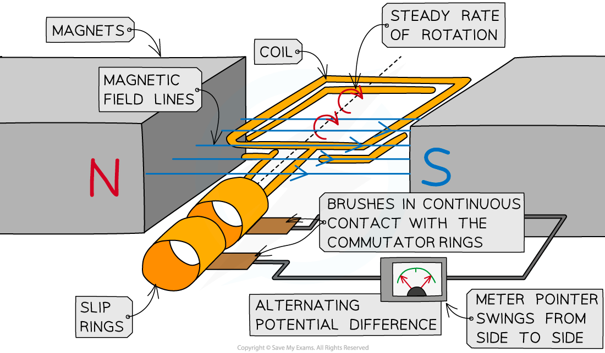
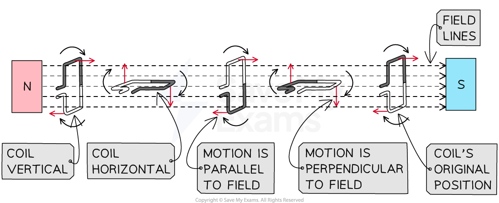
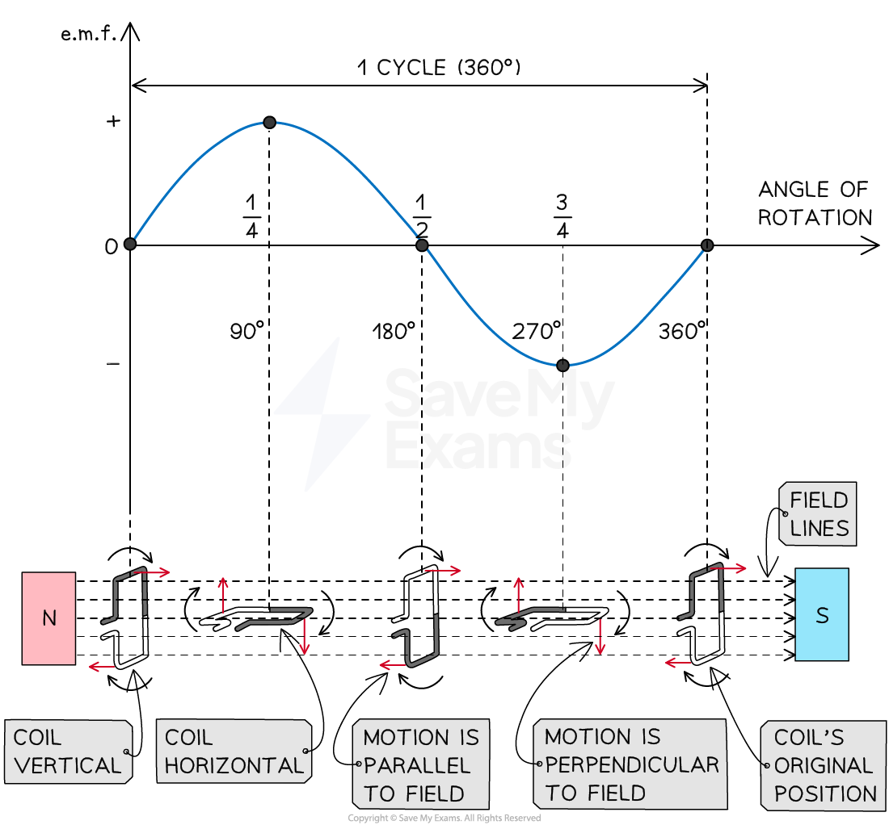

# The A.C. Generator

## Simple a.c. generators

> **Spec point** — `spcpt_B3zGNBFndQs9tm73` · Describe a simple form of a.c. generator (rotating coil or rotating magnet) and the use of slip rings and brushes where needed

## Simple a.c. generators

### Extended Tier Only

- An a.c. generator is a device which converts energy from **motion **into an **electrical **output
- An alternating e.m.f. is generated which causes an ***alternating current*** to flow
- A simple a.c. generator consists of:

  - a rotating coil of wire between the poles of a permanent magnet
  - slip rings and brushes connected to an external circuit

*A simple a.c. generator consists of a rotating coil in a magnetic field connected to an external circuit via slip rings and carbon brushes*

- The functions of each component are shown in the table:

| Component | Function |
|---|---|
| Permanent magnet | To provide a uniform magnetic field |
| Rotating coil | To cut the magnetic field as it rotates and allow an induced current to flow |
| Slip rings | To allow the alternating current to flow between the coil and the external circuit |
| Carbon brushes | To provide a good electrical connection between the coil and the external circuit |

### Operation of an a.c. generator

- A rectangular coil rotates in a **uniform magnetic field**
- The coil is connected to an external circuit via **slip rings and brushes**

  - The induced e.m.f. in the coil can be measured by adding a galvanometer (centre-zero meter) to the external circuit

- An e.m.f. is **induced **in the coil as it **cuts **the magnetic field

  - The pointer deflects first one way, then the opposite way, and then back again
  - This indicates the size and direction of the e.m.f. is constantly changing

- As a result of the alternating e.m.f., an alternating **current** is also produced as the coil rotates

  - This continues as long as the coil keeps turning in the **same** direction

#### Motion of an a.c. generator

*The size and direction of the induced e.m.f. (and current) depend on the orientation of the coil with the field*

- A maximum e.m.f. is induced when:

  - the **position **of the coil is **parallel** to the field
  - the **motion **of the coil is **perpendicular **to the field

- This is because the greatest number of lines are cut when the coil is moving perpendicular to the field

- No e.m.f. is induced when:

  - the **position **of the coil is **perpendicular **to the field
  - the **motion **of the coil is **parallel **to the field

- This is because no lines are cut when the coil is moving parallel to the field

## Graphs for a.c. generators

> **Spec point** — `spcpt_PFcDzTnH9YDqRzbp` · Sketch and interpret graphs of e.m.f. against time for simple a.c. generators and relate the position of the generator coil to the peaks, troughs and zeros of the e.m.f.

## Graphs for a.c. generators

### Extended Tier Only

- The output of an a.c. generator can be seen on a graph of e.m.f. against time, or angle of rotation
- The shape of the graph is a sine or cosine curve, depending on the starting position of the coil

  - When it starts from a **horizontal **position (e.m.f. is at a maximum), the graph is a **cosine **curve
  - When it starts from a **vertical **position (e.m.f. is zero), the graph is a **sine **curve

### Graph of induced e.m.f. with angle for an a.c. generator

*Alternating e.m.f. with corresponding positions of the coil relative to the field*

- When the coil is vertical at 0°:

  - it is moving **parallel** to the direction of the magnetic field
  - the size of the induced e.m.f. is **zero**

- When the coil has rotated by 90°:

  - it is now **horizontal **and moving **perpendicular **to the direction of the magnetic field
  - the size of the induced e.m.f. is at a **maximum**

- When the coil has rotated by 180°:

  - it is **vertical **again and moving **parallel **to the direction of the magnetic field
  - the size of the induced e.m.f. is **zero**

- When the coil has rotated by 270°:

  - it is **horizontal **again and moving **perpendicular **to the direction of the magnetic field
  - the size of the induced e.m.f. is at a **maximum **and in the **opposite **direction to its position at 90°

- When the coil has completed a full 360° rotation:

  - it is back at its starting point where it is moving **parallel **to the direction of the magnetic field
  - the size of the induced e.m.f. is **zero**

### Factors affecting a.c. generators

- The magnitude of the induced e.m.f. can be increased by:

  - increasing the **frequency **of rotation of the coil
  - increasing the number of **turns **on the coil
  - increasing the **strength **of the magnet
  - inserting a **soft iron core** into the coil

> **Exam Hint**
> For your exam, you need to be aware that an alternating current can be produced by:
> 
> - a **coil rotating** in a magnetic field
> - a **magnet rotating** within a coil
> 
> Both will induce an e.m.f. in the coil as they both ensure the coil will experience a **changing** magnetic field.
> 
> Take a look at these notes on [trigonometric graphs](https://www.savemyexams.com/igcse/maths_extended/cie/25/revision-notes/pythagoras-and-trigonometry/trigonometric-graphs-and-equations/trigonometric-graphs/) if you need to brush up on your knowledge of sine and cosine graphs.
