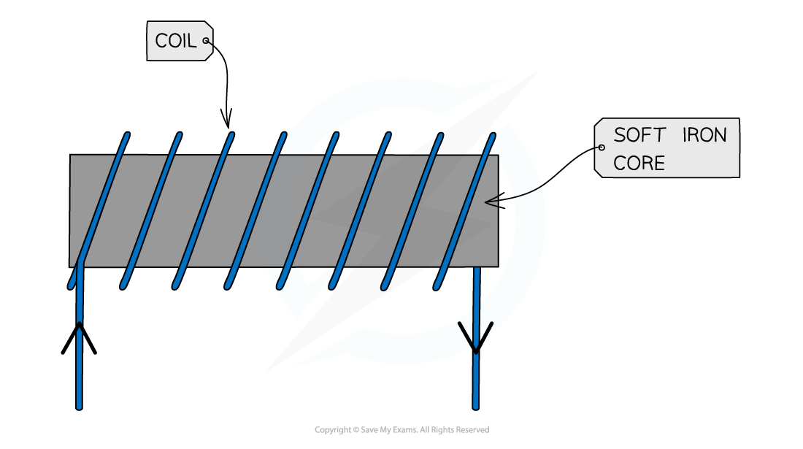
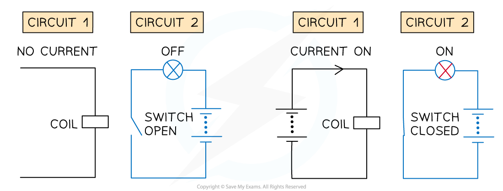
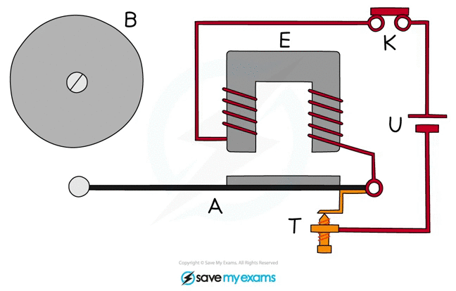
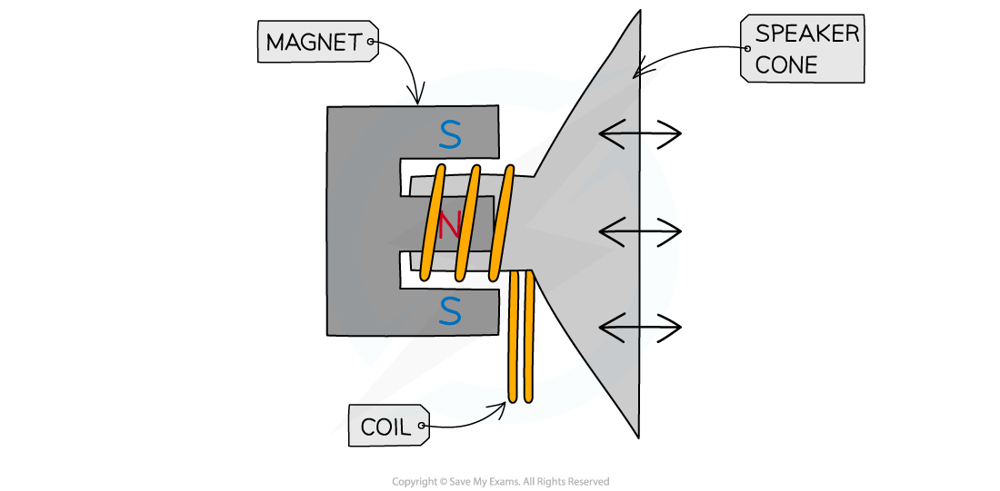

# Magnetic Effect of a Current

## Magnetic field around wires & solenoids

> **Spec point** — `spcpt_6zM4PpWM8GKDgBdN` · Describe the pattern and direction of the magnetic field due to currents in straight wires and in solenoids

## Magnetic fields around wires & solenoids

- ***Magnetic fields*** are formed wherever a current flows, such as in:

  - straight wires
  - solenoids
  - circular coils

### Magnetic field due to a straight wire

- The magnetic field lines around a straight wire are:

  - made up of ***concentric circles***
  - centred on the wire

- A circular field pattern indicates that the magnetic field around a current-carrying wire has **no poles**

- The field lines are clockwise or anticlockwise around the wire, depending on the direction of the current

  - Reversing the current reverses the direction of the field

*The direction of the field around a current-carrying wire can be determined using the right-hand grip rule*

- The direction of the magnetic field can be determined using the** right-hand grip rule**

  - This is determined by pointing the **right-hand** thumb in the direction of the current in the wire and curling the fingers onto the palm
  - The direction of the curled fingers represents the direction of the magnetic field lines around the wire
  - For example, if the current is travelling vertically upwards, the magnetic field lines will be directed anticlockwise, as seen from directly above the wire

- **Note:** the direction of the current is taken to be the conventional current i.e. from **positive** to **negative**, **not** the direction of electron flow

### Magnetic field due to a solenoid

- As seen from a current-carrying wire, an electric current produces a magnetic field
- An electromagnet utilises this by using a coil of wire called a ***solenoid***

  - This increases the strength of the magnetic field by adding more **turns** of wire into a smaller region of space

- One end of the solenoid becomes a north pole, and the other becomes the south pole

*The magnetic field lines around a solenoid are similar to a bar magnet*

- As a result, the field lines around a solenoid are similar to those around a bar magnet

  - The field lines **emerge** from the **north** pole
  - The field lines **return** to the **south** pole

- The poles of the solenoid can be determined using the **right-hand grip rule**

  - The curled fingers represent the direction of the current flow around the coil
  - The thumb points in the direction of the field inside the coil, towards the **north pole**

*In a solenoid, the north pole forms at the end where the current flows anti-clockwise, and the south pole at the end where the current flows clockwise*

### Magnetic field due to a circular coil

- A circular coil is equivalent to one of the coils of a solenoid
- The field lines emerge through one side of the circle (north pole) and enter through the other (south pole)
- As with a solenoid, the direction of the magnetic field lines depends on the direction of the current

  - This can also be determined using the **right-hand grip rule**

*Magnetic field lines of many individual circular coils can be combined to make a solenoid*

> **Worked Example**
> The current in a long, straight vertical wire is in the direction XY, as shown in the diagram.
> 
> 
> 
> Sketch the magnetic field lines in the horizontal plane ABCD due to the current-carrying wire. Draw at least four field lines.
> 
> [3]
> 
> **Answer:**
> 
> 
> 
> - Concentric circles **[1 mark]**
> - Increasing separation between each circle **[1 mark]**
> - Arrows drawn in an anticlockwise direction **[1 mark]**

## Magnetic effects of changing current

> **Spec point** — `spcpt_7dTJMHFFZYYGj3cj` · Describe the effect on the magnetic field around straight wires and solenoids of changing the magnitude and direction of the current
State the qualitative variation of the strength of the magnetic field around straight wires and solenoids

## Magnetic effects of changing current

### Extended Tier Only

### Magnetic field strength around a straight wire

- The strength of the magnetic field around a wire depends on:

  - the size of the **current**
  - the **distance **from the wire

- The strength of a magnetic field **increases** as the amount of **current **flowing through the wire increases

  - This means the field lines will become **closer together**

- The strength of a magnetic field **decreases** with **distance** from the wire

  - The magnetic field is strongest near the wire and becomes weaker further away from the wire
  - This is shown by the magnetic field lines becoming **further apart**

- When the **direction** of the current changes, the magnetic field acts in the **opposite **direction

*The greater the current, the stronger the magnetic field. This is shown by more concentrated field lines*

### Magnetic field strength around a solenoid

- The strength of the magnetic field produced around a **solenoid** can be increased by:

  - increasing the amount of **current** flowing through the coil
  - increasing the **number of turns** on the coil
  - inserting an **iron core** into the coil

- When a soft **iron core** is inserted into a solenoid, it can be used as an electromagnet
- The iron core becomes an ***induced magnet*** when a current flows through the coils
- The magnetic field produced by the solenoid and the iron core will create a much **stronger** magnet overall

*An electromagnet consists of a solenoid wrapped around a soft iron core*

- Changing the direction of the current also changes the direction of the magnetic field produced by the iron core

## Applications of the magnetic effect of a current

> **Spec point** — `spcpt_x98b7kmVr2cq7Fjy` · Describe how the magnetic effect of a current is used in relays and loudspeakers and give examples of their application

## Applications of the magnetic effect of a current

- Electromagnets are used in a wide variety of applications, including:

  - relay circuits (utilised in electric bells, electronic locks, scrapyard cranes etc)
  - loudspeakers

### Relay circuits

- Electromagnets are commonly used in **relay circuits**
- Relays are switches that open and close via the action of an electromagnet
- A relay circuit consists of:

  - an electrical circuit containing an electromagnet
  - a second circuit with a switch which is near to the electromagnet in the first circuit

#### Operation of a relay circuit

*When a current passes through the coil in Circuit 1, it attracts the switch in Circuit 2, and closing it enables a current to flow in Circuit 2*

- When a current flows through **Circuit 1**:

  - a magnetic field is induced around the coil
  - the magnetic field attracts the switch, causing it to pivot and close the contacts in **Circuit 2**
  - this allows a current to flow in **Circuit 2**

- When no current flows through **Circuit 1**:

  - the magnetic force stops
  - the electromagnet stops attracting the switch
  - the current in **Circuit 2 **stops flowing

- Scrapyard cranes utilise relay circuits to function:

  - When the electromagnet is switched on, it will **attract **magnetic materials
  - When the electromagnet is switched off, it will **drop **the magnetic materials
- Electric bells also utilise relay circuits to function:

*Animation: Electric bells utilise relay circuits. As the current alternates, the metal arm strikes the bell and drops repeatedly to produce the ringing effect*

- When the button **K** is pressed:

  - a current passes through the electromagnet** E** creating a magnetic field
  - this attracts the iron armature **A**, causing the hammer to strike the bell **B**
  - the movement of the armature breaks the circuit at **T**
  - this stops the current, destroying the magnetic field and so the armature returns to its previous position
  - this re-establishes the circuit, and the whole process starts again

### Loudspeakers

- Loudspeakers convert electrical signals into sound waves

  - They work due to the [motor effect](https://www.savemyexams.com/igcse/physics/cie/23/revision-notes/4-electricity-and-magnetism/4-4-electromagnetic-effects/4-4-6-force-on-a-current-carrying-conductor/?_ai=internal-linking)
- A loudspeaker consists of a coil of wire which is wrapped around one pole of a **permanent magnet**

#### Structure of a loudspeaker

*A loudspeaker converts the a.c. of an electrical signal into sound waves*

- An ***alternating current*** passes through the coil of the loudspeaker

  - This creates a **changing magnetic field** around the coil

- As the current is constantly changing direction, the direction of the magnetic field will be **constantly changing**
- The magnetic field produced around the coil **interacts** with the field from the permanent magnet
- The interacting magnetic fields will exert a **force** on the coil
- As the magnetic field is constantly changing direction, the force exerted on the coil will **constantly change direction**

  - This makes the coil **oscillate**

- The oscillating coil causes the speaker cone to oscillate

  - This makes the air oscillate, creating **sound waves**
