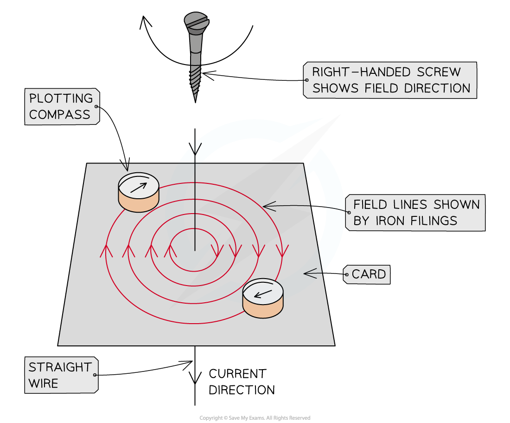
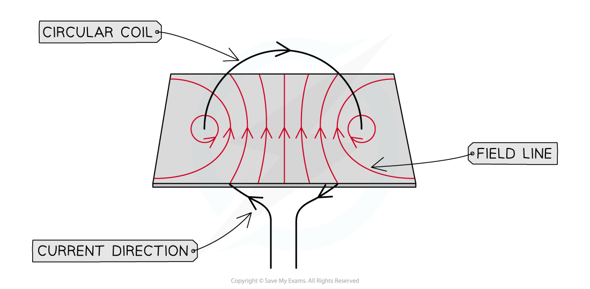
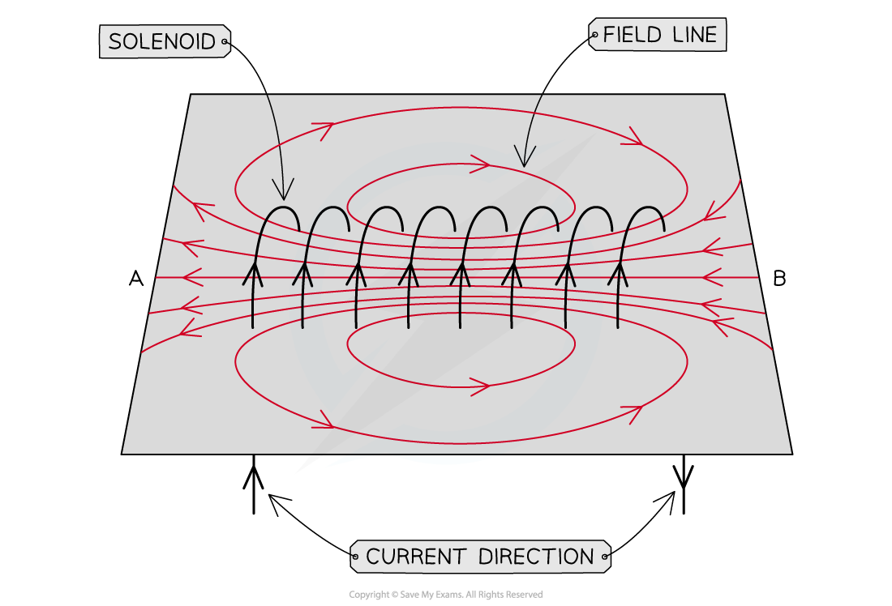

# Investigating the Field Around a Wire

## Investigating the magnetic field around a wire

> **Spec point** — `spcpt_9q6wTkP3mJFqk8bv` · Describe an experiment to identify the pattern of the magnetic field (including direction) due to currents in straight wires and in solenoids

## Investigating the magnetic field around a wire

- The magnetic field patterns due to currents in straight wires and in solenoids can be investigated using:

  - a thick wire
  - a solenoid (a wire wrapped into a coil) – for example, a metal slinky
  - cell, ammeter, variable resistor and connecting wires
  - cardboard with holes (the holes must be large enough for the wire to fit through)
  - clamp stand
  - iron filings or a compass

### Experiment 1: plotting the magnetic field around a wire

1. Attach the thick wire through a hole in the middle of the cardboard and secure it to the clamp stand

  - Secure the wire vertically so it sits perpendicularly to the cardboard
2. Attach the ends of the wire to a series circuit containing the variable resistor and ammeter on either side of the cell

#### Using plotting compasses

1. Place plotting compasses on the card and draw dots at each end of the needle once it settles

  - Make sure to draw an arrow to show the direction of the field at different points
2. Move the compass so that it points away from the new dot, and repeat the process above
3. Keep repeating the previous process until there is a chain of dots on the card
4. Then remove the compass, or compasses, and link the dots using a smooth curve – this will be the magnetic field line
5. Repeat the whole process several times to create several other magnetic field lines

  - When the current direction is reversed, the compasses point in the opposite direction showing that the direction of the field reverses when the current reverses

#### Using iron filings

1. If using iron filings, spread the iron filings uniformly onto the cards and gently shake the card until the filings settle in the pattern of the magnetic field around the wire

*Plotting compasses and iron filings are used to show the magnetic field around a current-carrying wire*

### Experiment 2: plotting the magnetic field around a solenoid

1. Attach the thick wire through a hole on one side of the cardboard and loop it through a hole on the other side of the cardboard and secure it to the clamp stand

  - Secure the wire so it forms a circular loop around the cardboard
2. Attach the ends of the wire to a series circuit containing the variable resistor and ammeter on either side of the cell

*The magnetic field around a circular current-carrying coil of wire*

#### Using plotting compasses

- Follow the procedure outlined in Experiment 1

  - Note: this can be carried out using a solenoid, but since a solenoid is essentially many circular loops, the pattern around a circular loop can be extended to give the pattern around a solenoid

#### Using iron filings

1. Take a solenoid (a metal slinky works well for this) and thread it through pre-made holes in a piece of card
2. Pour the filings onto the card and gently shake the card until the filings settle in the pattern of the magnetic field around the solenoid

*The magnetic field around a solenoid*
