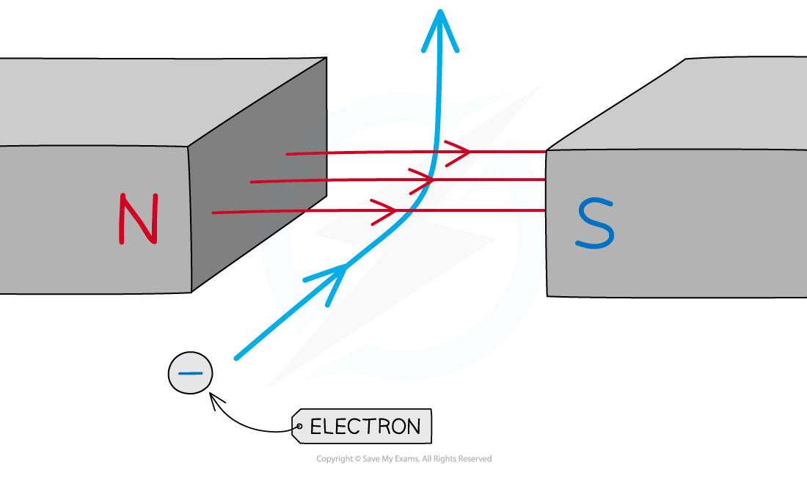

# Force on a Current-Carrying Conductor

## Force on a current-carrying conductor

> **Spec point** — `spcpt_sm2ndjkpFcb2s4zM` · Describe an experiment to show that a force acts on a current-carrying conductor in a magnetic field, including the effect of reversing:
   (a) the current
   (b) the direction of the field

## Force on a current-carrying conductor

- A current-carrying conductor produces its own ***magnetic field***

  - When interacting with an external magnetic field, it therefore will experience a **force**

- A current-carrying conductor will only experience a force if the current through it is **perpendicular **to the direction of the magnetic field lines

  - A simple situation would be a copper rod placed within a uniform magnetic field
  - When current is passed through the copper rod, it experiences a force which makes it move

*A copper rod moves within a magnetic field when current is passed through it*

- Two ways to reverse the direction of the force (and therefore, the copper rod) are by:

  - reversing the direction of the **current**
  - reversing the direction of the **magnetic field**

> **Exam Hint**
> This phenomenon is sometimes referred to as 'the motor effect'. The direction of the force is determined by Fleming’s left-hand rule.

## Fleming's left-hand rule

> **Spec point** — `spcpt_gss392Zwx8gYmp8c` · Recall and use the relative directions of force, magnetic field and current

## Fleming’s left-hand rule

- The **direction** of the **force** (also called the **thrust**) on a current-carrying wire depends on the direction of:

  - the current
  - the magnetic field

- The direction of the force (or thrust) can be worked out by using **Fleming’s left-hand rule**:

  - the **thumb **points in the direction of the force, or thrust, on the conductor
  - the **first **finger points in the direction of the magnetic field
  - the **second **finger points in the direction of current flow (from positive to negative)

*Fleming’s left-hand rule can be used to determine the directions of the force, magnetic field and current*

- All three will be **perpendicular **to each other in Fleming’s left-hand rule questions

  - This means that sometimes the force could be into and out of the page (in 3D)

> **Worked Example**
> A current-carrying wire is placed into the magnetic field between the poles of the magnet, as shown in the diagram.
> 
> 
> 
> Use Fleming’s left-hand rule to show that there will be a downward force acting on the wire.
> 
> [3]
> 
> **Answer:**
> 
> **Step 1: Determine the direction of the magnetic field**
> 
> - Start by pointing your **F**irst **F**inger in the direction of the (magnetic) **F**ield **[1 mark]**
> 
> **Step 2: Determine the direction of the current**
> 
> - Now rotate your hand around the first finger so that the se**C**ond finger points in the direction of the **C**urrent **[1 mark]**
> 
> **Step 3: Determine the direction of the force**
> 
> - The **TH**umb will now be pointing in the direction of the **TH**rust (the force)
> - Therefore, this will be the direction in which the wire will move **[1 mark]**
> 
> 

> **Exam Hint**
> Remember that the magnetic field is always in the direction from **North **to **South** and current is always in the direction of a **positive** terminal to a **negative** terminal.

## Charged particles in a magnetic field

> **Spec point** — `spcpt_hjTtWvs5W6BmprWm` · Determine the direction of the force on beams of charged particles in a magnetic field

## Charged particles in a magnetic field

### Extended Tier Only

- When a current-carrying wire is placed in a magnetic field, it will experience a force if the wire is perpendicular to the magnetic field

  - This is because the magnetic field exerts a force on each individual electron flowing through the wire

- Therefore, when a charged particle passes through a magnetic field, the field can exert a **force** on the particle, causing it to **deflect**

  - The force is always at** 90 degrees** to both the direction of travel and the magnetic field lines
  - The direction can be worked out by using ***Fleming’s left-hand rule***

- In the case of an electron in a magnetic field:

  - the second finger (current) points in the opposite direction to the direction of motion
  - this is because conventional current flows in the opposite direction to electron flow

*When a charged particle (such as an electron) enters a magnetic field, it is deflected by the field*

- If the particle is travelling **perpendicular** to the field lines:

  - it will experience the **maximum** force

- If the particle is travelling **parallel** to the field lines:

  - it will experience **no** force

- If the particle is travelling at an **angle** to the field lines:

  - it will experience a **small** force

> **Exam Hint**
> Remember that the direction of **current** is the direction of **positive** charge. Therefore, if a particle has a negative charge (such as an electron), then the second finger (current) must point in the **opposite** direction to its direction of travel.
> 
> The left-hand rule can be applied to any charged particles, but in the IGCSE exam questions are likely to stick to electrons.

## Video of the motor effect

> **Spec point** — `spcpt_jMDVmdy9XdSPM8rP` · nan

##
