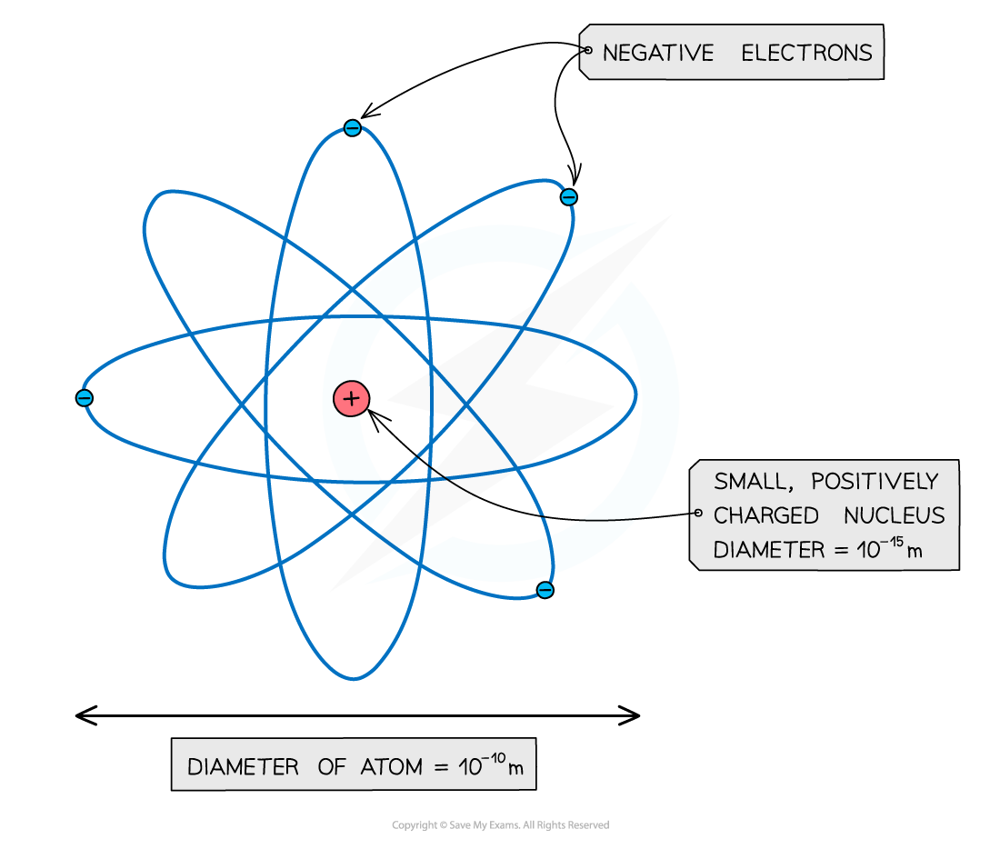
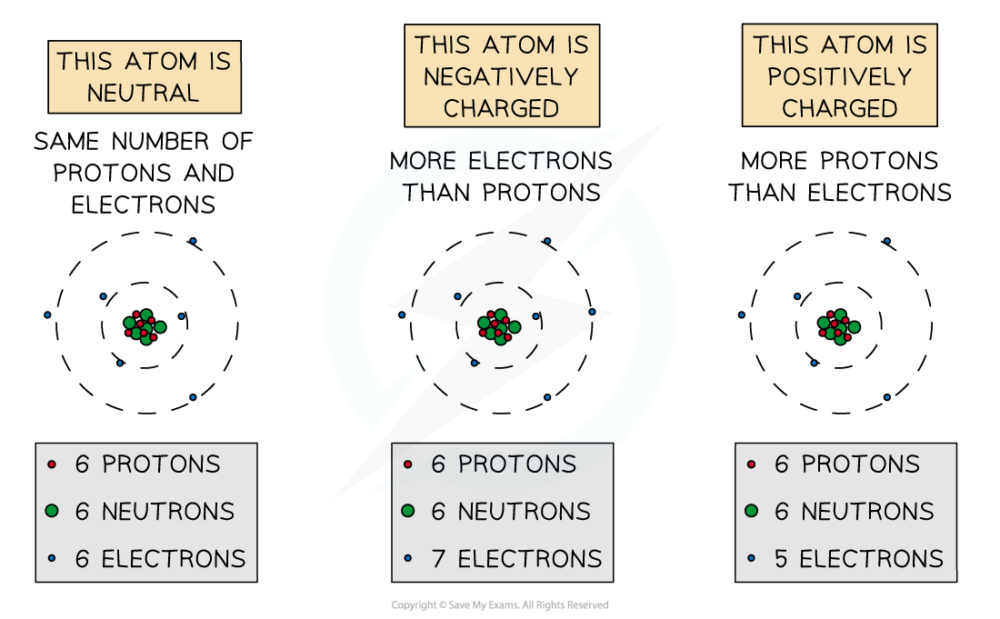

# The Atom

## Atomic structure

> **Spec point** — `spcpt_rHGfCHCfdC2ttDZv` · Describe the structure of an atom in terms of a positively charged nucleus and negatively charged electrons in orbit around the nucleus

## Atomic structure

- Atoms are the building blocks of **all matter**
- They consist of a small dense **positively** charged nucleus and **negatively** charged electrons in orbit around the nucleus

*An atom is a small positive nucleus, surrounded by orbiting negative electrons*

- Atoms are incredibly small, with a radius of only 1 × 10-10 m

  - This means that about one hundred million atoms could fit side by side across your thumbnail
- The radius of the nucleus is over 10 000 times smaller than the whole atom, but it contains almost **all of the mass** of the atom

## Rutherford's alpha scattering experiment

> **Spec point** — `spcpt_c4Mh28Nhxrx47SXD` · Describe how the scattering of alpha (α) particles by a sheet of thin metal supports the nuclear model of the atom, by providing evidence for:
(a) a very small nucleus surrounded by mostly empty space
(b) a nucleus containing most of the mass of the atom
(c) a nucleus that is positively charged

## Rutherford's alpha scattering experiment

### Extended Tier Only

- In Rutherford's alpha scattering experiment the scattering of alpha (α) particles by a sheet of thin metal supports the **nuclear model** of the atom, by providing evidence for:

  - a very **small nucleus** surrounded by **mostly empty space**
  - a **nucleus** containing most of the **mass** of the atom
  - a nucleus that is** positively charged**
- In 1909 a group of scientists were investigating the Plum Pudding model of atomic structure

  - Physicist **Ernest Rutherford** was instructing two of his students, Hans Geiger and Ernest Marsden to carry out the alpha scattering experiment
- They directed a beam of **alpha particles** (He2+ ions) at a thin gold foil

  - They expected the alpha particles to **travel through** the gold foil, and maybe change direction a small amount
- As shown in the diagram, instead they discovered that:

  - most of the alpha particles **passed straight through** the foil because the atom is mostly **empty space** (A)
  - some of the alpha particles were **deflected** (changed direction**)** as they passed through the foil because they came close to the positively charged nucleus, which repelled the positively charged alpha particles (B)
  - a few of the alpha particles **bounced back** off the gold foil because the nucleus is tiny

- This bouncing back could not be explained by the Plum Pudding model of atomic structure, so a new model had to be created

  - This was the first evidence of the nuclear atom as atomic structure

*When α-particles are fired at thin gold foil, most of them go straight through but a very small number bounce straight back *

## Atoms & ions

> **Spec point** — `spcpt_9y3ByRgBSW4Vjn7T` · Know how atoms may form positive ions by losing electrons or form negative ions by gaining electrons

## Atoms & ions

- An ion is an **electrically** **charged** atom or group of atoms formed by the **loss** or **gain** of **electrons**

  - An atom will lose or gain electrons to become more stable
- A stable atom is normally electrically neutral

  - This means it has the same number of protons (positive charge) and electrons (negative charge)
- Positive ions are therefore formed when atoms **lose** electrons

  - There will be more protons than electrons
- Negative ions are therefore formed when atoms **gain** electrons

  - There will be more electrons than protons

*The difference between positive and negative ions*

> **Exam Hint**
> You may hear the term 'net charge'. This just means the 'overall' charge of the atom. If an atom has 5 protons, 5 neutrons and 6 electrons, it has a **net** negative charge because it's a negative ion (more electrons than protons).
> 
> Remember which way around the charges are by **p**roton being **p**ositive.
