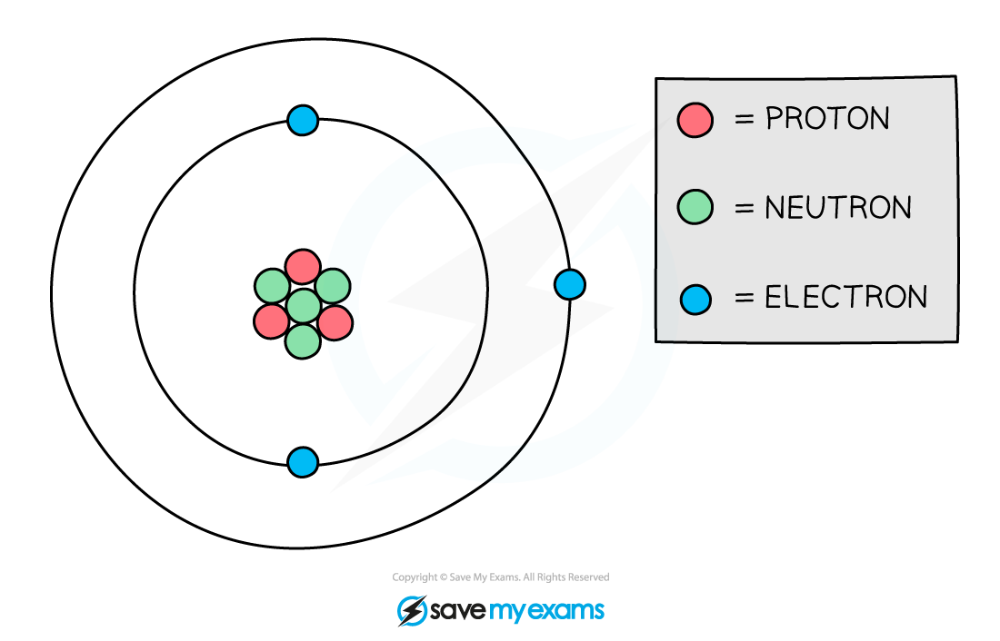
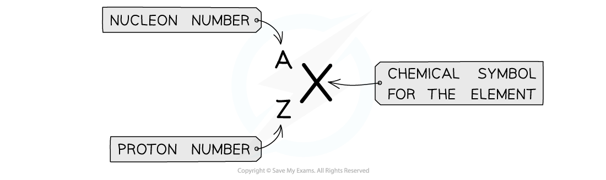

# The Nucleus

## Composition of the nucleus

> **Spec point** — `spcpt_2rTXpKXyZTzJNRGT` · Describe the composition of the nucleus in terms of protons and neutrons

## Composition of the nucleus

- A nucleus is composed of:

  - positively charged **protons**
  - neutrally charged **neutrons**
- Hence a nucleus has an **overall positive** charge

### Structure of the atom

*Protons and neutrons are found in the nucleus of an atom*

> **Exam Hint**
> Be careful with your terminology:
> 
> - Atom = nucleus (proton and neutron) **and** electrons
> - Nucleus = protons and neutrons at the centre of the atom

## Video

> **Spec point** — `spcpt_W78dPvKpsrNdWQGH` · nan

## 

## Describing the nucleus

> **Spec point** — `spcpt_C6S2sx3JHMR7j5F4` · Define the terms proton number (atomic number) Z and nucleon number (mass number) A and be able to calculate the number of neutrons in a nucleus

## Describing the nucleus

### Proton number, Z

- The number of protons in an atom is called its **proton** number (it can also be called the **atomic** number)

  - Elements in the periodic table are ordered by their atomic number
  - Therefore, the number of protons determines which element an atom is

- The atomic number of a particular element is always the same
- For example:

  - Hydrogen has an atomic number of 1 — it always has just one proton
  - Sodium has an atomic number of 11 — it has 11 protons
  - Uranium has an atomic number of 92 — it has 92 protons

- The atomic number is also equal to the number of electrons in an atom

  - This is because atoms have the same number of electrons and protons in order to have no overall charge

### Nucleon number, A

- The total number of particles in the nucleus of an atom is called its **nucleon number **(or **mass** number)
- The mass number is the number of protons **and** neutrons in the atom

### Calculating the number of neutrons

- The number of neutrons can be found by **subtracting** the **atomic** number from the **mass** number

$\mathrm{number} \mathrm{of} \mathrm{neutrons}=\mathrm{nucleon} \mathrm{number}-\mathrm{proton} \mathrm{number}$

- For example, if a sodium atom has a mass number of 23 and an atomic number of 11, then the number of neutrons would be 23 – 11 = 12

> **Exam Hint**
> You may have noticed that the number of electrons is not part of the mass number. This is because electrons have a **tiny** mass compared to neutrons and protons. We say their mass is negligible when compared to the particles in the nucleus.

## Nuclide notation

> **Spec point** — `spcpt_9dP28GSfKJRhp9yB` · Use the nuclide notation ZXA

## Nuclide notation

- Atomic symbols are written in a specific notation called **AZX **or** nuclide** **notation**

  - The top number A represents the **nucleon **number
  - The lower number Z represents the **proton** number

*Atomic symbols in AZX nuclide notation describe the constituents of nuclei*

- A nuclide is a group of atoms containing the same number of protons and neutrons

  - For example, five atoms of oxygen are all the same nuclide but are five separate atoms

- An example of nuclide notation is:

*Atomic symbols, like the one above, describe the constituents of nuclei*

> **Worked Example**
> The element symbol for gold is Au. How many protons, neutrons and electrons are in the gold atom?
> 
> $Au_{79}^{197}$
> 
> | ** ** | **Protons** | **Neutrons** | **Electrons** |
> |---|---|---|---|
> | A | 79 | 79 | 79 |
> | B | 197 | 79 | 118 |
> | C | 118 | 118 | 79 |
> | D | 79 | 118 | 79 |
> 
> [1]
> 
> **Answer:**
> 
> **Step 1: Determine the atomic and mass number**
> 
> - The gold atom has an atomic number of 79 (lower number) and a mass number of 197 (top number)
> 
> **Step 2: Determine the number of protons**
> 
> - The **atomic** number is equal to the number of **protons**
> - The atom has 79 protons
> 
> **Step 3: Calculate the number of neutrons**
> 
> - The mass number is equal to the number of protons and neutrons
> - The number of neutrons is equal to the mass number minus the atomic number
> 
> $197-79=118$
> 
> - The atom has 118 neutrons
> 
> **Step 4: Determine the number of electrons**
> 
> - An atom has the **same** number of **protons and electrons**
> - The atom has 79 electrons
> - Therefore, the correct answer is **D** **[1 mark]**

> **Exam Hint**
> You may recognise this notation from the periodic table in chemistry when mass number and proton number are more commonly used. In physics, you are more likely to see nucleon number and proton number. The periodic table is ordered by atomic number.

## Isotopes

> **Spec point** — `spcpt_YPYY7jJHk8Sj4nMN` · Explain what is meant by an isotope and state that an element may have more than one isotope

## Isotopes

- Although the number of protons in a particular element is always the same, the number of **neutrons** can be different
- **Isotopes** are atoms of the same element that have an equal number of protons but a **different** number of **neutrons**

  - This means that each element can have more than one isotope
- Isotopes tend to be more **unstable** due to their imbalance of protons and neutrons

  - This means they are [more likely to decay](https://www.savemyexams.com/igcse/physics/cie/23/revision-notes/5-nuclear-physics/5-2-radioactivity/5-2-4-radioactive-decay/?_ai=internal-linking)

- In the diagram below are three isotopes of hydrogen:

*Hydrogen has three isotopes, each with a different number of neutrons*

- Isotopes occur naturally, but some are more rare than others
- For example, about two in every 10 000 hydrogen atoms is deuterium

  - Tritium is even more rare (about 1 in every billion billion hydrogen atoms)

> **Worked Example**
> Which of the following elements are isotopes of each other?
> 
> | **A** | $Cl_{17}^{35}$ and $Cl_{18}^{35}$ |
> |---|---|
> | **B** | `U _ 92 ^ 238` and `U _ 92 ^ 235` |
> | **C** | $C_{6}^{12}$ and $C_{8}^{14}$ |
> | **D** | $O_{8}^{16}$ and $N_{7}^{14}$ |
> 
> [1]
> 
> **Answer:**
> 
> - In nuclide notation, the top number is the **nucleon** number (number of protons and neutrons) and the bottom number is the **proton** number (number of protons)
> - Isotopes are two of the same elements
> 
>   - This eliminates option **D** since one is oxygen (O) and the other nitrogen (N)
> - Which have the same number of protons
> 
>   - This eliminates option **C** and **A**
>   - Their proton numbers are different for the same element
> - But a different number of neutrons
> 
>   - Therefore, the correct answer is **B** **[1 mark]**
