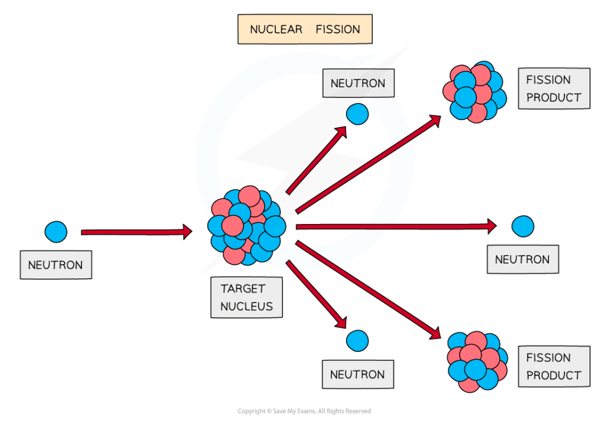
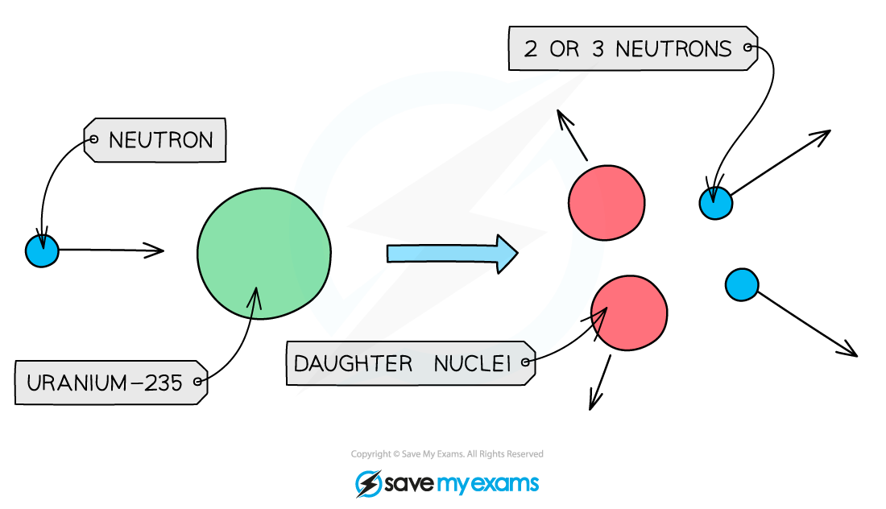
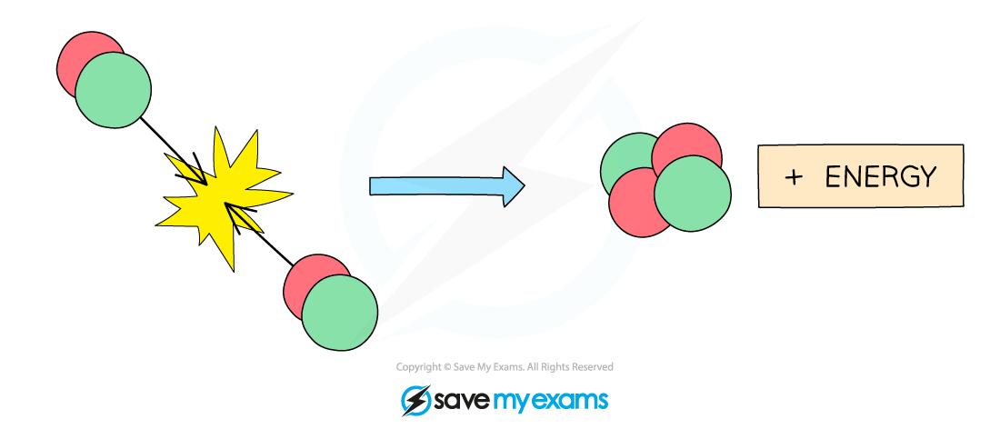

# Fission & Fusion

## Fission & fusion

> **Spec point** — `spcpt_QjFJc2CKhdyWRpVh` · Describe the processes of nuclear fission and nuclear fusion 
- as the splitting or joining of nuclei, 
- to include the nuclide equation 
- and qualitative description of mass and energy changes without values

## Fission & fusion

- Nuclear fission & fusion are **nuclear reactions** that change the nucleus of an atom to produce high amounts of energy from the energy **stored** in the nucleus of an atom

### Nuclear fission

- Nuclear fission is defined as:

**The splitting of a large, unstable nucleus into two smaller nuclei**

- During fission:

  - a neutron collides with an unstable nucleus
  
    - The neutron and the nucleus are the **reactants**
  - the nucleus splits into **two smaller nuclei** (called daughter nuclei) and **two or three neutrons**
  
    - The daughter nuclei and the neutrons are the **products** of the reaction
  - gamma rays are also emitted

#### Nuclear fission process

*A neutron is fired into the target nucleus, causing it to split*

### Nuclear fission nuclide equations

- An example of a nuclide equation for the fission of uranium-235 is:

`U _ 92 ^ 235 + n _ 0 ^ 1 -> Kr _ 36 ^ 92 + Ba _ 56 ^ 141 + 3 n _ 0 ^ 1 + energy`

- Where:

  - `U _ 92 ^ 235` is an unstable isotope of uranium
  - `n _ 0 ^ 1` is a neutron
  - $Kr_{36}^{92}$ is an unstable isotope of krypton
  - $Ba_{56}^{141}$ is an unstable isotope of barium

#### Nuclear fission of uranium-235

*Large nuclei can decay by fission to produce smaller nuclei and neutrons with a lot of kinetic energy*

### Nuclear fission mass and energy values

- **Energy is conserved** in a nuclear fission reaction

- In the example:

`U _ 92 ^ 235 + n _ 0 ^ 1 -> Kr _ 36 ^ 92 + Ba _ 56 ^ 141 + 3 n _ 0 ^ 1 + energy`

- The sum of the nucleon (top) numbers of the reactants (left-hand side) is equal to the sum of the nucleon numbers of the products (right-hand side):

$235+1=92+141+(3\times1)$

- The same is true for the proton (bottom) numbers:

$92+0=36+56+(3\times0)$

- The products of fission move away very **quickly**

  - During a fission reaction, energy is transferred from **nuclear energy** store of the parent nucleus to the kinetic energy store of the products
- The mass of the products is fractionally **less** than the mass of the original nucleus

  - This is because the remaining mass has been converted into **energy**, which is released during the fission process
- Large isotopes with a large nucleon number, such as **uranium** and **plutonium**, both undergo fission and are used as fuels in nuclear power stations

### Nuclear fusion

- Nuclear fusion is defined as:

**When two light nuclei join to form a heavier nucleus**

- Stars use nuclear fusion to produce **energy**

  - In most stars, hydrogen nuclei (**light nuclei**) are fused together to form a helium nucleus (**heavier nucleus**) and a huge amount of **energy** is produced

#### Nuclear fusion of hydrogen

*Two hydrogen nuclei fuse to form a helium nucleus*

- Nuclear fusion requires extremely high **temperature** and **pressure**

  - So fusion is very hard to reproduce on Earth

### Nuclear fusion nuclide equations

- An example of a nuclide equation for fusion is:

`H _ 1 ^ 2 + H _ 1 ^ 1 -> He _ 2 ^ 3 + energy`

- Where:

  - `H _ 1 ^ 2` is deuterium (isotope of hydrogen with 1 proton and 1 neutron)
  - $H_{1}^{1}$ is hydrogen (with one proton)
  - $He_{2}^{3}$ is an isotope of helium (with two protons and one neutron)

### Nuclear fusion mass and energy values

- The energy produced during nuclear fusion comes from a very small amount of a particle’s mass **converted** into energy
- Therefore, the mass of the product (fused nucleus) is fractionally **less** than the mass of the two original nuclei (reactants)

  - The remaining mass has been converted into the **energy** released when the nuclei fuse
- The amount of **energy released** during nuclear fusion is **huge**:

  - the energy from 1 kg of hydrogen that undergoes fusion is equivalent to the energy from burning about 10 million kilograms of coal

> **Worked Example**
> A nuclide equation for nuclear fission is stated as:
> 
> `U _ 92 ^ 235 + n _ 0 ^ 1 -> Rb _ 37 ^ 96 + Cs _ 55 ^ 137 + N n _ 0 ^ 1`
> 
> Calculate the number of neutrons, *N* emitted in this reaction.
> 
> [2]
> 
> **Answer:**
> 
> **Step 1: Calculate the sum of the nucleon numbers of the reactants**
> 
> - The reactants are on the left-hand side of the equation
> - The nucleon numbers are the top numbers in the nuclide notation
> 
> $235+1=236$
> 
> **Step 2: Calculate the sum of the nucleon numbers of the products**
> 
> - The products are on the right-hand side of the equation
> 
> $96 + 137 + ( N \times 1 ) = 233 + N$
> 
> **Step 3: Equate the total nucleons of the reactants and products**
> 
> $236=233+N$ **[1 mark]**
> 
> **Step 4: Rearrange for the number of neutrons, N**
> 
> $N=236-233$
> 
> $N=3$ **[1 mark]**
