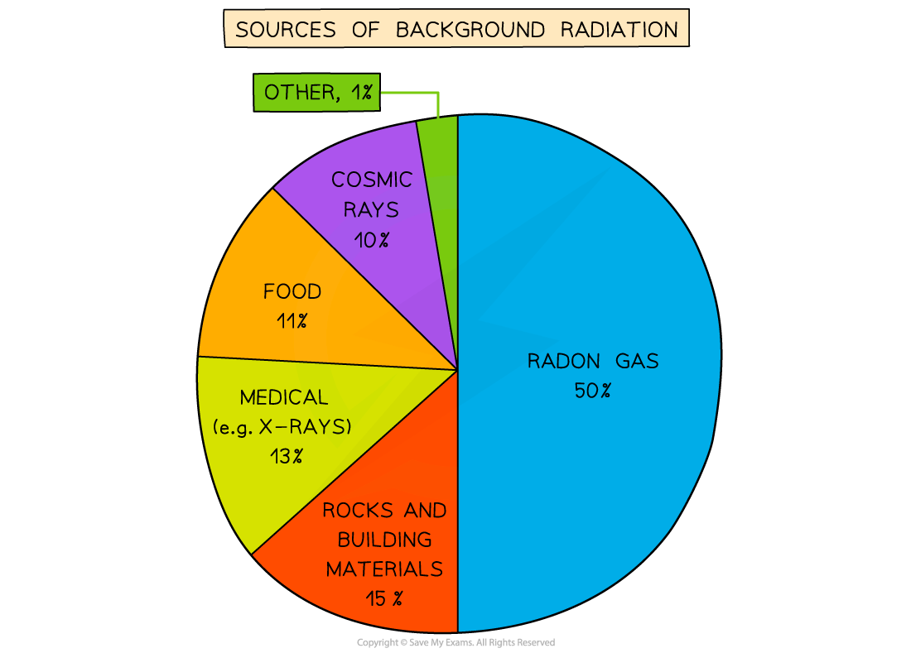
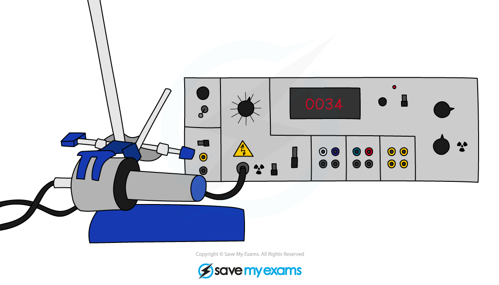

# Background Radiation

## Background radiation

> **Spec point** — `spcpt_3c9dMg5DtyS9QCTZ` · Know what is meant by background radiation

## Background radiation

- Background radiation is defined as:

**The radiation that exists around us all the time**

- There are two types of background radiation:

  - **Natural sources** from radioactive elements that have always existed on Earth and in outer space
  - **Man-made sources** from human activity that adds to the amount of radiation humans are exposed to on Earth
- The count rate of detected levels of background radiation can vary significantly from place to place

## Sources of background radiation

> **Spec point** — `spcpt_29PZ5CG8MQmz7DvD` · Know the sources that make a significant contribution to background radiation including:
   (a) radon gas (in the air)
   (b) rocks and buildings
   (c) food and drink
   (d) cosmic rays

## Sources of background radiation

- The sources that make a significant contribution to background radiation include:

  - radon gas (in the air)
  - rocks and buildings
  - food and drink
  - cosmic rays

*Background radiation is the radiation that is present all around in the environment. Radon gas is given off from some types of rock*

### Natural sources

- **Rocks and buildings**

  - Natural radioactivity can be found in building materials, including decorative rocks, stone and brick
  - Heavy radioactive elements, such as uranium and thorium, occur naturally in rocks in the ground
  - Uranium decays into radon gas

- **Radon gas (in the air)**

  - Radon gas is an alpha emitter
  - Radon gas is particularly dangerous if it is inhaled into the lungs in large quantities
  - The gas is tasteless, colourless and odourless, but it is not generally a health issue unless levels are significantly high

- **Radioactive material in food and drink**

  - Naturally occurring radioactive elements can get into food and water since they are in contact with rocks and soil containing these elements
  - Some foods contain higher amounts such as potassium-40 in bananas
  - However, the amount of radioactive material is minuscule and is not a cause for concern

- **Cosmic rays from space**

  - The sun emits an enormous number of protons every second
  - Some of these enter the Earth’s atmosphere at high speeds
  - When they collide with molecules in the air, this leads to the production of gamma radiation
  - Other sources of cosmic rays are supernovae and other high-energy cosmic events

- **Carbon-14 in biological material**

  - All organic matter contains a tiny amount of carbon-14
  - Living plants and animals constantly replace the supply of carbon in their systems hence the amount of carbon-14 in the system stays almost constant

### Man-made sources

- **Medical sources**

  - In medicine, radiation is used frequently
  - Uses include X-rays, CT scans, radioactive tracers, and radiation therapy

- **Nuclear waste**

  - While nuclear waste itself does not contribute much to background radiation, it can be dangerous for the people handling it

- **Nuclear fallout from nuclear weapons**

  - Fallout is the residue radioactive material that is thrown into the air after a nuclear explosion, such as the bomb that exploded at Hiroshima
  - While the amount of fallout in the environment is presently very low, it increases significantly in areas where nuclear weapons are tested

- **Nuclear accidents**

  - Accidents such as that in Chernobyl contributed a large dose of radiation into the environment
  - While these accidents are now extremely rare, they can be catastrophic and render areas devastated for centuries

> **Exam Hint**
> The sources that make the most significant contribution are the natural sources:
> 
> - Radon gas
> - Rocks and buildings
> - Food and drink
> - Cosmic rays
> 
> Make sure you remember these for your exam!

## Detecting radiation

> **Spec point** — `spcpt_4NpJXn5pRkN5xkXj` ·  - Know that ionising nuclear radiation can be measured using a detector connected to a counter
 - Use count rate measured in counts/s or counts/minute

## Detecting radiation

- Ionising nuclear radiation can be measured using a **detector** connected to a counter

### Count rate

- The detector uses **count rate** measured in **counts/s** or **counts/minute**

  - The count rate is the **number** of decays per second
- The count rate decreases the further the detector is from the source

  - This is because the radiation becomes more spread out the further away it is from the source

### Geiger–Müller tube detects count rate

- The Geiger-Müller tube is the most common device used to measure and detect the count rate of radiation
- Each time it absorbs radiation, it transmits an electrical pulse to a counting machine

  - This makes a clicking sound and it displays the **count rate** on a screen
- The greater the frequency of clicks, or the higher the count rate, the more radiation the Geiger-Müller tube is absorbing

  - Therefore, it matters how close the tube is to the radiation source
  - The further away from the source, the lower the count rate detected

#### Geiger–Müller tube detects count rate

*A Geiger-Müller tube (or Geiger counter) is a common type of radiation detector detecting count rate*

- Examples of other radiation detectors include:

  - **Photographic film** (often used in badges)
  - **Ionisation chambers**
  - **Scintillation counters**
  - **Spark counters**

> **Worked Example**
> A Geiger-Müller tube is used to detect radiation in a particular location. What is the count rate if it counts 16 000 decays in 1 hour?
> 
> [2]
> 
> **Answer:**
> 
> **Step 1: Identify the different variables**
> 
> - The number of decays is 16 000
> - The time is 1 hour
> 
> **Step 2: Determine the time period in seconds**
> 
> - 1 hour is equal to 60 minutes, and 1 minute is equal to 60 seconds
> 
> $\mathrm{time} \mathrm{period}=1\times60\times60=3600s$ **[1 mark]**
> 
> **Step 3: Divide the total counts by the time period in seconds**
> 
> $\mathrm{decays}=\frac{\mathrm{counts}}{\mathrm{time} \mathrm{period}}$
> 
> $\mathrm{decays}=\frac{16000}{3600}$
> 
> $\mathrm{decays}=4.5$
> 
> - Therefore, there are **4.5 decays per second** **[1 mark]**

> **Exam Hint**
> If asked to name a device for detecting radiation, the Geiger-Müller tube is a good example to give. You can also refer to it as a GM tube, a GM detector, GM counter, Geiger counter etc. (The examiners will allow some level of misspelling, providing it is readable). Don’t, however, refer to it as a ‘radiation detector’ as this is too vague and may simply restate what was asked for in the question.
> 
> It is important to regulate the exposure of humans to radiation. The amount of radiation received by a person is called the **dose.**

## Accounting for background radiation

> **Spec point** — `spcpt_SCVDtYKFr4ytPB4d` · Use measurements of background radiation to determine a corrected count rate

## Accounting for background radiation

### Extended Tier Only

- Measurements of background radiation are used to determine a **corrected count rate**
- This can be done by taking readings with **no radioactive source** present and then subtracting this from readings with the source present

> **Worked Example**
> A student is using a Geiger-counter to measure the counts per minute at different distances from a source of radiation. Their results and a graph of the results are shown here.
> 
> | Distance from source / m | Counts per minute |
> |---|---|
> | 0.2 | 180 |
> | 0.4 | 67 |
> | 0.6 | 29 |
> | 0.8 | 17 |
> | 1.0 | 15 |
> | 1.2 | 15 |
> | 1.4 | 15 |
> 
> 
> 
> Determine the background radiation count.
> 
> [1]
> 
> **Answer:**
> 
> **Step 1: Determine the point at which the source radiation stops being detected**
> 
> - The background radiation is the amount of radiation received all the time
> - When the source is moved back far enough it is all absorbed by the air before reaching the Geiger-counter
> - Results after 1 metre do not change
> - Therefore, the amount after 1 metre is only due to background radiation
> 
> **Step 2: State the background radiation count**
> 
> - The background radiation count is **15 counts per minute** **[1 mark]**
