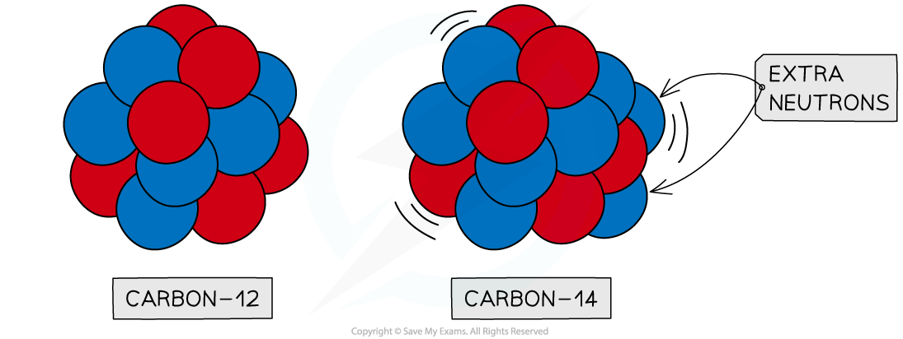
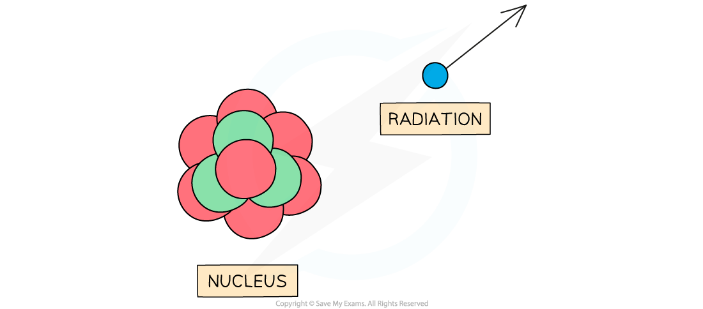
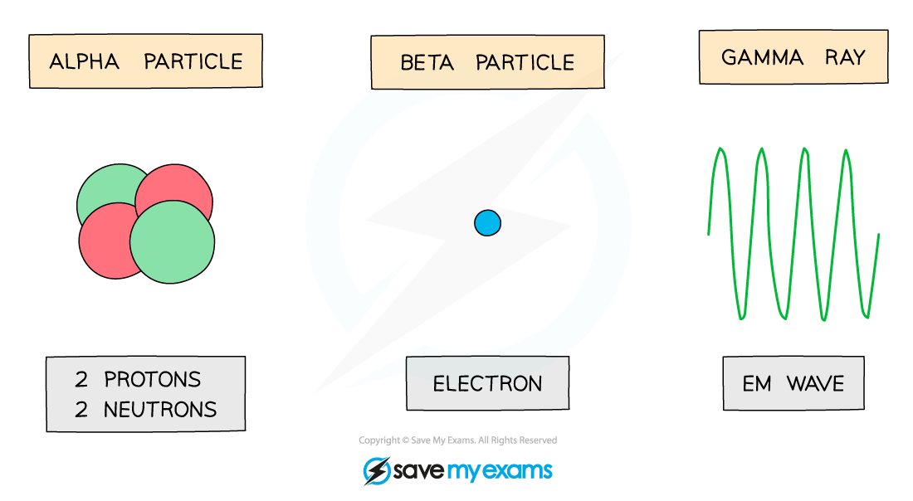
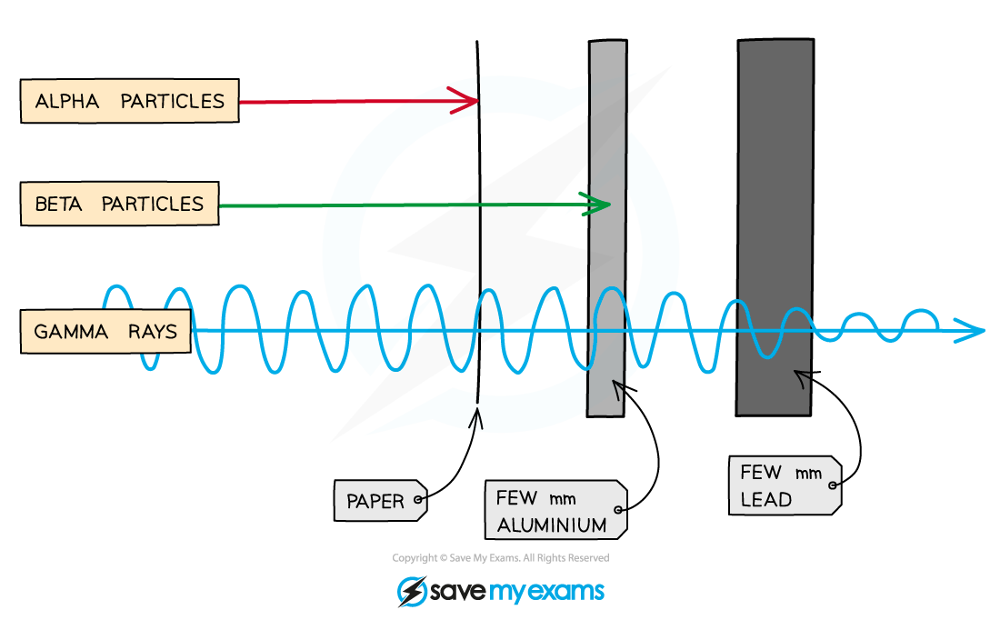

# Types of Radiation

## Radioactive decay

> **Spec point** — `spcpt_zDFznjBTPQjwY3d8` · - Describe the emission of radiation from a nucleus as spontaneous and random in direction

## Radioactive decay

- The emission of radiation from a nucleus is **spontaneous** and **random** in direction
- This random process of radioactive decay means:

  - There is an **equal probability** of any nucleus decaying
  - It cannot be known **which particular nucleus will decay next**
  - It cannot be known **at what time a particular nucleus will decay**
  - The rate of decay is **unaffected** by the surrounding conditions
  - It is only possible to estimate the **probability** of a nuclei decaying in a given time period

### Unstable nuclei

- Some atomic nuclei are **unstable**
- This is because of an imbalance in the forces within the nucleus

  - Forces exist between the particles in the nucleus
- Instability is commonly due to:

  - The nucleus having **too many** protons or neutrons
  - The nucleus being **very large**
- An example of an **unstable** nucleus is carbon-14

  - This is an ***isotope*** of carbon
  
    - It has two extra neutrons compared to stable carbon-12

#### Isotopes of carbon

*Carbon-12 is stable, whereas carbon-14 is unstable. This is because carbon-14 has two extra neutrons*

- Unstable nuclei can **emit** **radiation** to become more stable

  - Radiation can be in the form of a **high-energy** particle or wave

#### Unstable nuclei emit radiation

*Unstable nuclei decay by emitting high-energy particles or waves*

- As the radiation moves away from the nucleus, it takes some energy with it

  - This reduces the overall energy of the nucleus
  - This makes the nucleus more **stable**

> **Worked Example**
> Which of the following statements is **not** true?
> 
> **A**  Isotopes can be unstable because they have too many or too few neutrons
> 
> **B**  The process of emitting particles or waves of energy from an unstable nucleus is called radioactive decay
> 
> **C**  Scientists can predict when a nucleus will decay
> 
> **D**  Radiation refers to the particles or waves emitted from a decaying nucleus
> 
> [1]
> 
> **Answer: C**
> 
> - Consider what you know about the statements above:
> 
> | Isotopes |  |
> |---|---|
> | Radioactive decay |  |
> | Nuclei decay prediction |  |
> | Radiation |  |
> 
> - Answer A is **true** — the number of neutrons in a nucleus determines the stability
> - Answer B is **true **— this is a suitable description of radioactive decay
> - Answer D is **true** — radiation is about emissions. It is different to radioactive particles
> - Answer C is **not true**
> 
>   - Radioactive decay is a random process
>   - It is not possible to predict precisely when a particular nucleus will decay
>   - Therefore, the correct answer is **C** **[1 mark]**

> **Exam Hint**
> The terms **unstable**, **random** and **decay** have very particular meanings in this topic. Remember to use them correctly when answering questions!

## Types of radioactive decay

> **Spec point** — `spcpt_DRWc5tc699WSvz6p` · - Know that radioactive decay is a change in an unstable nucleus that can result in the emission of    
    > α-particles or 
    > β-particles and/or 
    > γ-radiation and 
    > know that these changes are spontaneous and random

## Types of radioactive decay

- Radioactive decay is a change in an unstable nucleus that can result in the emission of one of the following types of radiation:

  - **Alpha (α)** particles
  - **Beta (β****-****)** particles
  - **Gamma (γ)** radiation
- Remember that these changes are** *****spontaneous*** and **random**

### Alpha particles

- The radiation symbol for alpha is **α**
- An alpha particle is the same as a helium nucleus

  - This is because they consist of two neutrons and two protons
- Alpha particles have a charge of +2

  - This means they can be affected by an electric field

### Beta particles

- The radiation symbol for beta is **β****-**
- Beta particles are fast-moving electrons
- They are produced in nuclei when a neutron changes into a proton and an electron
- Beta particles have a charge of -1

  - This means they can be affected by an electric field

### Gamma rays

- The radiation symbol for gamma is **γ**
- Gamma rays are electromagnetic waves
- They have the highest energy of the different types of electromagnetic waves
- Gamma rays have no charge

*Alpha particles, beta particles and gamma waves can be emitted from unstable nuclei*

## Alpha, beta & gamma emission

> **Spec point** — `spcpt_WTtP5qj7SBQxgW7B` · Identify alpha (α), beta (β) and gamma (γ) emissions from the nucleus by recalling:
  (a) their nature 
  (b) their relative ionising effects 
  (c) their relative penetrating abilities 
                (β+ are not included, β-particles will be taken to refer to β–)

## Alpha, beta & gamma emission

- α, β and γ radiation can be identified by the emission from a nucleus by recalling their:

  - Nature (what type of particle or radiation they are)
  - Their relative ionising effects (how easily they ***ionise*** other atoms)
  - Their relative penetrating abilities (how far can they travel before they are stopped completely)
- The properties of alpha, beta and gamma are given in the table which shows the following trends down the table:

  - The range increases
  - Penetrating power increases
  - Ionisation decreases

| **Particle** | **Nature** | **Range in air** | **Penetrating power** | **Ionising ability** |
|---|---|---|---|---|
| Alpha (α) | Helium nucleus (2 protons, 2 neutrons) | A few cm | Low; stopped by a thin sheet of paper | High |
| Beta (β) | High-energy electron | A few 10s of cm | Moderate; stopped by a few mm of aluminium foil or Perspex | Moderate |
| Gamma (γ) | Electromagnetic wave | Infinite | High; reduced by a few cm of lead | Low |

### Penetrating power

- Alpha, beta and gamma radiation have different properties
- So they **penetrate** materials in different ways

  - This means they are each **stopped** by different materials

#### Penetrating power of alpha, beta and gamma radiation

*Alpha, beta and gamma are different in how they penetrate materials. Alpha is the least penetrating, and gamma is the most penetrating*

- Alpha is stopped by **paper**, whereas beta and gamma pass through it
- Beta is stopped by a few millimetres of aluminium

  - Gamma can pass through **aluminium**
- Gamma rays are only partially stopped by thick **lead**

> **Exam Hint**
> It is important to note that **beta particles** are only **stopped** by **aluminium** if it is a **few mm** thick. They **can** pass though aluminium which is **thinner** than this. This concept often comes up in exam questions.

> **Worked Example**
> A student has an unknown radioactive source and is trying to determine which type of radiation it emits. Using a Geiger-Muller tube, they measure the count rate when the source is placed behind different materials.
> 
> Their results are shown in the table below:
> 
> |   | **No material between source and detector** | **Paper between source and detector** | **5 mm aluminium between source and detector** | **5 mm lead between source and detector** |
> |---|---|---|---|---|
> | **Count rate** | 4320 | 4218 | 256 | 34 |
> 
> Which type of radiation is being given off by the source?
> 
> **A**  Alpha particles
> 
> **B**  Beta particles
> 
> **C**  Gamma rays
> 
> **D**  Neutrons
> 
> [1]
> 
> **Answer:**
> 
> - Consider the diagram showing penetrating power from above
> - The answer is **not A** because the radiation passed through the paper almost unchanged
> 
>   - This means it is **not** alpha
> - The answer is **not C or D** because the aluminium decreased the count rate significantly
> 
>   - This means it is **not** gamma (gamma penetrates aluminium)
>   - This also means it is **not** neutrons (neutrons penetrate aluminium, however, this does not need to known for the exam)
> - Therefore, the source must be **beta** particles and the correct answer is **B** **[1 mark]**

> **Exam Hint**
> Remembering the type of particle, penetration and ionising power for alpha, beta and gamma radiation is very important for your exam. Often the exam question will give some clues and you will have to choose which type of radiation it could be based on these.
