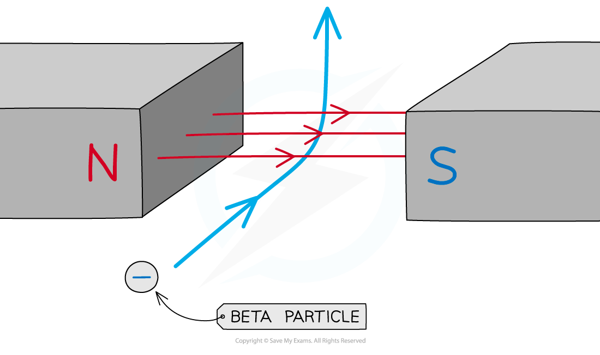

# Ionising Power & Deflection

## Ionising effect of radiation

> **Spec point** — `spcpt_J6jr2FWgVK3rtxbv` · Explain their relative ionising effects with reference to:
  (a) kinetic energy
  (b) electric charge

## Ionising effect of radiation

### Extended Tier Only

- The relative ionising effects of nuclear radiation depend upon their:

  - **kinetic energy**
  - **electric charge**

### Ionisation

- Ionisation is when an atom becomes negatively or positively charged by gaining or losing electrons
- Nuclear radiation can **ionise** the atoms that it hits

  - This is mostly done by removing an electron so the atom loses a negative charge and is left with an overall **positive** charge

#### Nuclear radiation ionising an atom

*When radiation passes close to atoms it can knock out electrons, ionising the atom*

### Effects of kinetic energy and charge on ionising power

- The **greater** the **charge** of the radiation, the **more** ionising it is

  - This means alpha radiation is the most ionising as it has a charge of +2
  - A beta particle has a charge of –1 so it is moderately ionising
  - This means gamma radiation is the least ionising as it has a charge of 0 (no charge)

- The **higher** the **kinetic** **energy** of the radiation, the **more** ionising it is

  - This means the alpha particle is still the most ionising because it has the greatest mass
  - However, a beta particle is very light (it is an electron) but travels at high speeds, therefore, it has a lot of kinetic energy and is still moderately ionising
  - Gamma radiation has virtually no mass so it is weakly ionising

> **Exam Hint**
> Remembering the properties of alpha, beta and gamma radiation helps to deduce how much ionising power they have. E.g. An alpha particle is a helium nucleus which contains two protons and two neutrons. It therefore has a charge of +2 since each proton has a charge of +1 and a neutron has no charge.
> 
> Kinetic energy is defined by the equation $\frac{1}{2}$*mv*2 therefore it depends on the mass *m* of the particle and its velocity *v*.

## Deflection in electric & magnetic fields

> **Spec point** — `spcpt_gRWBK8vrmwyJJ7cC` · Describe the deflection of α-particles, β-particles and γ-radiation in electric fields and magnetic fields

## Deflection in electric & magnetic fields

### Extended tier only

- α-particles, β-particles and γ-radiation are deflected differently in electric and magnetic fields
- A particle is deflected in an electric field if it has **charge**
- A particle is [deflected in a magnetic field](https://www.savemyexams.com/igcse/physics/cie/23/revision-notes/4-electricity-and-magnetism/4-4-electromagnetic-effects/4-4-6-force-on-a-current-carrying-conductor/?_ai=internal-linking) if it has **charge** and is **moving** perpendicular to it

  - Therefore, since gamma (γ) particles have no charge, they are **not** deflected by either electric or magnetic fields
  - Only alpha (α) and beta (β) particles are deflected

### Electric fields

- Alpha particles have a **charge of +2** (the charge of a helium nucleus)
- Beta particles have a **charge of −1** (the charge of an electron)
- Therefore, in an electric field created between negatively and positively charged plates

  - Alpha particles are deflected towards the **negative** plate
  - Beta particles are deflected towards the **positive** plate
  - Gamma radiation is not deflected and travels straight through between the plates

#### Deflection in electric fields

*Alpha and beta particles can be deflected by electric fields*

- Alpha particles are **heavier** than beta particles

  - Therefore, **beta** particles are deflected **more** in the electric field

### Magnetic fields

- Similarly, alpha and beta particles are deflected by magnetic fields whilst they are moving
- They are deflected in **opposite** directions due to their opposite charges

#### Deflection of a beta particle in a magnetic field

*Alpha and beta particles can also be deflected by magnetic fields*

> **Exam Hint**
> It is important to note that because of their opposite charges, alpha and beta particles will deflect in **opposite** directions. You need to know in which direction alpha and beta particles are deflected in an electric field and a magnetic field.
