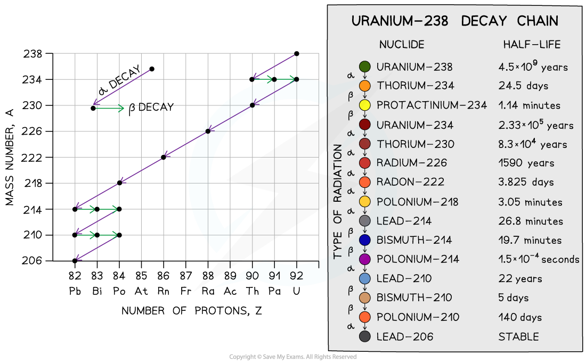
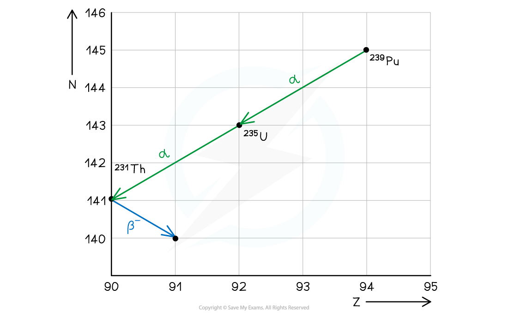

# Radioactive Decay

## Effect of nuclear size on decay

> **Spec point** — `spcpt_GGhwHkf8mCkQgVMJ` · Know that isotopes of an element may be radioactive due to an excess of neutrons in the nucleus and/or the nucleus being too heavy

## Effect of nuclear size on decay

### Extended Tier Only

- ***Isotopes*** of an element may be **radioactive** due to an **excess of neutrons** in the nucleus and/or the nucleus being too **heavy**

### Excess of protons or neutrons

- The most **stable** nuclei have roughly the **same number** of protons as neutrons, especially among light elements
- In **heavier** nuclei, stability requires more **neutrons** than protons because neutrons help reduce the **electrostatic repulsion** between positively charged protons by contributing to the strong nuclear force
- If a **nucleus** has too many or too few **neutrons **relative to **protons**, it becomes unstable and may decay into a more stable nucleus by releasing **radiation**
- An example of this is the isotope of hydrogen-1

  - H-1 is the stable nucleus of hydrogen with 0 neutrons and 1 proton
  - H-2 (deuterium) has one more neutron in the nucleus
  - H-3 (tritium) has 2 neutrons to 1 proton. This is much more unstable than H-1 or H-2

| Isotope | Atomic Structure | Nuclide Notation |
|---|---|---|
| Hydrogen-1 | 0 neutrons  1 electron  1 proton | `H _ 1 ^ 1` |
| Hydrogen-2 | 1 neutron  1 electron  1 proton | `H _ 1 ^ 2` |
| Hydrogen-3 | 2 neutrons  1 electron  1 proton | `H _ 1 ^ 3` |

### Heavy nucleus

- If a nucleus is too **heavy**, this means it has too many protons and neutrons

  - The forces keeping the protons and neutrons together in the nucleus will be **weaker**
- An example of this is uranium-238

  - It has a nucleus with 238 protons and neutrons
- During nuclear decay, the **mass number** of the element which it decays into is gradually **reduced**

  - This is done through alpha (α) or beta (β) decay

#### Uranium-238 decay chain

*The graph shows the decay chain of uranium-238 through alpha and beta emission*

> **Exam Hint**
> The notation of C-12 for example, means the element 'carbon' with the **mass** (or nucleon) number of 12.

## Change to a new element

> **Spec point** — `spcpt_wZtRZsQkWxWJKHDd` · State that during α-decay or β-decay, the nucleus changes to that of a different element

## Change to a new element

- A nucleus changes to a **different element**, during α-decay or β-decay

  - The initial nucleus is often called the **parent nucleus**
  - The nucleus of the new element produced is often called the **daughter** nucleus
- The daughter nucleus is a new element because it has a **different** proton and/or nucleon number than the original parent nucleus
- This can be seen on a graph of N (neutron number) against Z (proton number)

  - For example; when Pu-239 decays by alpha to U-235, it loses 2 protons and 2 neutrons
  - U (uranium) is a completely different element from Pu (plutonium)

*Graph of N against Z for the decay of Pu–239*

## Reducing neutron number

> **Spec point** — `spcpt_W4sszptGkRKhSsDR` · Describe the effect of α-decay, β-decay and γ-emissions on the nucleus, including an increase in stability and a reduction in the number of excess neutrons; 

the following change in the nucleus occurs during β-emission: neutron → proton + electron

## Reducing neutron number

### Extended Tier Only

- α and β-decay affect the nucleus by

  - **increasing** its **stability**
  - **reducing** the number of **excess neutrons**

### Alpha decay

- During alpha decay an alpha particle is emitted from an unstable nucleus
- A completely **new element** is formed in the process

*Alpha decay usually happens in large unstable nuclei, causing the overall mass and charge of the nucleus to decrease*

- An alpha particle is a **helium nucleus**

  - It is made of 2 protons and 2 neutrons

- When the alpha particle is emitted from the unstable nucleus, the mass number and atomic number of the nucleus changes

  - The mass number **decreases** by 4
  - The atomic number **decreases** by 2

- The charge on the nucleus also decreases by 2

  - This is because protons have a charge of +1 each

### Beta decay

- During **beta** decay, a **neutron** changes into a **proton** and an **electron**

  - The electron is **emitted** and the proton **remains** in the nucleus

- A completely new element is formed because the **atomic number** changes

*Beta decay often happens in unstable nuclei that have too many neutrons. The mass number stays the same, but the atomic number increases by one*

- A beta particle is a high-speed **electron**
- It has a mass number of 0

  - This is because the electron has a negligible mass, compared to neutrons and protons

- Therefore, the **mass number** of the decaying nucleus **remains the same**
- Electrons have an atomic number of -1

  - This means that the new nuclei will **increase their atomic number by 1** so atomic number is conserved before and after the decay

### Gamma decay

- During gamma decay, a gamma ray is emitted from an unstable nucleus

  - This process makes the nucleus less energetic but does not change its structure because gamma radiation has no mass or charge

*Gamma decay does not affect the mass number or the atomic number of the radioactive nucleus, but it does reduce the energy of the nucleus*

> **Exam Hint**
> There is a second form of beta decay during which a proton changes into a neutron. This is called beta-plus decay - you might come across it while revising, but you don't need to know about it for your exam. Only use the information here for your IGCSE. 
> 
> It is easy to forget that an alpha particle **is** a helium nucleus, or that a beta particle is an electron. Look out for either wording.

## Decay equations

> **Spec point** — `spcpt_wxxgCwhsgyCCNs3J` · Use decay equations, using nuclide notation, to show the emission of α-particles, β-particles and γ-radiation

## Decay equations

### Extended Tier Only

- Decay equations, use **nuclide notation**, to show the emission of α-particles, β-particles and γ-radiation
- A decay equation is similar to a chemical reaction equation

  - The particles present before the decay are shown **before** the arrow
  - The particles produced in the decay are shown **after** the arrow

- During decay equations, the sum of the mass and atomic numbers **before** the reaction must be the same as the sum of the mass and atomic numbers **after** the reaction

### Alpha decay equation

- All alpha decay equations have the following form for isotopes X and Y:

`X _ Z ^ A -> Y _ Z - 2 ^ A - 4 + alpha _ 2 ^ 4`

- The following decay equation shows polonium-212 undergoing alpha decay $Po_{84}^{212} \rightarrow Pb_{82}^{208} + \ \\alpha pre_{2} pre^{4}$

  - It forms lead-208 and an alpha particle
  - An alpha particle can also be written as a helium (He) nucleus

### Beta decay equation

- All beta decay equations have the following form for isotopes X and Y:

`X _ Z ^ A -> Y _ Z + 1 ^ A + beta _ - 1 ^ 0`

### Gamma decay equation

- All gamma decay equations have the following form for isotope X

$\mathrm{X} pre_{Z} pre^{A} \rightarrow \mathrm{X} pre_{Z} pre^{A} + \ \\gamma pre_{0} pre^{0}$

> **Worked Example**
> A nucleus with 84 protons and 126 neutrons undergoes alpha decay. It forms lead, which has the element symbol Pb.
> 
> **A  **`Pb presubscript 82 presuperscript 206`
> 
> **B  **`Pb presubscript 82 presuperscript 208`
> 
> **C  **`Pb presubscript 84 presuperscript 210`
> 
> **D  **`Pb presubscript 86 presuperscript 214`
> 
> Which isotope of lead pictured is the correct one formed during the decay?
> 
> [1]
> 
> **Answer:**
> 
> **Step 1: Calculate the mass number of the original nucleus**
> 
> - The mass number is equal to the number of protons plus the number of neutrons
> - The original nucleus has 84 protons and 126 neutrons
> 
> $84+126=210$
> 
> - The mass number of the original nucleus is 210
> 
> **Step 2: Calculate the new atomic number**
> 
> - The alpha particle emitted is made of two protons and two neutrons
> - Protons have an atomic number of 1, and neutrons have an atomic number of 0
> - Removing two protons and two neutrons will reduce the atomic number by 2
> 
> $84--2=82$
> 
> - The new nucleus has an atomic number of **82**
> 
> **Step 3: Calculate the new mass number**
> 
> - Protons and neutrons both have a mass number of 1
> - Removing two protons and two neutrons will reduce the mass number by 4
> 
> $210--4=206$
> 
> - The new nucleus has a mass number of **206**
> - Therefore, the correct answer is **A** **[1 mark]**

> **Worked Example**
> A nucleus with 11 protons and 13 neutrons undergoes beta decay. It forms magnesium, which has the element symbol Mg.
> 
> **A  **`Mg presubscript 9 presuperscript 20`
> 
> **B  **`Mg presubscript 10 presuperscript 24`
> 
> **C  **`Mg presubscript 11 presuperscript 23`
> 
> **D  **`Mg presubscript 12 presuperscript 24`
> 
> Which is the correct isotope of magnesium formed during the decay?
> 
> [1]
> 
> **Answer:**
> 
> **Step 1: Calculate the mass number of the original nucleus**
> 
> - The mass number is equal to the number of protons plus the number of neutrons
> - The original nucleus has 11 protons and 13 neutrons
> 
> $11+13=24$
> 
> - The mass number of the original nucleus is 24
> 
> **Step 2: Calculate the new atomic number**
> 
> - During beta decay a neutron changes into a proton and an electron
> - The electron is emitted as a beta particle
> - The neutron has an atomic number of 0 and the proton has an atomic number of 1
> - So the atomic number increases by 1
> 
> $11+1=12$
> 
> - The new nucleus has an atomic number of 12
> 
> **Step 3: Calculate the new mass number**
> 
> - Protons and neutrons both have a mass number of 1
> - Changing a neutron to a proton will not affect the mass number
> - The new nucleus has a mass number of 24 (the same as before)
> - Therefore, the correct answer is **D** **[1 mark]**

> **Exam Hint**
> You are not expected to know the names of the elements produced during radioactive decays, but you do need to be able to calculate the mass and atomic numbers by making sure they are balanced on either side of the reaction.

## Beta emission video

> **Spec point** — `spcpt_CwcQdTBmCmc6SSH6` · nan

##
