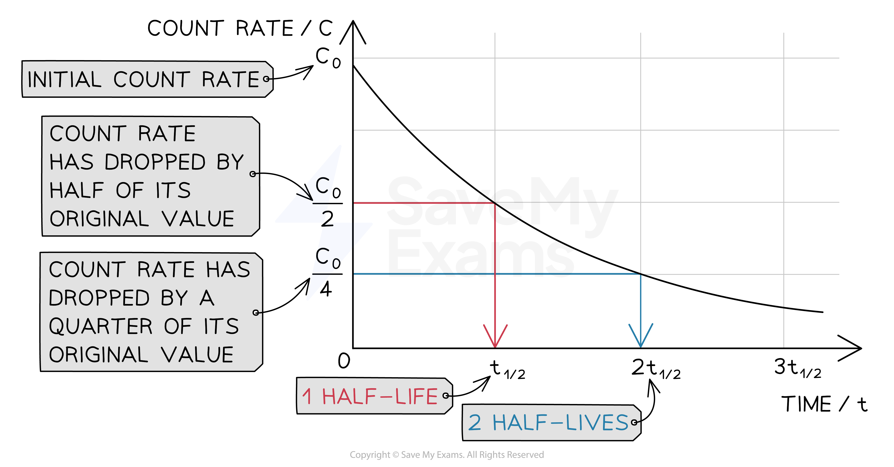
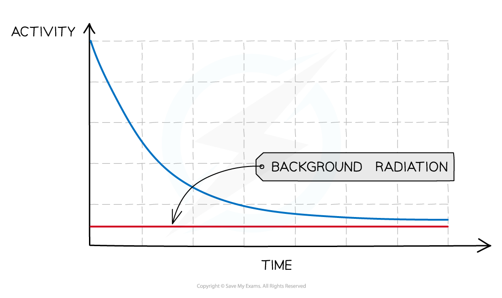

# Half-Life

## Half-life basics

> **Spec point** — `spcpt_sVscG4pJMD8BPNZC` · Define the half-life of a particular isotope as the time taken for half the nuclei of that isotope in any sample to decay; recall and use this definition in simple calculations, which might involve information in tables or decay curves (calculations will not include background radiation)

## Half-life basics

- The **half-life** of a particular **isotope** is defined as:

**The time taken for half the nuclei of that isotope in any sample to decay**

- The **rate** at which the activity of a sample decreases is measured in terms of **half-life**

  - This is the time it takes for the activity of a sample to fall to half its original level

- This is the time it takes for the activity of the sample to decrease from 100 % to 50 %

  - It is the same length of time as it would take to decrease from 50 % activity to 25 % activity

- Different isotopes have different half-lives and half-lives can vary from a fraction of a second to billions of years in length

  - The half-life is **constant** for a particular isotope

### Representing half-life

- Half-life can be determined from an activity–time graph

#### A half-life graph

*The graph shows how the activity of a radioactive sample changes over time. Each time the original activity halves, another half-life has passed*

- Half-life can also be represented on a table

  - As the number of the half-life increases, the proportion of the isotope remaining **halves**

#### Table showing the number of half-lives to the proportion of isotope remaining

| **Number of half-lives** | **Proportion of isotope remaining** |
|---|---|
| 0 | 1 |
| 1 | $\frac{1}{2}$ |
| 2 | $\frac{1}{4}$ |
| 3 | $\frac{1}{8}$ |
| 4 | $\frac{1}{16}$ |
| ... | ... |

> **Worked Example**
> An isotope of protactinium-234 has a half-life of 1.17 minutes.
> 
> Calculate the amount of time it takes for a sample to decay from a mass of 10 mg to 2.5 mg.
> 
> [2]
> 
> **Answer:**
> 
> **Step 1: Calculate the fraction of the sample remaining**
> 
> - Initial mass of sample = 10 mg
> - Final mass of sample = 2.5 mg
> 
> $\frac{2.5}{10}=\frac{1}{4}$
> 
> - The fraction of the sample remaining is $\frac{1}{4}$
> 
> **Step 2: Calculate the number of half-lives that have passed**
> 
> - Using the table above, we can see that **two** half-lives have passed **[1 mark]**
> 
> **Step 3: Calculate the time for the sample to decay**
> 
> - Two half lives have passed
> - So the time for the sample to decay is twice the half-life
> 
> $2\times1.17=2.34\text{minutes}$
> 
> - The time for the sample to decay to a mass of 2.5 mg is **2.34 minutes** **[1 mark]**

## Half-life graphs

> **Spec point** — `spcpt_rwJc3Vw8bYWt5gdR` · Calculate half-life from data or decay curves from which background radiation has not been subtracted

## Half-life graphs

### Extended Tier Only

- The half-life of an isotope should be calculated by **removing** the [background radiation](https://www.savemyexams.com/igcse/physics/cie/23/revision-notes/5-nuclear-physics/5-2-radioactivity/5-2-1-background-radiation/?_ai=internal-linking) from data or decay curves
- To calculate the half-life of a sample from a graph:

  - Check the original activity or count rate (where the line crosses the y-axis), C*0*
  - Halve this value and look for this activity
  - Go across from the halved value (on the y-axis) to the best-fit curve, and then straight down to the x-axis
  - The point where you reach the x-axis should be the half-life

*To find the time for the half-life, find half of the activity first*

- To **remove background radiation** from the decay curve:

  - Start by measuring the background radiation (with no sources present) – this is called the **background count**
  - Then carry out the experiment
  - Subtract the background count from each reading, to provide a **corrected count**
  - The corrected count is your best estimate of the radiation emitted from the source and should be used to measure its half-life

*When measuring radioactive emissions, some of the detected radiation will be background*

> **Worked Example**
> The radioisotope technetium is used extensively in medicine. The graph below shows how the activity of a sample varies with time.
> 
> 
> 
> Determine the half-life of this material.
> 
> [2]
> 
> **Answer:**
> 
> **Step 1: Draw lines on the graph to determine the time it takes for technetium to drop to half of its original activity**
> 
> 
> 
> **[1 mark]**
> 
> **Step 2: Read values off the graph**
> 
> - Activity dropped by half of its original value after 6 hours
> - Therefore, the half-life of this material is 6 hours **[1 mark]**

> **Worked Example**
> A particular radioactive sample contains 2 million un-decayed atoms. After a year, there are only 500 000 atoms left un-decayed. What is the half-life of this material?
> 
> [2]
> 
> **Answer:**
> 
> **Step 1: Calculate how many times the number of un-decayed atoms has halved**
> 
> - There were 2 000 000 atoms to start with
> - **1 000 000** atoms would remain after **1 half-life**
> - **500 000** atoms would remain after **2 half-lives**
> - Therefore, the sample has undergone 2 half-lives **[1 mark]**
> 
> **Step 2: Divide the time period by the number of half-lives**
> 
> - The time period is a year
> - The number of half-lives is 2
> 
> `2 space 000 space 000 rightwards arrow from text 6 months end text to text 1 half life end text of 1 space 000 space 000 rightwards arrow from text 1 year end text to text 2 half lives end text of 500 space 000`
> 
> - So two half-lives is 1 year, and one half-life is 6 months
> - Therefore, the half-life of the sample is **6 months** **[1 mark]**

> **Exam Hint**
> When looking for the corresponding time for the activity, it is good practice to draw a line on the graph with your ruler, as in the mark scheme of the worked example. This ensures you're reading the most accurate value possible.
