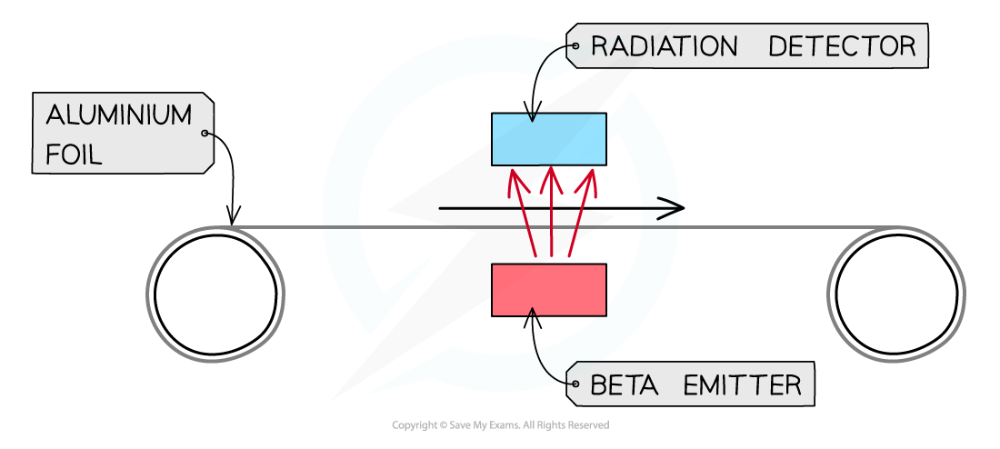

# Uses of Radiation

## Uses of radiation

> **Spec point** — `spcpt_DGTsNVzMB2rDxbnS` · Explain how the type of radiation emitted and the half-life of an isotope determine which isotope is used for applications including:
   (a) household fire (smoke) alarms
   (b) irradiating food to kill bacteria
   (c) sterilisation of equipment using gamma rays
   (d) measuring and controlling thicknesses of materials with the choice of radiations used linked to penetration and absorption 
   (e) diagnosis and treatment of cancer using gamma rays

## Uses of radiation

### Extended Tier Only

- The **type of radiation** emitted and the [half-life](https://www.savemyexams.com/igcse/physics/cie/23/revision-notes/5-nuclear-physics/5-2-radioactivity/5-2-5-half-life/?_ai=internal-linking) of an isotope determine which isotope is used for the following applications:

  - household fire (smoke) alarms
  - irradiating food to kill bacteria
  - sterilisation of equipment using gamma rays
  - measuring and controlling thicknesses of materials with the choice of radiations used linked to penetration and absorption
  - diagnosis and treatment of cancer using gamma rays

### Household fire alarms are a use of alpha radiation

- Alpha particles are used in smoke detectors
- The alpha radiation **ionises** the air within the detector, creating a current
- The alpha emitter is blocked when smoke enters the detector
- The alarm is triggered by a microchip when the sensor no longer detects the alpha particles
- An isotope of alpha radiation with a long half-life is used for smoke detectors so they don't need replacing often

#### Uses of alpha radiation: household fire alarms

*In the diagram at the bottom, alpha particles are stopped by the smoke, preventing the flow of current and triggering the alarm*

### Sterilisation of equipment using gamma rays

- Gamma radiation is widely used to **sterilise** medical equipment
- Gamma is most suited to this because:

  - It is the most **penetrating** out of all the types of radiation
  - It is penetrating enough to irradiate **all sides** of the instruments
  - Instruments can be sterilised without removing the **packaging**

- The source of gamma radiation used for sterilisation has a half-life of around **5 years**

  - This means the **sterilisation equipment** does not need to be replaced often

### Irradiating food to kill bacteria using gamma rays

- Food can be irradiated to** kill any microorganisms** that are present on it
- This makes the food last longer and reduces the risk of food-borne infections

#### Uses of gamma radiation: killing bacteria

*Food that has been irradiated carries this symbol, called the Radura. Different countries allow different foods to be irradiated*

### Measuring the thickness of materials using different radiation

- Beta radiation is most commonly used to measure the thickness of materials because it will be **partially absorbed** by most materials

  - **Beta** particles are used for thinner materials because they have a lower penetrating power and are absorbed by a thin sheet of aluminium
  - **Gamma** radiation can be used for very thick materials because they have a higher penetrating power and are mostly absorbed by thick pieces of lead

- A material moves across a **radiation** source

  - The particles that penetrate it are monitored using a detector above
- The thickness of the material is monitored

  - If the material gets **thicker, more** particles will be absorbed by the material, meaning that **less** will get through and be detected by the detector
  - If the material gets **thinner** the **opposite** happens
- The machine makes **adjustments** to keep the thickness of the material **constant**
- Radiation used to measure the thickness of materials has a half-life of **many years** (10-20 years) so that the count rate remains relatively **constant** each day

#### Uses of radiation: monitoring material thickness

*Beta particles can be used to measure the thickness of thin materials such as paper, cardboard or aluminium foil*

> **Exam Hint**
> Students often get confused about whether **beta particles** can pass though **aluminium foil**. Beta particles **can be stopped** by aluminium foil if it is thick enough (**a few mm** thick); if the foil is thin enough, they can pass through. This is the basis of using beta radiation to measure the thickness of aluminium foil (a common exam question!). The thicker the foil, the fewer beta particles pass through and are measured by a detector on the other side of the foil.

### Diagnosis and treatment of cancer using gamma rays

- **Radiotherapy** is the name given to the treatment of cancer using radiation

  - Chemotherapy is treatment using chemicals
- Radiation can kill living cells

  - Some cells, such as bacteria and cancer cells, are more susceptible to radiation than others
- Beams of gamma rays are directed at the cancerous tumour

  - Gamma rays are used because they can **penetrate the body**, reaching the tumour
  - The beams are moved around to minimise harm to healthy tissue whilst still being aimed at the tumour

- Gamma radiation used in radiotherapy has a half-life of around **five years**

  - This means that it does not need to be replaced often within the machine that uses it

#### Uses of gamma radiation: treatment of cancer

*Radiation therapy to remove a tumour*

- A **tracer** is a radioactive isotope that can be used to track the movement of substances, like blood, around the body

  - A PET scan can detect the emissions from a tracer to diagnose cancer and determine the location of a tumour

- The half-life of a tracer is **several hours**

  - This provides time for a **scan** to be conducted and then the radiation to **leave the body** quickly

> **Worked Example**
> Use the diagram to explain why alpha radiation is used in smoke detectors, and beta or gamma radiation is not.
> 
> 
> 
> [4]
> 
> **Answer:**
> 
> - Consider the different properties of alpha, beta and gamma:
> 
>   - **Alpha** is the most **weakly** penetrating and **strongest** ioniser **[1 mark]**
>   - **Beta** and **gamma** have **stronger** penetrating power and **weaker** ionising power **[1 mark]**
> 
> - If beta or gamma radiation were used in this situation then they would pass straight through the smoke and the alarm would not go off **[1 mark]**
> - Therefore, since alpha is **absorbed** by smoke, and beta and gamma are not, this makes it **most suitable** for use in a smoke detector **[1 mark]**

> **Exam Hint**
> If you are presented with an unfamiliar situation in your exam don’t panic! Just apply your understanding of the properties of alpha, beta and gamma radiation. Mainly think about the range (how far it can travel) and ionising power of the radiation to help understand which radiation is used in which situation.
