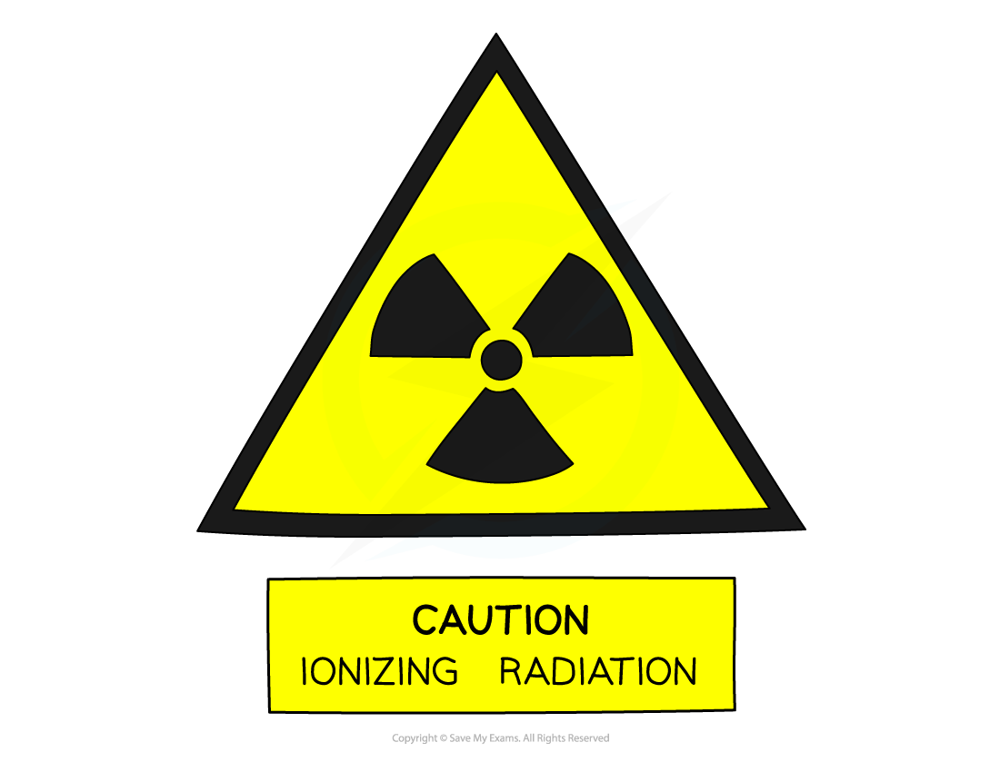
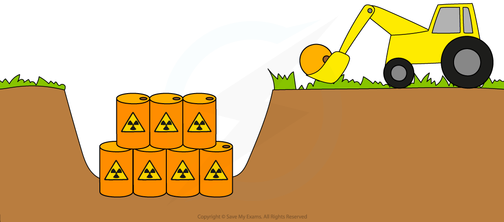

# Dangers of Radiation

## Dangers of radioactivity

> **Spec point** — `spcpt_6NKQTwcSRQHhMVqf` · State the effects of ionising nuclear radiations on living things, including cell death, mutations and cancer

## Dangers of radioactivity

- Ionising nuclear radiation can **damage living things** such as human cells and tissues at high doses:
- This can include:

  - Cell death
  - Mutations
  - Cancer

- If the atoms that make up a DNA strand are **ionised,** then the DNA strand can be **damaged**
- If the DNA is damaged, then the cell may die, or the DNA may be **mutated** when it is replicated
- If a mutated cell replicates itself then a **tumour** may develop

  - This is an example of **cancer**, which is a significant danger of radiation exposure

*Diagram showing the damage caused to DNA by ionising radiation. Sometimes the cell is able to repair the DNA during replication successfully, but incorrect repairs can cause a mutation*

- Acute radiation exposure can have other serious symptoms:

  - It can cause skin **burns**, similar to severe sunburn
  - Radiation can **reduce** the amount of **white blood cells** in the body, making a person more susceptible to infections by lowering their immune system

- Because of this, it is very important to handle radioactive sources carefully

## Safe storage

> **Spec point** — `spcpt_vNP79QQky2MbBW7w` · Describe how radioactive materials are moved, used and stored in a safe way

## Safe storage

- Radioactive materials are moved, used and stored in a safe way

### Safe handling to minimise the dangers of radioactivity

- The risks associated with handling radioactive sources can be minimised by following a few simple procedures:

  - Store the sources in **lead-lined boxes** and keep them at a distance from people
  - Sources should be handled for as **little** time as possible and returned to their boxes immediately after use
  - During use, keep every person as **far** from the sources as possible
  - When handling the sources do so at **arm’s length**, using a pair of tongs

#### A sign indicating the dangers of radioactivity

*Radioactivity warning sign*

### Safe transportation to minimise the dangers of radioactivity

- Radioactive materials such as used nuclear fuel are transported in special containers called casks
- These casks can withstand extreme conditions such as fire, cold and being submerged in water

### Disposing of radioactive waste to minimise the dangers of radioactivity

- If an isotope has a [long half-life](https://www.savemyexams.com/igcse/physics/cie/23/revision-notes/5-nuclear-physics/5-2-radioactivity/5-2-5-half-life/?_ai=internal-linking) then a sample of it will decay slowly

  - Although it may not emit a lot of radiation, it will **remain radioactive for a very long time**

- Sources with long half-life values present a risk of **contamination** for a much longer time
- Radioactive waste with a long half-life is **buried** underground to prevent it from being released into the environment

#### Correct disposal of radioactive waste reduces the dangers of radioactivity

*Radioactive waste with long half-lives is buried deep underground*

> **Worked Example**
> A student plans to use a gamma source to conduct an experiment. List four things that the student should do in order to minimise the risk to themselves when using the source.
> 
> [4]
> 
> **Answer:**
> 
> **Any four from:**
> 
> - Keep the source in a lead-lined container until the time it is needed
> - Use tongs to move the source, rather than handling it directly
> - The source should be kept at as far a distance from the student as possible during the experiment
> - The time that the source is being used should be minimised
> - After the experiment, the student should wash their hands
> - The date and the time that the radiation has been used should be recorded
> 
> **[4 marks]**

## Safety precautions

> **Spec point** — `spcpt_rQHCBsYpVtJ3gJ53` · Explain safety precautions for all ionising radiation in terms of reducing exposure time, increasing distance between source and living tissue and using shielding to absorb radiation

## Safety precautions

### Extended Tier Only

- Safety precautions for all ionising radiation include:

  - reducing **exposure time**
  - increasing the **distance** between the source and living tissue
  - using **shielding** to absorb radiation

### Reducing exposure time reduces the dangers of radioactivity

- Limiting the amount of time spent near a radioactive source reduces the amount of radiation dose received
- The amount of radiation received by a person is called the dose and is measured in **sieverts** (Sv)
- One sievert is a very big dose of radiation

  - It would cause acute **radiation poisoning**

### Increasing the distance reduces the dangers of radioactivity

- **Increasing** the **distance** the radiation is away greatly **reduces** the size of the **dose** received

  - Using tongs instead of your hand when handling a radioactive source can help with this
- Constructing nuclear power plants in **remote areas** increases their distance from people if there is a problem
- Burying nuclear waste far from places where people live also increases **the distance **to people

### Shielding reduces the dangers of radioactivity

- Radiation shielding is a **barrier** placed between a radiation source and a person or area to protect them

  - The purpose of shielding is to **limit exposure** to radiation at a certain location or time
- Barriers** absorb the energy** from radioactive sources
- Barriers are normally made of lead, water or concrete

  - People handling radioactive sources should wear a **lead apron** to reduce their exposure
- When X-rays are taken:

  - the area around where the image is needed is shielded
  - the radiologist stands behind a barrier or leaves the room

#### Reducing the dangers of radiation for a radiologist

*A radiologist can stand behind a lead barrier to reduce the amount of radiation they are exposed to*
