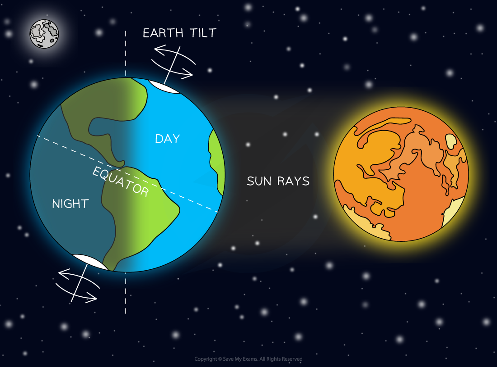
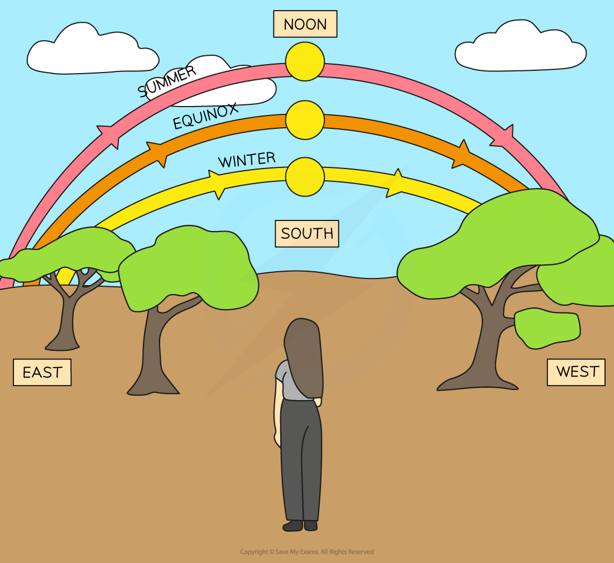
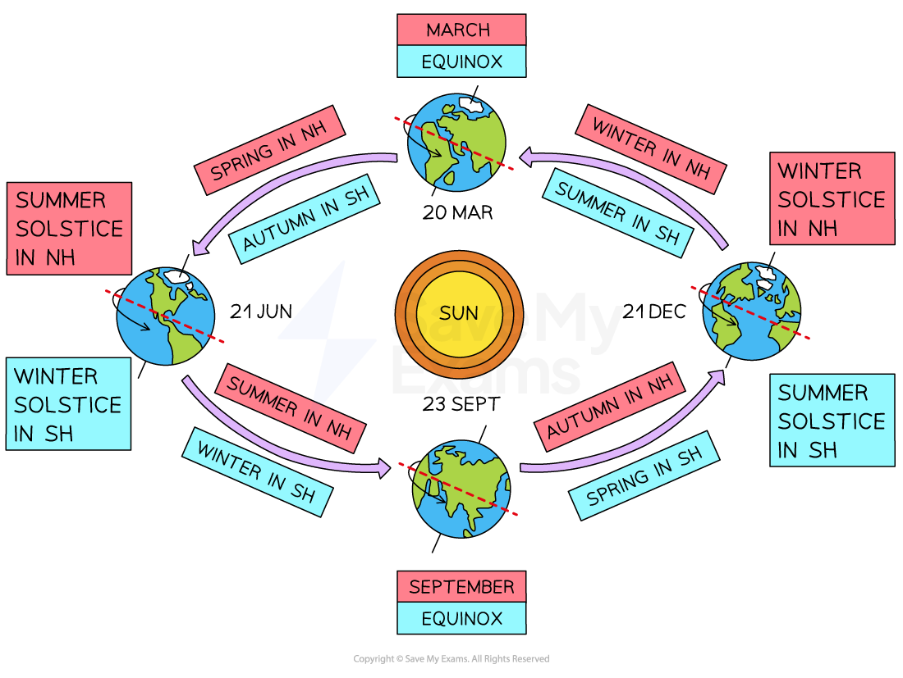

# The Earth, Moon & Sun

## Sun & Earth

> **Spec point** — `spcpt_VK4PVHgZ5QCQkKQN` · Know that the Earth is a planet that rotates on its axis, which is tilted, once in approximately 24 hours, and use this to explain observations of the apparent daily motion of the Sun and the periodic cycle of day and night
Know that the Earth orbits the Sun once in approximately 365 days and use this to explain the periodic nature of the seasons 

## Sun & Earth

- The Earth is a **planet** that

  - rotates on its axis once every **24 hours**
  - orbits around the Sun once every **365 days**

- The Earth's** axis** is:

  - a line that passes through the North and South poles
  - tilted at an angle of approximately **23.5°** from the vertical

- The daily rotation of the Earth on its axis causes

  - the periodic cycle of **day **and **night**
  - the apparent daily **rising** and **setting** of the Sun

### Day and night

- Day and night are caused by the Earth's **rotation** on its axis
- One full rotation takes approximately 24 hours, which means

  - the half of the Earth's surface facing the Sun experiences **day**
  - the other half of the Earth's surface, facing away from the Sun, experiences **night**

#### Day and night on Earth

*Day and night are caused by the rotation of the Earth on its axis once every 24 hours*

### The rising and setting of the Sun

- The apparent daily motion of the Sun is also caused by the Earth's** rotation** on its axis
- Each day, the Sun appears

  - to rise from the **east**
  - to set in the **west**
  - to reach its highest point above the horizon at **noon **(12 pm)

- The length of a day is

  - the number of hours a location receives sunlight, i.e. from the time the Sun **rises **to the time it **sets**
  - the **same** (about 12 hours) in locations near to the equator
  - **variable **in locations north and south of the equator

#### Apparent motion of the Sun

*The Sun rises in the east and sets in the west. Its apparent motion across the sky changes throughout the year*

- During **equinoxes **in both hemispheres:

  - day and night are approximately equal in length
  - the Sun appears to rise exactly in the east and set exactly in the west

- During the **summer**, the Sun appears:

  - to rise in the northeast and set in the northwest (in the **northern** hemisphere)
  - to rise in the southeast and set in the southwest (in the **southern **hemisphere)
  - to move higher above the horizon
  - to reach its greatest height above the horizon on the **summer solstice**, the day when daylight hours are the **longest**

- During the **winter**, the Sun appears:

  - to rise in the southeast and set in the southwest (in the **northern **hemisphere)
  - to rise in the northeast and set in the northwest (in the **southern **hemisphere)
  - to move closer to the horizon
  - to reach its lowest height above the horizon on the **winter solstice**, the day when daylight hours are the **shortest**

### The seasons

- Throughout the year, most locations on Earth experience **four **seasons; summer, autumn, winter and spring
- These seasons are caused by

  - the Earth's **orbit **around the Sun
  - the Earth's** tilted axis**

- The Earth's axis of rotation stays tilted at 23.5° throughout its orbit around the Sun, which means

  - one hemisphere tilts **towards **the Sun and receives **more** solar radiation
  - the other hemisphere tilts **away **from the Sun and receives **less **solar radiation
  - six months later, the hemispheres tilt in the **opposite **direction

#### Seasons on Earth

*Seasons are caused by the tilt of the Earth and the orbital motion around the Sun. When it is summer in the northern hemisphere (NH), it is winter in the southern hemisphere (SH)*

- When it is **summer **in the northern hemisphere

  - the northern hemisphere is tilted **towards **the Sun
  - the northern hemisphere receives a **greater** proportion of solar radiation
  - the southern hemisphere experiences **winter**

- When it is **winter **in the northern hemisphere

  - the northern hemisphere is tilted **away **from the Sun
  - the northern hemisphere receives a **smaller **proportion of solar radiation
  - the southern hemisphere experiences **summer**

- When it is **spring **or **autumn**, both hemispheres receive about the **same **amount of solar radiation

#### The effect of the Earth's tilt on solar radiation

***The amount of solar radiation received by the northern hemisphere in winter is less than the amount of solar radiation received by the southern hemisphere in summer***

- The variation in daylight hours throughout the year in the northern and southern hemispheres is shown below:

#### Seasons, equinoxes and solstices

| **When** | **Northern Hemisphere** | **Daylight hours** | **Southern Hemisphere** | **Daylight hours** |
|---|---|---|---|---|
| 20 Mar | (spring) equinox | **equal **hours of day and night | (autumn) equinox | **equal** hours of day and night |
| Mar, Apr, May | spring | days are **longer **than nights hours of daylight **increase** | autumn | days are **shorter** than nights hours of daylight **decrease** |
| 21 Jun | (summer) solstice | **longest **hours of daylight | (winter) solstice | **shortest** hours of daylight |
| Jun, Jul, Aug | summer | days are **longer **than nights hours of daylight **decrease** | winter | days are **shorter** than nights hours of daylight **increase** |
| 23 Sept | (autumn) equinox | **equal **hours of day and night | (spring) equinox | **equal** hours of day and night |
| Sept, Oct, Nov | autumn | days are **shorter **than nights hours of daylight **decrease** | spring | days are **longer** than nights hours of daylight **increase** |
| 21 Dec | (winter) solstice | **shortest **hours of daylight | (summer) solstice | **longest** hours of daylight |
| Dec, Jan, Feb | winter | days are **shorter** than nights hours of daylight **increase** | summer | days are **longer** than nights hours of daylight **decrease** |

> **Exam Hint**
> It is a common misconception that summer is warm because the Sun is closer to Earth and that winter is cold because the Sun is further away - this is not correct! The Earth does have a slightly elliptical orbit around the Sun, but this does not cause a significant temperature variation.
> 
> Remember that seasons are caused by the Earth's **tilted axis** of rotation and its **yearly revolution** around the Sun.

## Moon & Earth

> **Spec point** — `spcpt_gSSSsxBDz642BSsR` · Know that it takes approximately one month for the Moon to orbit the Earth and use this to explain the periodic nature of the Moon’s cycle of phases

## Moon & Earth

- The Moon is a **natural satellite** that

  - orbits around the Earth in a roughly circular orbit
  - takes about one month (28 days) to complete one orbit
  - rotates on its axis once every 28 days so the **same** side always faces the Earth

### Phases of the Moon

- The Moon does not produce its own light
- It is visible in the night sky because it **reflects** the light from the Sun
- As it orbits around the Earth, it can be seen to undergo different **phases**

#### Motion of the Moon

*Exactly half of the Moon is always illuminated by the Sun, but its appearance varies when viewed from Earth as it completes its monthly orbit*

- On day 0, a **new moon** is observed, where:

  - the Moon is positioned between the Earth and the Sun
  - the side of the Moon facing **away **from Earth is fully illuminated
  - **none **of the Moon's surface is visible from Earth

- On day 7, the **first quarter **phase is observed

  - After the new moon, a thin **crescent** appears and becomes brighter (**waxes**)
  - After the first quarter moon, it continues to brighten (wax) into a **gibbous **shape

- On day 14, a **full moon** is observed, where:

  - the Earth is positioned between the Moon and the Sun
  - the side of the Moon facing **towards **the Earth is fully illuminated
  - **all** of the Moon's surface is visible from Earth

- On day 21, the **last quarter **phase is observed

  - After the full moon, it becomes dimmer (**wanes**) back into a **gibbous **shape
  - After the last quarter moon, it continues to dim (wane) into a **crescent**

- On day 29, a **new moon** is observed and the cycle starts again
