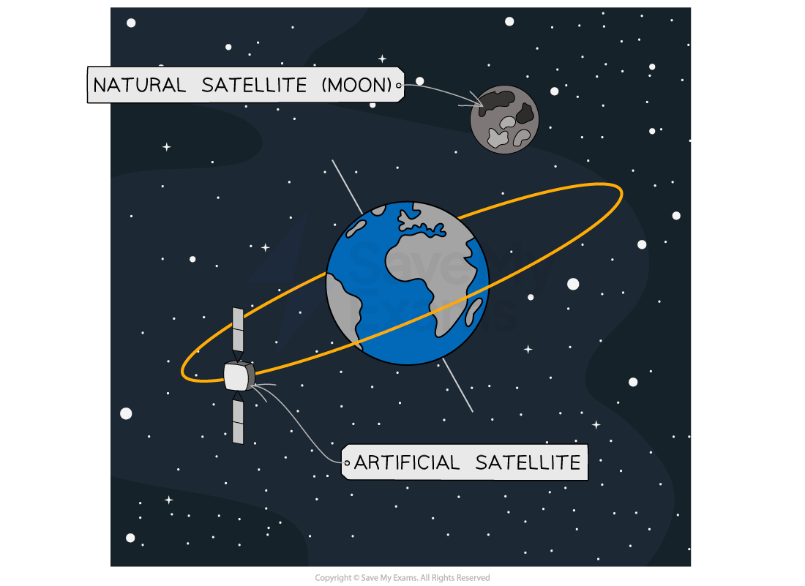
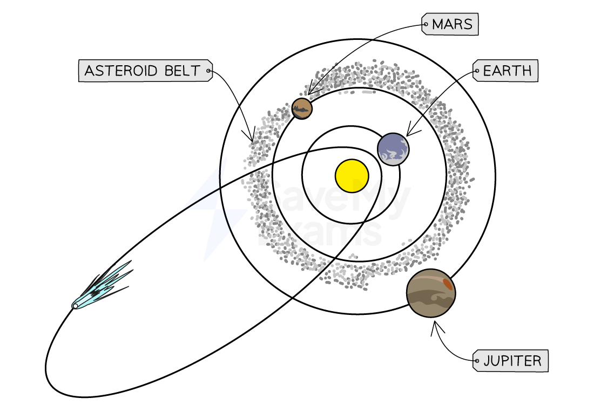
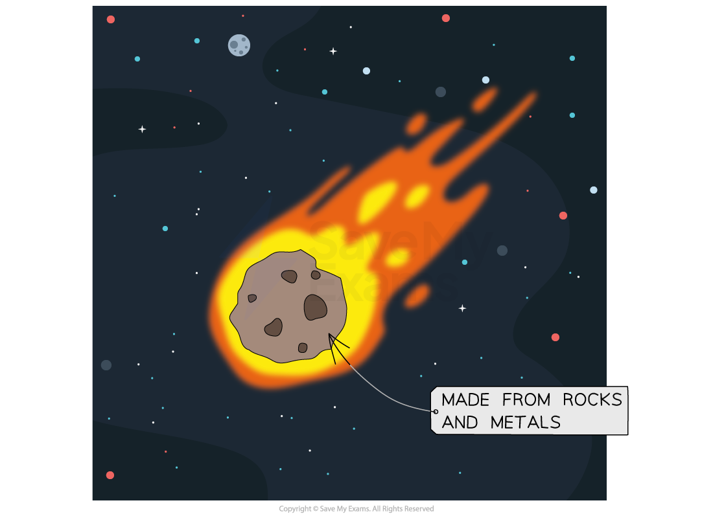
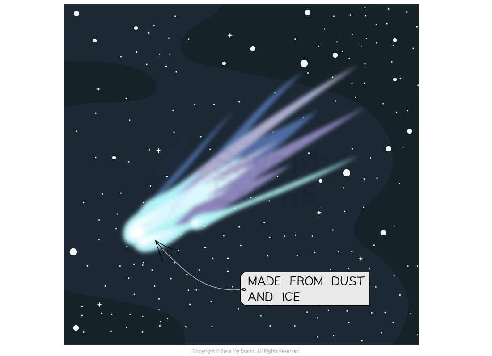

# The Solar System

## The Solar System

> **Spec point** — `spcpt_BkdmdYCfhSvVnFVf` · Describe the Solar System as containing:
   (a) one star, the Sun
   (b) the eight named planets and know their order from the Sun
   (c) minor planets that orbit the Sun, includin dwarf planets such as Pluto and asteroids in the asteroid belt
   (d) moons, that orbit the planets
   (e) smaller Solar System bodies, including comets and natural satellites

## The Solar System

- The Solar System consists of:

  - the Sun
  - eight planets
  - natural and artificial satellites
  - dwarf planets
  - asteroids and comets

*The Solar System consists of one star (the Sun) and the objects that orbit it, including the planets, moons, dwarf planets, asteroids and comets*

### The planets

- There are **eight** planets which ***orbit*** the Sun
- In ascending order of the distance from the Sun, these are:

**Mercury, Venus, Earth, Mars, Jupiter, Saturn, Uranus, Neptune**

- The planets can be divided into two groups

  - the **inner** rocky planets
  - the **outer** gas giants

### Dwarf planets

- A dwarf planet is an object similar to a planet, but much smaller
- The **gravitational field** around a planet is strong enough to pull in nearby objects (with the exception of natural ***satellites***)
- Whereas, the [gravitational field](https://www.savemyexams.com/igcse/physics/cie/23/revision-notes/6-space-physics/6-1-earth-and-the-solar-system/6-1-5-gravitational-field-strength/?_ai=internal-linking) around a dwarf planet is **not strong enough** to pull in nearby objects

### Satellites

- There are two types of satellites: **natural** and **artificial**

#### Natural and artificial satellites of Earth

*The Moon is a natural satellite of the Earth. Many artificial satellites orbit around the Earth*

- Natural satellites are objects that orbit planets
- A **moon** is a type of natural satellite
- **Artificial satellites** are manmade objects that orbit another object in space
- The International Space Station (ISS) is an example of an artificial satellite that orbits the Earth

### Asteroids and comets

- Asteroids and comets also orbit the Sun

#### Locations of asteroids and comets

*Asteroids are found in the Asteroid Belt between Mars and Jupiter, whereas comets are usually found in the outer reaches of the Solar System due to their highly elliptical orbits*

- An **asteroid** is a small **rocky object** which orbits the Sun
- The **asteroid belt** lies between Mars and Jupiter

#### An asteroid

*Asteroids are small, rocky objects which occupy the inner Solar System*

- A **comet** is an object made of **dust and ice** which goes around the Sun in a [highly elliptical](https://www.savemyexams.com/igcse/physics/cie/23/revision-notes/6-space-physics/6-1-earth-and-the-solar-system/6-1-7-elliptical-orbits/?_ai=internal-linking) (not a circular path with the Sun at the centre) path
- The ice melts when the comet approaches the Sun and forms the comet’s **tail**

#### A comet

*Comets are small, icy objects which occupy the outer Solar System*

### Orbiting bodies

- The Solar System is made up of many bodies which orbit around other bodies
- **Smaller** bodies **orbit** around **larger** bodies

  - For example, planets orbit the Sun and moons orbit planets

- The orbiting bodies in the Solar System are shown in the table below:

#### Table of orbiting bodies in the Solar System

| **Orbiting body** | **Body it orbits** |
|---|---|
| Planet | The Sun |
| Moon | Planet |
| Comet | Can pass around the Sun |
| Asteroid | The Sun |
| Artificial satellites | The Earth |

> **Exam Hint**
> You need to know the order of the 8 planets in the Solar System. The following mnemonic gives the first letter of each of the planets to help you recall them:
> 
> **M**y **V**ery **E**xcellent **M**other **J**ust **S**erved **U**s **N**oodles
> 
> **M**ercury, **V**enus, **E**arth, **M**ars, **J**upiter, **S**aturn, **U**ranus, **N**eptune

## Analysing orbits

> **Spec point** — `spcpt_yhprhgKF2K9Nh2Rf` · Analyse and interpret planetary data about orbital distance, orbital duration, density, surface temperature and uniform gravitational field strength at the planet’s surface

## Analysing orbits

### Extended Tier Only

- Over many years, data for the planets, moons and the Sun have been collected
- Some of this data is shown in the table below

#### Data for the planets in the Solar System

| **Planet** | **Mean distance from Sun (relative to Earth)** | **Orbital period (Earth years)** | **Mean surface temperature (°C)** | **Density (kg/m****3****)** | **Diameter (10****3**** km)** | **Mass (relative to Earth)** | **Surface gravity (N/kg)** | **Number of moons** |
|---|---|---|---|---|---|---|---|---|
| **Mercury** | 0.39 | 0.24 | 350 | 5429 | 4.9 | 0.06 | 3.7 | 0 |
| **Venus** | 0.72 | 0.60 | 460 | 5243 | 12.1 | 0.82 | 8.9 | 0 |
| **Earth** | 1 | 1 | 20 | 5514 | 12.8 | 1 | 9.8 | 1 |
| **Mars** | 1.5 | 2 | −23 | 3934 | 6.8 | 0.11 | 3.7 | 2 |
| **Jupiter** | 5.2 | 12 | −120 | 1326 | 143 | 320 | 23.1 | 63 |
| **Saturn** | 9.6 | 30 | −180 | 687 | 121 | 95 | 9.0 | 61 |
| **Uranus** | 19 | 84 | −210 | 1270 | 51 | 15 | 8.7 | 27 |
| **Neptune** | 30 | 160 | −220 | 1638 | 50 | 17 | 11.0 | 13 |

- The data allows us to

  - make comparisons
  - identify trends and anomalies
  - make predictions

- Some examples of **comparisons **are:

  - Neptune is 30 times **further away** from the Sun than the Earth
  - Jupiter contains the **same **mass as 320 Earths

- An example of a **trend **is:

  - As the distance from the Sun **increases**, the time it takes to complete one orbit (orbital period) also **increases**

- An example of an **anomaly** is:

  - As the distance from the Sun increases, the temperature decreases, **except **for Venus which has a higher temperature than Mercury

- An example of a** prediction** is:

  - The temperature of a dwarf planet in the asteroid belt is **likely** to be around −100°C, but it could be anywhere between −63°C and −130°C as these are the temperatures of Mars and Jupiter

> **Exam Hint**
> Don't panic when you see the large table of numbers - you don't need to memorise any of it, but you need to be able to analyse and interpret it confidently. Look for trends such as one variable increasing whilst the other decreases (or increases). Think carefully about why that may be with what you have already learnt about the planets from this topic. For example, what is the planet made of? What is its distance from the Sun and how does this affect it?
