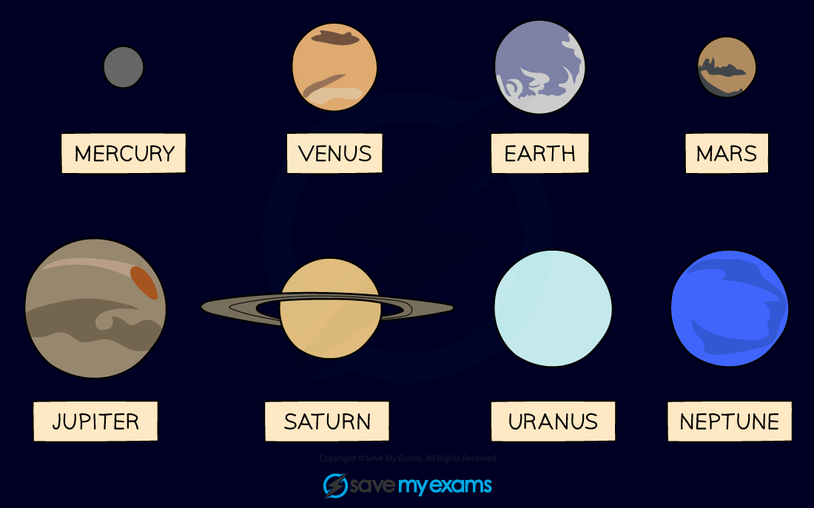
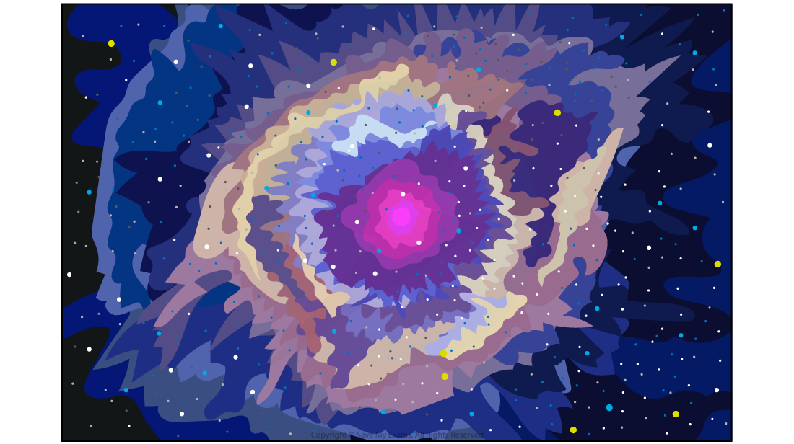
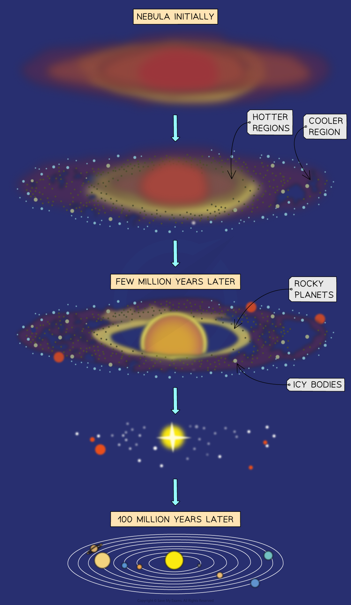

# Formation of the Solar System

## Formation of the Solar System

> **Spec point** — `spcpt_wrry5gnbRnZBbv3X` · Know that, in comparison to each other, the four planets nearest the Sun are rocky and small and the four planets furthest from the Sun are gaseous and large, and explain this difference by referring to an accretion model for Solar System formation, to include:
   (a) the model’s dependence on gravity
   (b) the presence of many elements in interstellar clouds of gas and dust
   (c) the rotation of material in the cloud and the formation of an accretion disc

## Formation of the Solar System

- The four **inner** planets (nearest to the Sun):

  - are **rocky** and **small**
  - have **atmospheres** (except for Mercury)

- The four **outer** planets (furthest from the Sun):

  - are **gaseous **and **large**
  - are mostly composed of **hydrogen** and **helium** gas

*The eight planets can be split into the four inner rocky planets and the four outer gas giants *

- The differences between the inner and outer planets can be explained using the **accretion model** for the formation of the Solar System

### Distribution of elements in the Solar System

- The Sun and the planets in the Solar System formed from a [cloud of dust and gas (nebula)](https://www.savemyexams.com/igcse/physics/cie/23/revision-notes/6-space-physics/6-2-stars-and-the-universe/6-2-3-star-formation/?_ai=internal-linking)

  - Gravity pulled this cloud together into a giant ball, which would eventually become the Sun
  - As the nebula collapsed, the Sun became **denser** and **hotter**

- The Solar System then formed around 4.5 billion years ago

  - The planets formed from the remnants of the matter left over from the nebula that formed the Sun
  - The nebula contained many elements that were created during a [supernova explosion](https://www.savemyexams.com/igcse/physics/cie/23/revision-notes/6-space-physics/6-2-stars-and-the-universe/6-2-4-life-cycle-of-a-star/?_ai=internal-linking) in the distant past

- As the early Sun became hotter, gaseous matter was pushed **further** out into the Solar System than solid matter

#### A nebula

*A nebula is an interstellar cloud of gas and dust *

#### Formation of the inner planets

- In the hotter regions, closer to the Sun, the temperature was too high for lighter elements to exist in a solid state

  - Therefore, the inner planets formed from materials with high melting temperatures such as metals (e.g. iron)
  - The original nebula contained only a small proportion of heavy elements, so the inner planets could not grow as significantly as the outer planets

- As a result, solids in the inner disc were pulled together by gravity to form solid planets

  - This is why the four planets nearest to the Sun (Mercury, Venus, Earth and Mars) are **rocky and small**

#### Formation of the outer planets

- In the cooler regions, further from the Sun, the temperature was low enough for the light molecules to exist in a solid state

  - Therefore, the outer planets formed from materials with low melting temperatures (e.g. hydrogen, helium, water and methane)
  - The original nebula contained a large proportion of light elements, so the outer planets were able to become exceptionally large

- As a result, gases in the outer disc were pulled together by gravity to form gaseous planets

  - This is why the four planets furthest from the Sun (Jupiter, Saturn, Uranus and Neptune) are **gaseous and large**

### Formation of the accretion disc

- In the nebula, matter **accreted**

  - This means attractive gravitational forces between particles caused them to join together and grow into larger objects

- As the cloud collapsed under gravitational forces

  - it began to spin faster
  - it became hotter
  - it formed an accretion disc

- From the rotating **accretion disc**, the Sun and the planets emerged

  - The Sun formed at the centre
  - The planets formed in the accretion disc

*The Solar System formed from a nebula with the Sun in the centre, then solid planets closer to the Sun and gaseous planets further away*

> **Exam Hint**
> When writing about the formation of the Solar System, make sure you can:
> 
> - State where solid and gaseous matter gathered in the Solar System
> - Explain how heavier elements became a part of the nebula
> - Describe the role of gravity in pulling matter together and the formation of an accretion disc
> - Explain the difference between the planets in terms of the accretion model
