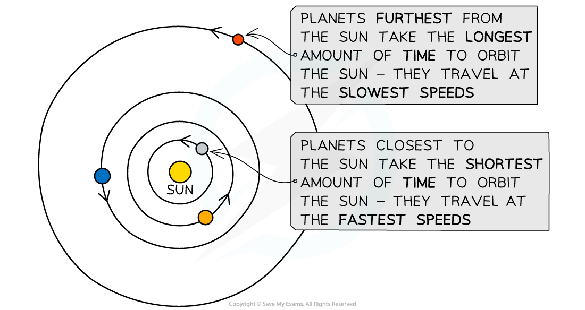

# Gravitational Field Strength

## Gravitational field strength of a planet

> **Spec point** — `spcpt_ZqCx3RfcF5jq63Zk` · nan

## Gravitational field strength of a planet

- The [strength of a gravitational field](https://www.savemyexams.com/igcse/physics/cie/23/revision-notes/1-motion-forces--energy/1-3-mass-weight--density/1-3-1-mass--weight/) around a planet depends on

  - the mass of the planet
  - the distance from the planet

### Gravitational field strength and mass

- The relationship between gravitational field strength and mass is:

**The greater the mass of a planet, the greater the strength of the gravitational field at its surface**

- The value of $g$ (gravitational field strength) varies from planet to planet depending on their mass and radius

#### Gravitational field strength of bodies in the Solar System

*The strength of the gravitational field at the surface of a planet depends on its mass and radius*

### Gravitational field strength and distance

- The relationship between gravitational field strength and distance is:

**As the distance from a planet increases, the strength of the gravitational field decreases**

- At the surface of a planet, the value of $g$ (gravitational field strength) is constant, but it decreases with distance from the planet

> **Exam Hint**
> You do not need to remember the value of *g* on different planets for your exam, and the value of *g* for Earth is given on the front page of the exam paper.

## Gravitational attraction of the Sun

> **Spec point** — `spcpt_Ndxk5sDYGjK2HHwf` · Know that the force that keeps an object in orbit around the Sun is the gravitational attraction of the Sun
Know that the Sun contains most of the mass of the Solar System and this explains why the planets orbit the Sun

## Gravitational attraction of the Sun

- Orbital motion is a result of the **gravitational force of attraction** acting between two bodies
- This gravitational force

  - always acts **towards the centre** of the larger body
  - causes the orbiting body to move in a **circular path**

- The Sun contains most of the mass (>99%) of the Solar System
- Therefore, for objects orbiting around the Sun

  - the Sun's **gravitational attraction** keeps them in orbit
  - the force is directed from the orbiting object to the centre of the Sun

*The Sun's gravitational force of attraction keeps the Earth in orbit around the Sun*

## Orbital motion of planets

> **Spec point** — `spcpt_K6nsHqqgJbJXxGrt` · Know that the strength of the Sun’s gravitational field decreases and that the orbital speeds of the planets decrease as the distance from the Sun increases

## Orbital motion of planets

### Extended Tier Only

- As the distance from the Sun increases:

  - the Sun's gravitational field strength **decreases**
  - the [orbital speed of a planet](https://www.savemyexams.com/igcse/physics/cie/23/revision-notes/6-space-physics/6-1-earth-and-the-solar-system/6-1-6-orbital-speed-equation/?_ai=internal-linking) **decreases**

- For an object to maintain a [circular orbit](https://www.savemyexams.com/igcse/physics/cie/23/revision-notes/1-motion-forces--energy/1-4-effects-of-forces/1-4-6-circular-motion/), it must have a ***centripetal force***

  - For planets orbiting the Sun, this force is the Sun's **gravitational attraction**

- Therefore, the [centripetal force](https://www.savemyexams.com/igcse/physics/cie/23/revision-notes/1-motion-forces-and-energy/1-4-effects-of-forces/1-4-6-circular-motion/?_ai=internal-linking) on a planet depends on

  - the strength of the Sun's gravitational field
  - the distance of the planet from the Sun

- The further away a planet is from the Sun, the **weaker** the strength of the Sun's gravitational attraction and the weaker the centripetal force

- The centripetal force on a planet is **proportional** to its orbital speed
- Therefore, the **further** a planet is from the Sun:

  - the **smaller** its orbital speed
  - the **longer** its orbital period

*The closest planets to the Sun have the fastest orbital speeds, and the furthest have the slowest*

- This trend in orbital speed and distance can be seen in the data of the planets in the Solar System:

| **Planet** | **Orbital radius (million km)** | **Orbital speed (km/s)** | **Orbital period (days or years)** |
|---|---|---|---|
| **Mercury** | 57.9 | 47.9 | 88 days |
| **Venus** | 108.2 | 35.0 | 225 days |
| **Earth** | 149.6 | 29.8 | 365 days |
| **Mars** | 227.9 | 24.1 | 687 days |
| **Jupiter** | 778.6 | 13.1 | 11.9 years |
| **Saturn** | 1433.5 | 9.7 | 29.5 years |
| **Uranus** | 2872.5 | 6.8 | 84 years |
| **Neptune** | 4495.1 | 5.4 | 165 years |

> **Exam Hint**
> Be careful with your wording in this topic when talking about gravity. It is important to refer to the **force** of gravity as 'gravitational attraction', 'strength of the Sun's gravitational field' or 'the force **due to** gravity'. Avoid terms such as 'the Sun's gravity' or even more vague, 'the force from the Sun'.
