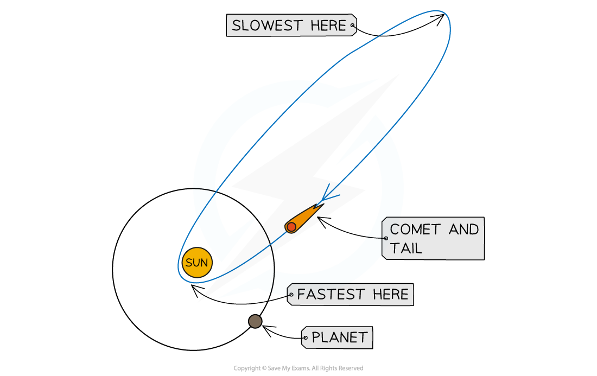

# Elliptical Orbits

## Elliptical orbits

> **Spec point** — `spcpt_Y3MbXgVDnmDSqMph` · Know that planets, minor planets and comets have elliptical orbits, and recall that the Sun is not at the centre of the elliptical orbit, except when the orbit is approximately circular

## Elliptical orbits

### Extended Tier Only

- The orbits of planets, minor planets and comets are **elliptical**

  - An ellipse is a 'squashed' circle

- Planets and minor planets have **slightly** elliptical orbits

  - Their orbits are approximately circular, so the Sun is generally considered to be at the centre

- Comets have **highly** elliptical orbits

  - The Sun is not at the centre of the orbit, it is at one of the two foci of the ellipse

> **Exam Hint**
> You will not be asked to do any calculations with elliptical orbits. If you are asked to calculate the time period, orbital speed or radius of an orbit, it can be assumed that it is circular.

## Comet speed

> **Spec point** — `spcpt_8K7hzBRCQjRdqBG8` · Know that an object in an elliptical orbit travels faster when closer to the Sun and explain this using the conservation of energy

## Comet speed

### Extended Tier Only

- An object in an elliptical orbit around the Sun travels at a **different** speed depending on its distance from the Sun
- Although these orbits are not circular, they are still **stable**

  - For a stable orbit, the **radius** must change if the comet's **orbital speed** changes

- As the comet approaches the Sun:

  - the radius of the orbit **decreases**
  - the orbital speed **increases** due to the [Sun's strong gravitational pull](https://www.savemyexams.com/igcse/physics/cie/23/revision-notes/6-space-physics/6-1-earth-and-the-solar-system/6-1-5-gravitational-field-strength/?_ai=internal-linking)

- As the comet travels further away from the Sun:

  - the radius of the orbit **increases**
  - the orbital speed **decreases** due to a weaker gravitational pull from the Sun

*Comets travel in highly elliptical orbits, speeding up as they approach the Sun*

### Conservation of energy in elliptical orbits

- When an object moves in an elliptical orbit, energy must be **conserved**
- Throughout the orbit, gravitational potential energy is **transferred** to [kinetic energy](https://www.savemyexams.com/igcse/physics/cie/23/revision-notes/1-motion-forces-and-energy/1-7-energy-work-and-power/1-7-2-kinetic-energy/?_ai=internal-linking), and vice versa

  - When a comet travels **closer** to the Sun, it has greater kinetic energy
  - When a comet travels **further** from the Sun, it has greater gravitational potential energy

- As the comet approaches the Sun:

  - it **loses **gravitational potential energy and **gains** kinetic energy
  - the increase in kinetic energy causes it to **speed up**

- As the comet moves away from the Sun:

  - it **gains** gravitational potential energy and **loses** kinetic energy
  - the decrease in kinetic energy causes it to **slow down**

> **Exam Hint**
> Remember that an object's kinetic energy is defined by: $\frac{1}{2}mv^{2}$ where *m* is the mass of the object and *v* is its speed. Therefore, if the speed of an object increases, so does its kinetic energy. Its gravitational potential energy therefore must decrease for energy to be conserved.
