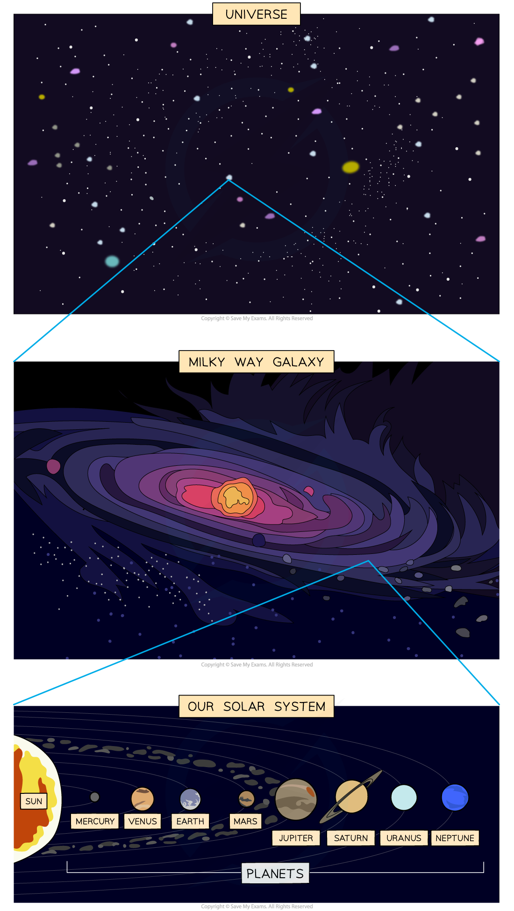

# The Scale of the Universe

## The scale of the Universe

> **Spec point** — `spcpt_Zzp5hP8WvybXB3yT` · State that:
   (a) galaxies are each made up of many billions of stars
   (b) the Sun is a star in the galaxy known as the Milky Way
   (c) other stars that make up the Milky Way are much further away from the Earth than the Sun is from the Earth
   (d) astronomical distances can be measured in light-years, where one light-year is the distance travelled in (the vacuum of) space by light in one year

## The scale of the Universe

### The Universe

- The Universe is defined as

**A large collection of billions of galaxies**

- It is also the name given to the entirety of space

### Galaxies

- A galaxy is defined as

**A large collection of billions of stars**

- Stars are large astronomical objects, such as the Sun

### The Milky Way

- **The Milky Way** is one of many billions of galaxies making up the Universe
- **The Sun** is one of many billions of stars making up the** **Milky Way
- Other stars in the Milky Way galaxy are **much further away** from Earth than the Sun is
- Some of these stars also have **planets** which orbit them

#### Hierarchy of the Universe

*The Universe is a large collection of galaxies and a galaxy is a large collection of stars. The Sun is a star at the centre of our Solar System in the Milky Way galaxy*

## Astronomical distances

> **Spec point** — `spcpt_Q7bWTdn9ycPfzzpk` · State that:
 (d) astronomical distances can be measured in light-years, where one light-year is the distance travelled in (the vacuum of) space by light in one year
Know that the Milky Way is one of many billions of galaxies making up the Universe (from Universe) and that the diameter of the Milky Way is approximately 100 000 light-years
Know that one light-year is equal to 9.5 × 10 ^15m (E)

## Astronomical distances

- Astronomical distances, such as the distances between stars and galaxies, are extremely **large**
- To describe these distances, astronomers use a special unit called the **light-year**

- One light-year is defined as:

**The distance travelled by light in one year**

- The **diameter of the Milky Way** is approximately **100 000 light-years**
- This means that light would take 100 000 years to travel from one side of the Milky Way to the other

> **Worked Example**
> The centre of our galaxy is 30 000 light-years away. How long does it take light to reach the Earth?
> 
> [1]
> 
> **Answer:**
> 
> - The centre of our galaxy is 30 000 light-years away
> - It takes light 30 000 years to reach the Earth from the centre of our galaxy **[1 mark]**

### Extended Tier Only

- One light-year is equal to 9.5 × 1012 km, or** 9.5 × 10****15**** m**

> **Worked Example**
> A galaxy is 46 000 light-years away. Calculate this distance in km.
> 
> [2]
> 
> **Answer:**
> 
> **Step 1: Write down the known quantities**
> 
> - 1 light-year = 9.5 × 1012 km
> 
> **Step 2: Calculate the distance in km**
> 
> `distance space equals space 46 space 000 space cross times space open parentheses 9.5 space cross times space 10 to the power of 12 close parentheses` **[1 mark]**
> 
> $\mathrm{distance}=4.37\times10^{17}\mathrm{km}$ **[1 mark]**
