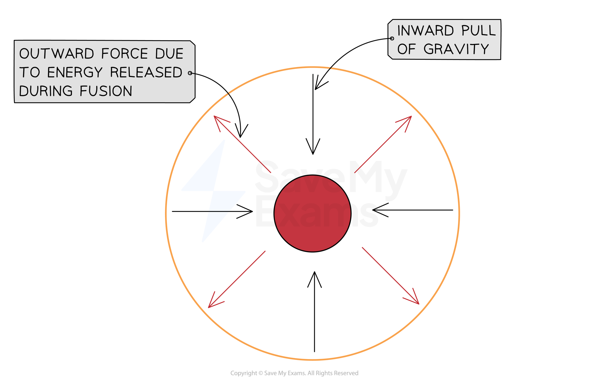
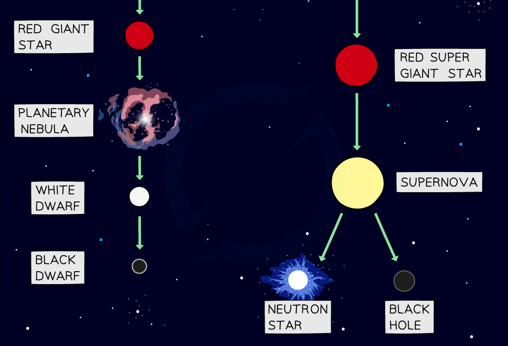

# Star Formation

## Star formation

> **Spec point** — `spcpt_TkVXWQTgtmHxPS27` · Describe the life cycle of a star:
   (a) a star is formed from interstellar clouds of gas and dust that contain hydrogen
   (b) a protostar is an interstellar cloud collapsing and increasing in temperature as a result of its internal gravitational attraction
   (c) a protostar becomes a stable star when the inward force of gravitational attraction is balanced by an outward force due to the high temperature in the centre of the star

## Star formation

### Extended Tier Only

- Stars go through a sequence of evolutionary stages, known as the **life cycle** of a star
- All stars follow the same initial stages:

**nebula → protostar → stable star**

### Nebula

- Stars form from a giant interstellar **cloud of gas and dust** called a nebula

### Protostar

- The **gravitational attraction** within a nebula pulls the particles **closer together** until a hot ball of gas forms, known as a **protostar**
- As the particles are pulled closer together, the **density** of the protostar **increases**
- This results in **more frequent collisions** between the particles, which causes the **temperature** to **increase**

### Stable star

- Once the protostar becomes hot enough, ***nuclear fusion*** reactions occur within its core

  - The hydrogen in the core of the star is converted into helium
  - Every fusion reaction releases heat and light, which keeps the core of the star hot

- Once a star initiates fusion, it is known as a **stable star**
- During this stage, the star is in **equilibrium** as the forces acting on it are balanced
- Gravitational forces act **inwards**

  - This is an attractive force which pulls the outer layers inwards
- Thermal pressure acts **outwards**

  - This is exerted by the expanding hot gases inside the star as energy is released during fusion

#### Balanced forces in a stable star

*The outward and inward forces within a star are in equilibrium. The centre red circle represents the star's core and the orange circle represents the star's outer layers*

- Once a stable star is formed, the [final stages of its life cycle](https://www.savemyexams.com/igcse/physics/cie/23/revision-notes/6-space-physics/6-2-stars-and-the-universe/6-2-4-life-cycle-of-a-star/?_ai=internal-linking) depend on its **mass**
- The different life cycles are shown below:

*Flow diagram showing the life cycle of a star which is the same size as the Sun (solar mass) and the life cycle of a star which is much more massive than the Sun*
