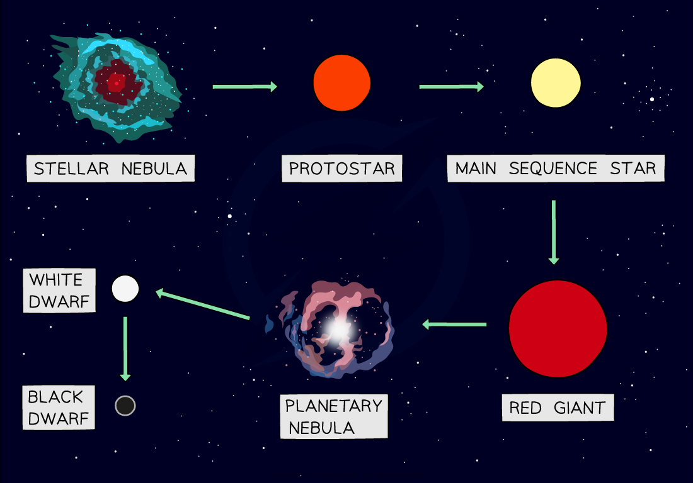

# Life Cycle of a Star

## Life cycle of low-mass stars

> **Spec point** — `spcpt_CpDsgG4bQ4DMpRsM` · Describe the life cycle of a star:
   (d) all stars eventually run out of hydrogen as fuel for the nuclear reaction
   (e) most stars expand to form red giants when most of the hydrogen in the centre of the star has been converted to helium
   (f) a red giant from a less massive star forms a planetary nebula with a white dwarf star at its centre

## Life cycle of low-mass stars

### Extended Tier Only

- A low-mass star is one with a mass of up to about eight times that of the Sun
- After the main sequence, a low-mass star finishes its life cycle in the following evolutionary stages:

**red giant → planetary nebula → white dwarf**

### Red giant

- After several **billion** years, the hydrogen fuel used for nuclear reactions begins to run out
- Once this happens, the rate of fusion decreases, which causes the core to shrink and heat up

  - As the energy produced by fusion decreases, the inward force due to gravity becomes **greater** than the outward force due to the thermal pressure

- Eventually, the star becomes a **red giant** when the core becomes hot enough for **helium **to fuse into **carbon**
- The energy released by re-ignited fusion reactions causes the outer layers of the star to **expand** and **cool**

### Planetary nebula

- Once the helium in the core runs out, fusion reactions cannot continue
- The star becomes **unstable** and the core collapses under its own gravity
- The outer layers are ejected into space as a **planetary nebula**

### White dwarf

- The collapsed core of the red giant is called a **white dwarf**
- The white dwarf **cools** down over time and as a result, the amount of **energy** it emits **decreases**

#### The life cycle of a low-mass star

*The life cycle of a star that is similar to our Sun*

> **Exam Hint**
> A low-mass star is any star that will eventually become a **white dwarf**. You may see different sources giving different ranges of masses for stars within this category, or terms such as low-mass stars (up to 2 solar masses) or intermediate mass stars (between 2 and 8 solar masses). Note that you do not need to know these numbers or categories, only that all these stars will follow the **same** evolutionary stages.

## Life cycle of high-mass stars

> **Spec point** — `spcpt_hkrDXrtNvcQ3zcCX` · Describe the life cycle of a star:
   (e) more massive stars expand to form red supergiants when most of the hydrogen in the centre of the star has been converted to helium
   (g) a red supergiant explodes as a supernova, forming a nebula containing hydrogen and new heavier elements, leaving behind a neutron star or a black hole at its centre
   (h) the nebula from a supernova may form new stars with orbiting planets

## Life cycle of high-mass stars

### Extended Tier Only

- A high-mass star is one with a mass of more than about eight times that of the Sun
- After the main sequence, a high-mass star finishes its life cycle in the following evolutionary stages:

**red supergiant → supernova → neutron star (or black hole)**

### Red supergiant

- After several **million** years, the hydrogen in the core begins to run out
- Similar to a low-mass star, the rate of fusion decreases and the core shrinks and heats up
- The star becomes a **red supergiant** when the core becomes hot enough for helium fusion to start
- This causes the outer layers of the star to **expand** and **cool**

- In the core of the star, **helium **fuses into **carbon**

  - This is followed by further fusion reactions in which successively heavier elements, such as nitrogen and oxygen, are formed

- During this stage, the core collapses and expands repeatedly** **as fusion reactions start and stop

### Supernova

- Eventually, fusion reactions inside the red supergiant cannot continue once **iron **is formed
- The core of the star will **collapse rapidly **and initiate a **gigantic explosion** called a **supernova**
- At the centre of this explosion, a **dense **body called a **neutron star** will form
- The **outer layers **of the star are **ejected** into space forming **new clouds **of dust and gas (**nebula**)

- The nebula from a supernova may form new **stars **with orbiting **planets**

  - The heaviest elements (elements heavier than iron) are formed during a supernova and are ejected into space
  - These nebulae may form new planetary systems

### Neutron star (or black hole)

- In the case of the **most massive stars**, the neutron star that forms at the centre will continue to **collapse** under the force of **gravity** until it forms a **black hole**
- A black hole is an **extremely dense** point in space that not even **light** can escape from

#### The life cycle of a high-mass star

*The life cycle of a star much larger than our Sun*

> **Exam Hint**
> A high-mass star is one that will **not **eventually become a white dwarf. Make sure you understand that most high-mass stars become neutron stars and only the highest mass stars become black holes.
