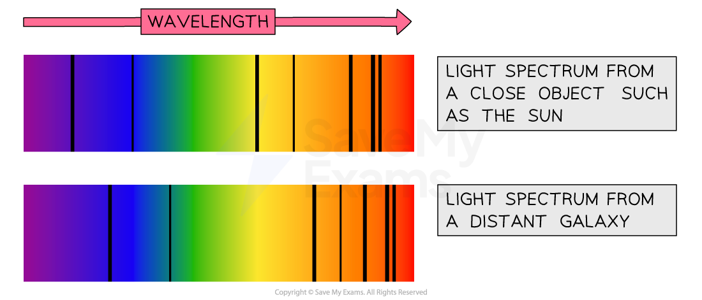

# Galactic Redshift

## Galactic redshift

> **Spec point** — `spcpt_NkKXGkHPhsxQWpmV` ·  - Describe redshift as an increase in the observed wavelength of electromagnetic radiation emitted from receding stars and galaxies
- Know that the light emitted from distant galaxies appears redshifted in comparison with light emitted on the Earth

## Galactic redshift

- When a stationary object emits waves, they spread out **symmetrically**
- If the source of the waves moves, the waves can become squashed together or spread out
- This change in wavelength is known as the ***Doppler effect***
- This effect applies to **both** sound waves and electromagnetic radiation (i.e. light waves)

### Doppler effect of light

- If a source of light moves **towards** an observer, the observed wavelength **decreases**

  - The wavelength of light **shifts** towards the **blue** end of the spectrum
  - This is called **blueshift**

- If a source of light moves **away** from an observer, the observed wavelength **increases**

  - The wavelength of light **shifts** towards the **red** end of the spectrum
  - This is called **redshift**

#### Redshift and blueshift of light

*When a light source moves away from an observer, redshift is observed, and when a light source moves towards an observer, blueshift is observed*

### Observing redshift in distant galaxies

- When astronomers compare light from glowing hydrogen in **distant galaxies** with light from glowing hydrogen on **Earth**, the light appears to be **redshifted**
- This means the observed wavelength has **increased** as the light travelled from the galaxy to the Earth
- This shows that distant stars and galaxies are [moving away (receding) from the Earth](https://www.savemyexams.com/igcse/physics/cie/23/revision-notes/6-space-physics/6-2-stars-and-the-universe/6-2-6-the-big-bang-theory/?_ai=internal-linking)

#### Redshift of light from a distant galaxy

*Light emitted from glowing hydrogen in distant objects appears to be shifted towards the red end of the spectrum, showing they are moving away from Earth*

- The greater the observed redshift:

  - the **greater** the **distance** to a galaxy
  - the **faster** the galaxy is moving **away** from Earth

> **Exam Hint**
> You need to know that in the visible light spectrum, **red light** has the **longest wavelength** and the **smallest frequency**.
