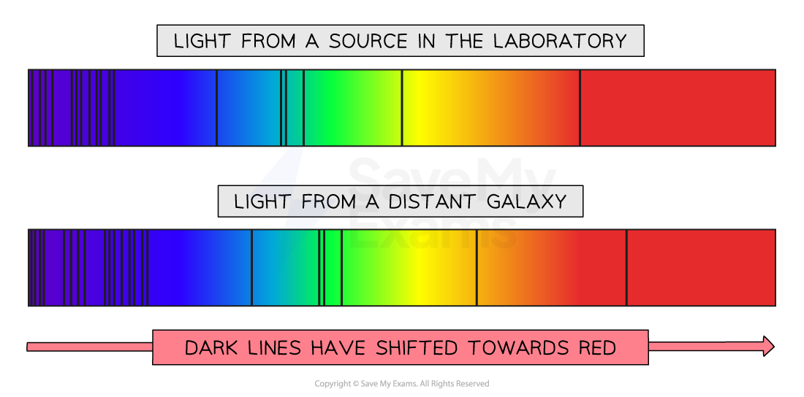
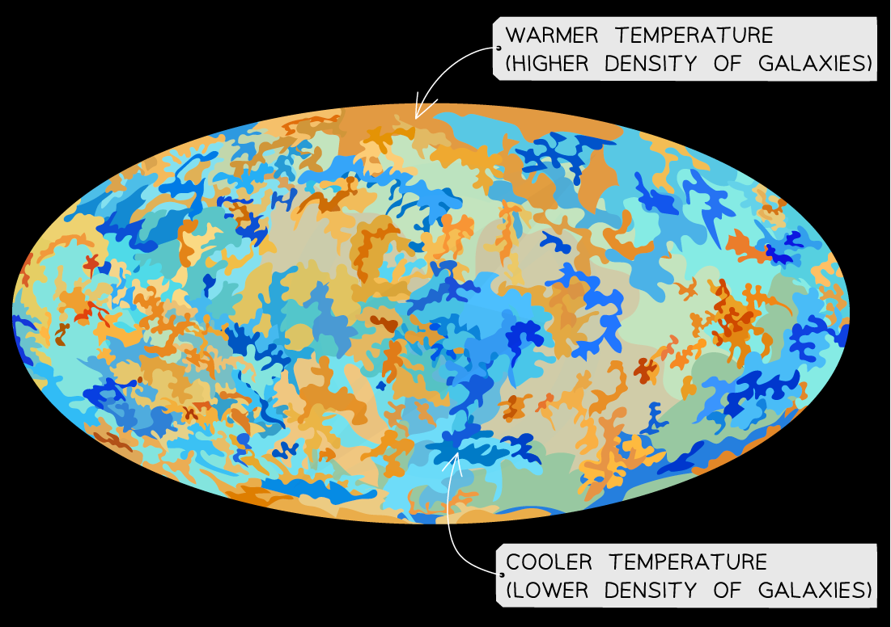
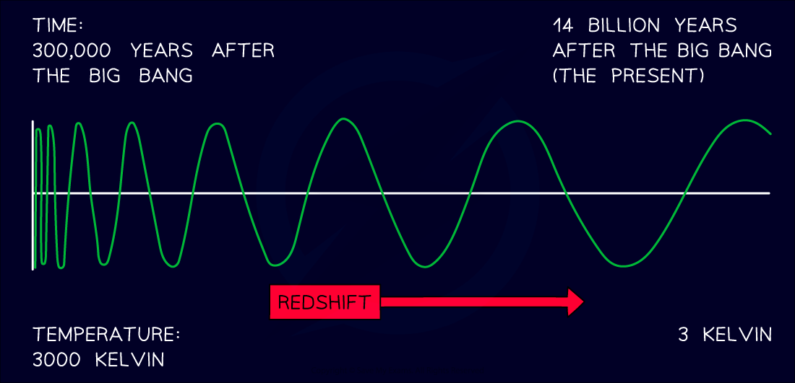

# The Big Bang Theory

## Evidence for the Big Bang Theory

> **Spec point** — `spcpt_ZBVqB5rYZT34SKCH` · Know that redshift in the light from distant galaxies is evidence that the Universe is expanding and supports the Big Bang Theory

## Evidence for the Big Bang Theory

- Around 13.8 billion years ago, the Universe began from a **single point** that was **extremely hot** and **dense**
- A giant explosion, known as the **Big Bang**, caused the Universe to **expand** outwards
- As each point **moved away** from the others, the Universe began to cool
- As a result of the initial explosion, the Universe **continues to expand**

*Tracing the expansion of the Universe back to the beginning of time leads to the idea it must have begun with a “Big Bang”*

### Evidence from galactic redshift

- Galactic redshift indicates that distant galaxies are moving **away** from us
- If galaxies are moving away from us, this means the Universe must be **expanding**

#### Expansion of the Universe

*Observations of light from galaxies show they are moving away from us which means the Universe is expanding*

- Redshift provides evidence for the Big Bang because:

  1. **Observations show that distant galaxies are all moving away from us**
  
    - We see that light from glowing hydrogen in stars from distant galaxies is redshifted in comparison with light from glowing hydrogen on Earth
  2. **Observations show that the further away a galaxy is, the faster it is moving away from us**
  
    - The spectra of light from more distant galaxies are more redshifted than closer galaxies due to the expansion of space itself

#### Galactic redshift spectra

*The dark lines (representing glowing hydrogen) have shifted towards red wavelengths due to the stretching of light as it travelled through space that was expanding*

> **Exam Hint**
> Make sure that you understand that the stretching of the wavelength of light is due to the expansion of the Universe, not the motion of stars and galaxies themselves.
> 
> This can be visualised by imagining a balloon with equally spaced points on it. The balloon represents space and the points represent galaxies.
> 
> 
> 
> When the balloon is deflated (i.e. the Universe was smaller), the points (galaxies) are closer together and are at an equal distance apart.
> 
> As the balloon (Universe) expands, all the points (galaxies) become further apart **by the same amount**.
> 
> This is because the **space between the galaxies** itself has expanded.

## Cosmic microwave background radiation

> **Spec point** — `spcpt_wC7p4ys4c9kw2gjn` · - Know that microwave radiation of a specific frequency is observed at all points in space around us and is known as cosmic microwave background radiation (CMBR)
- Explain that the CMBR was produced shortly after the Universe was formed and that this radiation has been expanded into the microwave region of the electromagnetic spectrum as the Universe expanded

## Cosmic microwave background radiation

### Extended Tier Only

- Cosmic microwave background radiation (CMBR) is a form of electromagnetic radiation that was emitted shortly after the beginning of the Universe
- It is detected **everywhere** throughout the Universe

  - The CMBR map is the closest image that exists to a map of the Universe

- It shows that the temperature of the Universe, and therefore the objects in it, are more or less **uniformly spread out**

*The CMBR map shows areas of higher and lower temperature in the Universe. Regions with higher temperatures have a higher concentration of galaxies, Suns and planets*

### Evidence from cosmic microwave background radiation

- Cosmic microwave background radiation provides evidence for the Big Bang because:

  1. **Theory predicts the early Universe was extremely hot and dense**
  
    - Therefore, CMBR would have initially existed as short-wavelength gamma radiation
    - The shorter wavelength in the past indicates the Universe must have been very hot in the beginning
  2. **CMBR is consistent with radiation that has been stretched over time**
  
    - The Big Bang would have released a lot of energy in the form of extremely high-energy gamma radiation
    - As the Universe expanded, the wavelength of the radiation **increased**
    - Over time, it has been redshifted so much that it is now in the **microwave** region of the spectrum
  3. **CMBR can be interpreted as the radiation left over from the Big Bang**
  
    - The CMBR is extremely uniform which indicates the Universe was initially much smaller than it is now

#### Redshift of CMBR

*CMBR is a result of high-energy radiation being redshifted over billions of years*

> **Worked Example**
> Describe and explain what can be deduced about the history of the Universe from the CMBR.
> 
> [3]
> 
> **Answer:**
> 
> **Step 1: Recall the features of the CMBR**
> 
> - Microwave radiation is detected from all directions at a similar intensity **[1 mark]**
> 
> **Step 2: State the source of this radiation**
> 
> - This is the radiation produced just after the formation of the Universe **[1 mark]**
> 
> **Step 3: Describe how the wavelength has changed and explain why**
> 
> - When the Universe was formed, the radiation was high in energy and short in wavelength
> - Now it has less energy and a longer wavelength
> - This is because the Universe has expanded and cooled, causing the wavelength to increase
> 
> **Step 4: Suggest what this tells us about the Universe in the beginning**
> 
> - This suggests the Universe was initially very small and very energetic and has been expanding since **[1 mark]**
