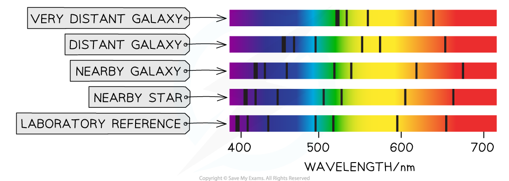
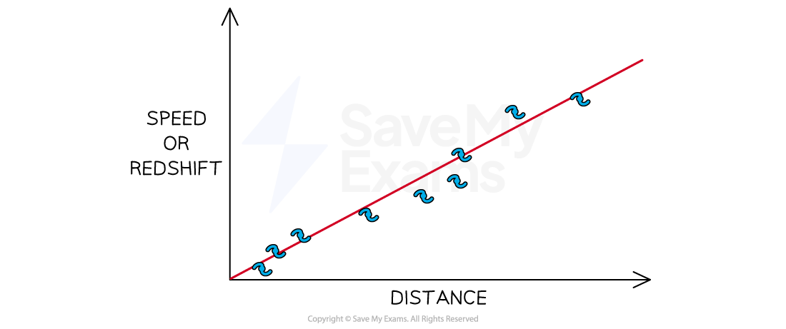

# Age of the Universe

## The Hubble constant

> **Spec point** — `spcpt_XMnXBktB2pHkpdNj` · Define the Hubble constant H0 as the ratio of the speed at which the galaxy is moving away from the Earth to its distance from the Earth; 
 - recall
- and use the equation
                            H0 = v/d
Know that the current estimate for H0 is 2.2 × 10^–18 per second

## The Hubble constant

### Extended Tier Only

- When Edwin Hubble looked at the absorption spectra of distant galaxies, he determined a relationship between the **speed** of a galaxy and its **distance** from Earth

*Hubble discovered that all galaxies show redshift, but the galaxies that are further away show a greater increase in redshift*

- This is **Hubble's law**, which states

**The speed of recession is proportional to the distance of the galaxy away from Earth**

- 'Recession' speed means the speed at which something is moving away
- This means that the further away a galaxy is from Earth:

  - the **faster** it is moving away
  - the **greater** the increase in **redshift**

*Hubble's law tells us the greater the distance to a galaxy, the greater the redshift, or the speed it moves away from Earth*

- Hubble’s law can be expressed as an equation:

$H_{0}=\frac{v}{d}$

- Where:

  - $H_{0}$ = Hubble constant (per second)
  - $v$ = recessional velocity of an object, the velocity of an object moving **away** from an observer (km/s)
  - $d$ = distance between the object and the Earth (km)

- From this equation, the Hubble constant $H_{0}$ can be defined as:

**The ratio of the speed at which the galaxy is moving away from the Earth, to its distance from the Earth**

- The accepted value of the Hubble constant is $H_{0}$ = **2.2 × 10****-18**** per second**

> **Exam Hint**
> Make sure to learn the currently accepted value of the Hubble constant.
> 
> You will be expected to know that the current estimate for *H*0 is 2.2 × 10-18 per second.

## Measuring recession speed & distance

> **Spec point** — `spcpt_dgBtNyMy3Qn7fvjJ` · - Know that the speed (v) at which a galaxy is moving away from the Earth can be found from the change in wavelength of the galaxy’s starlight due to redshift
 - Know that the distance of a far galaxy (d) can be determined using the brightness of a supernova in that galaxy

## Measuring recession speed & distance

### Extended Tier Only

- The Hubble constant $H_{0}$ can be determined from measurements of:

  - redshift of the light emitted by a galaxy
  - the brightness of supernovae in the galaxy

### Measuring recession speeds of galaxies

- The speed of recession $v$ of a galaxy (i.e. how fast it is moving away from the Earth) can be found from the change in wavelength of the galaxy’s starlight due to redshift

### Measuring distance using supernovae

- The distance $d$ to a galaxy can be determined using the brightness of a supernova in that galaxy
- ***Supernovae*** are exploding stars

  - Certain types of supernovae have the same peak level of brightness (**absolute magnitude**), meaning they can be used as ***standard candles***
  - These supernovae are so bright that they can be used for measuring distances to the most distant galaxies

## Age of the Universe

> **Spec point** — `spcpt_mcWZMNhfX6YnmBZp` · Know that the equation d/v = 1/H0 
 - represents an estimate for the age of the Universe and 
- that this is evidence for the idea that all the matter in the Universe was present at a single point

## Age of the Universe

### Extended Tier Only

- Hubble's law can be rearranged to give the expression:

$\frac{1}{H_{0}}=\frac{d}{v}$

- Since time is equal to distance divided by speed, the term $\frac{1}{H_{0}}$ represents an estimate of the **age of the Universe**

- Hubble's law provides further [evidence for the Big Bang](https://www.savemyexams.com/igcse/physics/cie/23/revision-notes/6-space-physics/6-2-stars-and-the-universe/6-2-6-the-big-bang-theory/?_ai=internal-linking)
- **It shows that the Universe has been expanding since the beginning of time**

  - If we looked at time in reverse, we would see galaxies were closer together in the past
  - This suggests that the Universe must have originated from a single point and has been expanding outwards ever since

### Hubble's law graph

- Using measurements from galactic redshift and brightness of supernovae, a graph of recession velocity against distance can be plotted

#### Graph of galaxy recession velocity against distance

*A key aspect of Hubble’s law is that the furthest galaxies appear to move away the fastest*

- The **gradient** of the graph represents the age of the Universe

  - When the distance equals zero, this represents all the matter in the Universe being at a single point
  - This is the singularity that occurred at the moment of the Big Bang

- Astronomers have used this formula to estimate the age of the Universe is about 13.8 billion years

> **Worked Example**
> A distant galaxy is 20 light-years away from Earth.
> 
> Use Hubble’s law to determine the velocity at which the galaxy moves away from Earth.
> 
> [3]
> 
> **Answer:**
> 
> **Step 1: List the known quantities**
> 
> - Distance to the galaxy, $d$ = 20 light-years
> - 1 light year = 9.5 × 1015 m
> - Hubble constant, $H_{0}$ = 2.2 × 10−18 per second
> 
> **Step 2: Convert 20 light-years to m**
> 
> $d = 20 \text{ly} = 20 \times ( 9.5 \times 10^{15} )$
> 
> $d=1.9\times10^{17}m$ **[1 mark]**
> 
> **Step 3: Substitute values into Hubble's Law**
> 
> $v=H_{0}d$
> 
> $v = ( 2.2 \times 10^{- 18} ) \times ( 1.9 \times 10^{17} )$ **[1 mark]**
> 
> $v=0.418m/s$
> 
> - The galaxy moves away from Earth at a velocity of 0.42 m/s **[1 mark]**

> **Exam Hint**
> If you are taking the Extended paper, remember that you have to learn the values for a light year and the Hubble constant.
