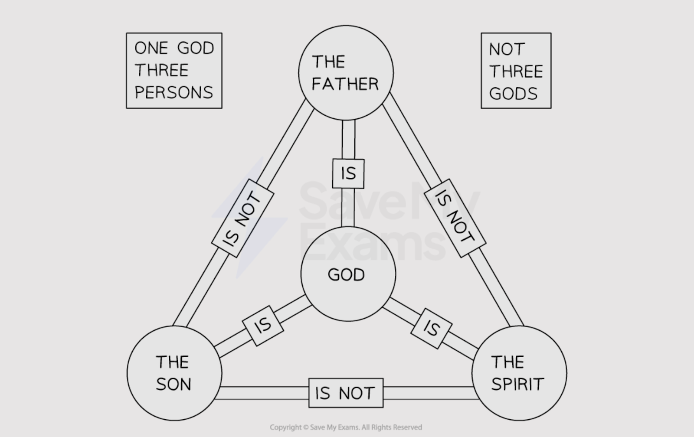

# Christian Beliefs about God

## The Apostles’ Creed

> **Spec point** — `spcpt_59j9XxM32vY4w4Hq`

## The Apostles’ Creed

- A** creed** is a statement of **Christian beliefs**
- The ***Apostles*****’ Creed** is one of the oldest creeds, although it was unlikely to have been written by the apostles themselves
- The **Apostles’ Creed** expresses all of the **key beliefs **Christians hold about God, including belief in the **Trinity**
- It is **accepted** by both **Catholics** and** Protestants** as an accurate statement of belief
- The Apostles’ Creed says that **God the Father** is the Creator:

> **blockquote**
> “I believe in God, the Father almighty, creator of heaven and earth.”
> 
> (Apostles’ Creed)

- The Creed says that **Jesus** was:

  - The **Son of God**
  - **Born** of the Virgin Mary
  - **Suffered, died** and was **buried**
  - **Rose again** on the third day
  - **Ascended** into heaven
  - Will **come again** to **judge** the living and the dead
- The Creed also expresses belief in:

  - The **Holy Spirit**
  - The **Church**
  - The communion of **saints**
  - **Forgiveness** of sins
  - Resurrection and **everlasting life**

## The Trinity

> **Spec point** — `spcpt_F6Rf9Rr7KdQgbpfv`

## What is the Trinity?

- The **Trinity** is the belief that God is three in one:

  - **God** the **Creator **and **Father**
  - **Jesus** as the **Son of God**
  - The** Holy Spirit **as the **Spirit of God **at work in the world
- All are **worshipped** and acknowledged as separate persons of the one God
- The Trinity is not clearly stated in the **New Testament**
- It has become something that marks Christianity apart from other* monotheistic** *religions, such as Islam and Judaism

  - Islam and Judaism reject the idea that God can be three parts

### What is the Nicene Creed?

- The **Nicene Creed** is a key **source of authority** for believing in the Trinity

The statement is recited by Christians of many **denominations** in their regular acts of worship

> **blockquote**
> “We believe in one God, the Father the Almighty … We believe in one Lord Jesus Christ, the only Son of God … We believe in the Holy Spirit, the Lord and giver of life” (The Nicene Creed)

- This statement of belief in the Trinity explains each role of the Trinity and the characteristics of those roles
- The Father is the **powerful creator **of everything

> **blockquote**
> “The maker of Heaven and Earth, of all that is seen and unseen” (Nicene Creed)

- The Son is Jesus Christ, who came to earth as God* incarnate** *and was crucified so that **humanity’s sins **were forgiven

> **blockquote**
> “For us and for our salvation, he came down from heaven” (Nicene Creed)

- The Holy Spirit, which is the** invisible power of God**, works within the world today to inspire and guide us

> **blockquote**
> “The giver of life who proceeds from the Father and the Son” (Nicene Creed)

- This Creed was drawn up in 325 CE by the **Council of Nicaea **(a gathering of all bishops from across the world)
- The Creed states belief in:

  - **The unity of the Church**
  - **Baptism **
  - **Repentance for the forgiveness of sins**
  - **Resurrection of the dead**
  - **Final judgement**
  - **Everlasting life**

## The oneness of God

- Although Christianity is a **monotheistic** religion, many Christians believe that there are **three equal and yet distinct persons in one God**
- Christians** do not believe** that there are **three Gods**
- The oneness of God is central to Christian belief
- The oneness of God is referred to in the **Old Testament**

  - Jesus also reminds his followers of the importance of believing in only one God

> **blockquote**
> “For there is one God, and one mediator between God and men, the man Christ Jesus” (1 Timothy 2:5)
> 
> “Thou believest that there is one God; thou doest well: the devils also believe, and tremble” (James 2:19)

- The oneness of God is a central Christian belief, as it reflects the oneness of the universe God created

### The Father, the Son and the Holy Ghost

- The Trinity helps Christians understand the three ways that God can be understood as Father, Son and Holy Ghost/Spirit

***The Trinity***

- Christians believe that it is easier to understand God by relating to these three aspects

  - As the Father, **God is loving **
  
    - Christians may feel loved and **demonstrate love for others,** for example, by giving to charity
  - As the Son, **God was incarnate**
  
    - Jesus lived and died among humans, so Christians know that God can understand them
    - Jesus felt pain as people do, so Christians can pray to God for help
  - As the Spirit, **God is a source of spiritual strength**
  
    - Christians can feel the Spirit at work in their lives, which strengthens and supports them
- The Trinity is a mystery

  - Christians can accept that there are things that they cannot know about God

## Existence of non-trinitarian belief

- Some Christians **reject** the **trinitarian idea** of **God as Father, Son and Holy Spirit**
- They believe that God is not three in one but instead **one undivided being**
- They use the name **unitarian**, meaning **one**

  - An example of a Unitarian** **church is the **Christadelphians**

- Many unitarian **beliefs** **about God **are **similar** to **trinitarian beliefs**:

  - God is seen as the **creator** and **sustainer** of the world
  - God is **loving**,** **and humans can know and have a **relationship** with God through **prayer**
  - God is **transcendent**, or beyond human understanding
- Some beliefs are **different**, especially about **Jesus**:

  - Jesus is **not seen as God**; rather, he was simply a **man** who taught with **divine inspiration** and **set a great example** for others to follow
  - Jesus did **not actually rise from the dead**; this idea is symbolic
- Many Unitarians think that Jesus did not actually think of himself as God
- As a result, many Unitarians would not call themselves “Christians”, since this would mean “follower of Christ”, and they worship only God

## The virgin birth and Incarnation

> **Spec point** — `spcpt_6mgppzJPVZJrGJ2c`

## The virgin birth and Incarnation

- Christians believe that the** Virgin Mary **had a miraculous baby The Bible says that an **angel** told Mary she would have a son and that:

> **blockquote**
> “The holy one to be born will be called the Son of God” (Luke 1:35)

> **blockquote**
> “He (Jesus) was** incarnate** from the **Holy Spirit** and the Virgin Mary and was made man” (Nicene Creed)

> **blockquote**
> “The Word became flesh and made his dwelling among us. We have seen his glory, the glory of the one and only Son, who came from the Father, full of grace and truth” (John 1:14)

- Christians refer to **Jesus** as the **Christ**, which means the *anointed one*

  - This is a translation of the word** Messiah**
- Central to Christians’ belief in *salvation* is that Jesus Christ, the second person of the Holy Trinity, is the** Son of God** and is also** God incarnate**

  - The** incarnation** is the act when God becomes a **human being as Jesus Christ**
- Christians believe that Jesus was both** fully God** and** fully man **(divine and human)
- The Bible describes how God “**appeared in the flesh**” (Timothy 3:16)
- The birth, death, resurrection and ascension of Jesus are central to the Christian belief in salvation
- Christians believe that when God came to earth in human form, he was showing that** he loves the world and everyone in it**
- Christians use the life and teachings of Jesus as an example of how they should live

> **Worked Example**
> Give two beliefs expressed in the Apostles’ Creed
> 
> ** [2 marks]**
> 
> **Final answer:** **Answer:**
> 
> One belief is in God the Father, creator of heaven and earth **[1 mark]**
> 
> Another is in Jesus, the Son of God** [1 mark]**

> **Exam Hint**
> If you are asked to evaluate a statement about whether God was fully human, you can contrast the Christian belief that God took on human form in Jesus through the Incarnation with the beliefs of Unitarians (non-Trinitarians).
> 
> You could prepare for this type of question by making a list of statements to support and oppose the belief that God was fully human in the person of Jesus.
