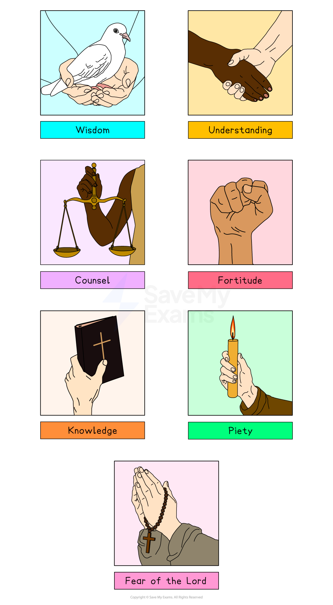

# Christian Beliefs about the Holy Spirit

## What is the Holy Spirit?

> **Spec point** — `spcpt_nc6TSXGdvq3jMz9r`

## What is the Holy Spirit?

- The **Holy Spirit** is the third person of the **Trinity**, along with **God the Father** and **God the Son**
- Christians believe that the Holy Spirit:

  - Is the **spirit **or **“breath” of God**
  - **Gives life** to all things (it is said in the creation story in Genesis 1 to be present at the first moment of creation)
  - Is **equal** in power and glory to God the Father and God the Son
  - **Comes from** the **Father** and the **Son**, uniting them in love
  - Is the **presence of God** working **in the world today**
  - **Inspires people** to let them know the will of God
- Christians express these beliefs in the **Nicene Creed**, the statement of Christian belief. It states the following regarding the Holy Spirit:

> **blockquote**
> “I believe in the Holy Spirit, the Lord, the giver of life,
> 
> who proceeds from the Father and the Son,
> 
> who with the Father and the Son is adored and glorified,
> 
> who has spoken through the prophets.”
> 
> (Nicene Creed)

## God's power given to believers

> **Spec point** — `spcpt_9YdbKrjTv8f7jSnF`

## God's power given to believers

- Christians believe that the **Holy Spirit** is the** unseen force of God at work in the world **today, giving believers **strength** and **power** to remain faithful and spread the message of God
- Christians believe that the Holy Spirit has been **present** in the world from the **first moment of creation**
- The events of ***Pentecost ***mark the moment when the Holy Spirit appeared and gave **God’s power** to the **early Christians**

  - After his **resurrection **from the dead, Jesus left earth and returned to heaven in the event known as the **Ascension**
  - Shortly afterwards, God sent the Holy Spirit in a special way to give Jesus’s **apostles** power and strength to continue the work of spreading the **gospel **message
- Christians believe that the Holy Spirit is with them to** influence, guide **and **sustain** them throughout their lives
- Some Christians, especially** Catholic Christians**, believe that the Holy Spirit’s presence is renewed in a special way through **confirmation**

  - **Confirmation** is one of the seven ***sacraments ***of the Catholic Church
  - It **“confirms” the faith** of a believer who was **baptised** as a baby, allowing them to make their own commitment to God
  - At this sacrament, the believer is **anointed** with a **holy oil **called **chrism**, and the words “**Be sealed with the gift of the Holy Spirit**” are spoken
  - This symbolises the **gifts of the Holy Spirit **being given to the believer
  - **God’s power** is now at work in their lives in a special way, much as the first believers at Pentecost

## The fruits and gifts of the Holy Spirit

> **Spec point** — `spcpt_vpH7KYNDHN663zq6`

## The gifts of the Holy Spirit

- The **gifts of the Holy Spirit **are the **qualities** passed on by the Holy Spirit to Christian believers
- They are given in a special way at certain stages of life through the **sacraments**
- They are particularly associated with:

  - **Baptism**, when a person becomes a Christian and enters God’s family for the first time
  - **Confirmation**, when a person confirms their faith and becomes an “adult” Christian
  - **Ordination**, when a person becomes a priest
- The gifts of the Holy Spirit are first listed by the prophet **Isaiah** in the **Old Testament** (Isaiah 11:2–3)
- They are:

  - **Wisdom:** the ability to be wise in life, to **see things as God would see them**
  - **Understanding**: the ability to understand and **appreciate God’s message**
  - **Counsel**: also known as “**right judgement**”, the ability to judge how best to act in a situation and to both give and receive good advice
  - **Fortitude**: **courage**, moral strength and determination to stand up for your beliefs and for justice
  - **Knowledge**: the ability to study and **learn about God** and to put that learning to good use
  - **Piety**: **personal holiness**, the ability to remain devoted to God
  - **Fear of the Lord**: **wonder and awe** at the greatness of God

***The gifts of the Holy Spirit***

- **St Paul **explained the gifts of the Holy Spirit to the early Christians, saying that although they are given to all, they may be apparent in **different people **in **different ways**

  - This allows **everyone** to play their part in spreading the **gospel message**

> **blockquote**
> “The Holy Spirit is given to each of us in a special way. That is for the good of all. To some people the Spirit gives a message of wisdom. To others the same Spirit gives a message of knowledge. To others the same Spirit gives faith.” (1 Corinthians 12:7–9)

### The fruits of the Holy Spirit

- The **fruits of the Holy Spirit** are the **attributes** or characteristics that should be clear in the lives of those who have **God’s Holy Spirit working in their lives**
- They also reflect the** qualities of God’s character**
- The fruits of the Holy Spirit are mentioned by St Paul in his letter to the** Galatians **(5:22–23)
- They are:

  - **Love**
  - **Joy**
  - **Peace**, meaning both inner peace and a spirit of peace with others
  - **Patience **(sometimes referred to as** **“**forbearance**”**)**
  - **Kindness**
  - **Goodness**
  - **Faithfulness **to God
  - **Gentleness**, meaning acting with humility, being thoughtful and being considerate
  - **Self-control** over a person’s own actions and desires so that they always do what is best as a Christian

> **Exam Hint**
> When you revise this section about the Holy Spirit, make sure you also consult the notes on Christian Festivals: Pentecost. This marks the coming of the Holy Spirit upon the twelve apostles, giving them the strength to spread the message of Jesus

> **Worked Example**
> **Name two of the gifts of the Holy Spirit **
> 
> **[2 marks]**
> 
> **Final answer:** **Answer:**
> 
> One of the gifts of the Holy Spirit is wisdom** [1 mark]**
> 
> Another is understanding** [1 mark]**
