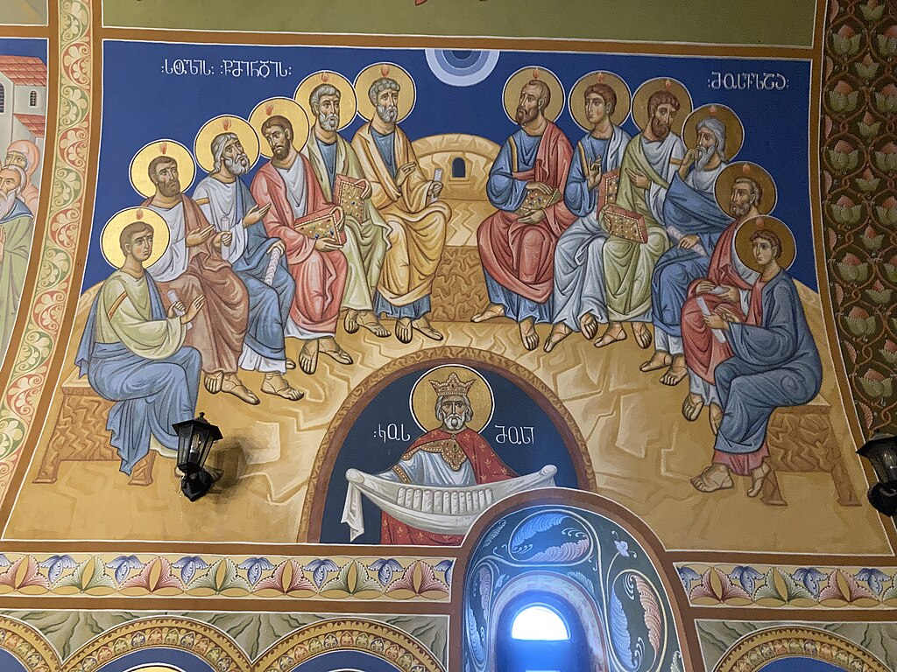

# Christian Festivals: Pentecost

## Pentecost and the coming of the Holy Spirit

> **Spec point** — `spcpt_gm4gY7dS36S5dsZ5`

## Pentecost and the coming of the Holy Spirit

- **Pentecost** is a major Christian festival that celebrates the **gift of the Holy Spirit** to the apostles
- It is held **50 days after Easter **
- Pentecost is considered the **birthday of the Christian Church** because the coming of the Holy Spirit enabled the apostles to **preach and spread the message of Jesus**

## Events of Pentecost

> **Spec point** — `spcpt_R5VSvk3GMJNv7ZMx`

## Events of Pentecost

- The **events of Pentecost** took place 50 days after Jesus’s** resurrection** at Easter and ten days after **Ascension Day **
- At Pentecost, the disciples were gathered together in **Jerusalem** to celebrate the Jewish festival of *Shavuot*
- They had seen Jesus after his resurrection and had **witnessed the events of the ascension**
- The events of Pentecost are described in the **Acts of the Apostles** in the Bible:

  - A **sound like rushing wind** filled the house
  - **Tongues of fire **appeared above each disciple
  - The disciples were **filled with the Holy Spirit**
  - They were able to **speak in many languages **to communicate with the people from many nations who were gathered in Jerusalem
  - They went out and started to **preach the good news** to everyone

> **blockquote**
> “Suddenly a sound like the blowing of a violent wind came from heaven and filled the whole house where they were sitting. They saw what seemed to be tongues of fire that separated and came to rest on each of them. All of them were filled with the Holy Spirit and began to speak in other tongues as the Spirit enabled them.” (Acts 2:2–4)

*The Holy Spirit descends on the apostles at Pentecost*

***The Holy Spirit descends on the apostles at Pentecost***

Fresco in the Orthodox church, Batumi, Georgia is licensed under CC0 License

## Customs of Pentecost

> **Spec point** — `spcpt_kqMBWBz2rqxyk4GF`

## Customs of Pentecost

- Pentecost is celebrated in many Christian Churches today
- During the celebrations of Pentecost:

  - **Churches are decorated** with symbols of the Holy Spirit (doves, flames, wind)
  - Priests and ministers **wear red** for church services to represent the fire of the Holy Spirit
  - There are** readings** from the** Acts of the Apostles** that tell the story of the first Pentecost
  - **Catholic churches** hold **confirmation services**
  
    - This is the sacrament where believers affirm their faith and receive the gift of the Holy Spirit, just as the first disciples did at Pentecost
  - **Special prayers** are said for church unity and mission

## Religious reasons for observing Pentecost

> **Spec point** — `spcpt_5ymyKGshG57drkxz`

## Religious reasons for observing Pentecost

- Christians observe the feast of Pentecost:

  - To **remember the gift of the Holy Spirit** who still guides, strengthens and empowers believers today
  - To commemorate the **start of the Christian Church** and its mission to spread the** gospel**
  - To reflect on the **power of God’s presence** still at work in the Church and the world today
  - To celebrate the **unity of the Church**, even across languages, cultures and nations
  - To encourage Christians to **use their spiritual gifts** (1 Corinthians 12:4–11)
  - To show that God is not limited to one group or nation: **Christianity is a universal message for all**

## Social significance of observing Pentecost

> **Spec point** — `spcpt_rXvGmrrgPrYMYKc6`

## Social significance of observing Pentecost

- Like all Christian festivals, Pentecost brings Christians together in **shared worship** and community reflection
- It encourages believers to think about how they can involve themselves in **outreach** and **spreading the gospel**, following the example of the early Church
- Some schools and churches hold **Pentecost events **or **shared meals**, which **strengthen the faith community** and help children **learn more **about their faith
- **Confirmations** often take place at Pentecost, helping young people feel part of the wider Church

## Different ways of observing Pentecost

> **Spec point** — `spcpt_jxvZcYKzwmWrdftz`

## Different ways of observing Pentecost

- There are different ways of observing Pentecost according to church denomination and local tradition
- In some European countries, **Whit Monday** (the day after Pentecost) is a public holiday

- **Catholic **and** Anglican Churches** hold a **Mass** or **Holy Communion** service where:

  - The priest wears **red garments**
  - There are hymns and Bible readings about Pentecost
- **Confirmation** and **baptism** services are often held at Pentecost in Catholic and Anglican churches
- **Protestant Christians **may not have a set **liturgy** for Pentecost, but their services focus on the **work of the Holy Spirit** in the Church and the world today

  - Pentecostal worship may include** speaking in tongues** and **healing prayers**

> **Worked Example**
> Give two features of Christian celebrations of Pentecost
> 
> **[2 marks]**
> 
> **Final answer:** **Answer:**
> 
> Readings from the Acts of the Apostles telling the story of the first Pentecost **[1 mark]**
> 
> The sacrament of confirmation held as part of the celebrations** [1 mark]**

> **Exam Hint**
> One eight-mark evaluation question you may be asked is:
> 
> **Evaluate whether Pentecost is the most important festival for Christians. You must refer to Christianity in your answer. Your response should consider different points of view when you evaluate the question.**
> 
> Using the information on this page, think about why Pentecost might be seen as the most important festival. Also think about other festivals that could be seen as just as important or more important than Pentecost — Easter, Ascension, Christmas, Epiphany — and note down some reasons why.
> 
> Which one do you think is the most significant? The examiner is looking for a “clear, considered and well-reasoned judgement” to give you full marks, so reasoning it all through is very important.
