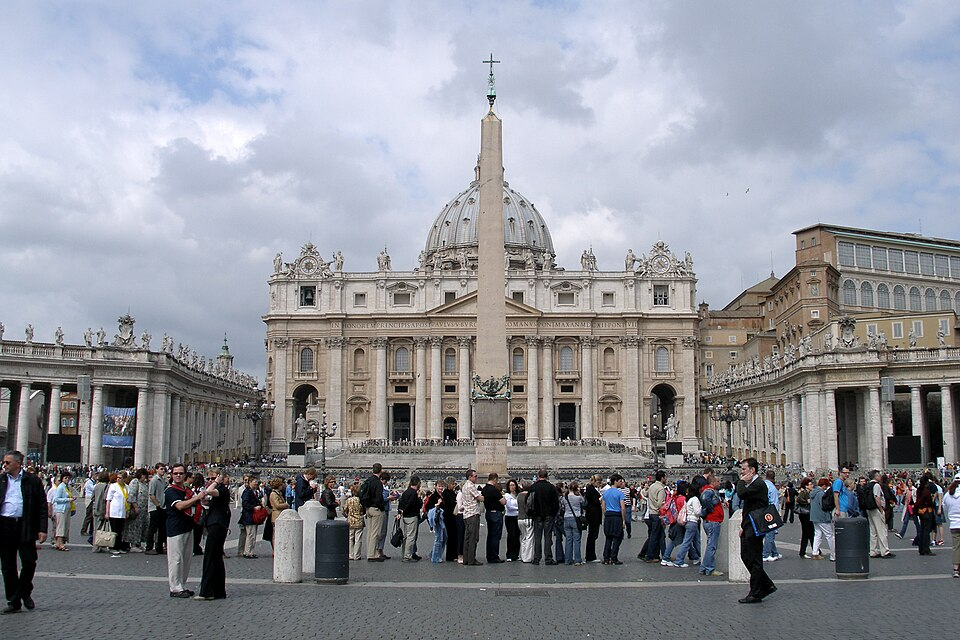

# Places of Pilgrimage for Christians

## Lourdes as a place of pilgrimage for Christians

> **Spec point** — `spcpt_hqJv6wDTGsB57sQw`

## Lourdes as a place of pilgrimage for Christians

- **Lourdes**, in **France**, is one of the most popular sites of pilgrimage for **Catholic Christians**

  - It is dedicated to the **Virgin Mary**
- In **1858**, a 14-year-old girl named **Bernadette Soubirous** saw **18 visions** of the **Virgin Mary**

  - In the visions, Mary told Bernadette to dig in the ground, and a **spring** appeared
  - Bernadette’s friend is believed to have been **healed in the waters** of the spring
- A number of **unexpected healings and cures** have taken place since that time, and several have been called **miracles**
- Pilgrims visit the **Sanctuary of Our Lady of Lourdes** and pray at the** grotto** where the **vision of Mary** is said to have taken place
- Pilgrims also participate in a **torchlight procession** that takes place each evening, before **Mass** is celebrated in the grotto
- Many pilgrims also **confess their sins** at the **chapel of reconciliation **

### The importance of pilgrimage to Lourdes for some Christians

- The **waters** from the spring at Lourdes are said to have **healing properties**

  - In the hope of being **healed**, many sick people visit Lourdes each year
- Although they may not be **physically **healed, many people say that they feel **strengthened** and have a **deeper faith** in God after their pilgrimage to Lourdes
- Prayers and services at Lourdes are considered to bring **real blessings** to the pilgrim
- Many people take the chance to **confess their sins** and feel **spiritually cleansed**
- Visiting Lourdes helps Catholics to** understand** more about the **Virgin Mary** and her message of peace
- They also have the opportunity to walk in the footsteps of **Bernadette,** who was declared a **saint **in 1933 by Pope Pius XI

## Rome as a place of pilgrimage for Christians

> **Spec point** — `spcpt_VXWrzx9gtqG3PNHF`

## Rome as a place of pilgrimage for Christians

- **Rome**,** in Italy**, is the **centre** of the **Catholic Church **
- **Vatican City**, within Rome, is the **home of the Pope** and the **headquarters of the Catholic Church**
- **St Peter** went to Rome to **preach the faith** in the early days of the Christian Church after Jesus had given him the authority to become the **first leader of the Church**

  - All popes are direct successors to St Peter
- **St Peter **was **crucified** and died in Rome

  - His **burial place** is there, on a hill where the Vatican now stands
- The spot is marked by **St Peter’s** ***Basilica***
- Rome also contains many other **relics, holy buildings and sites** connected with the history of the faith
- Rome is a place of **great historical importance** for Catholics worldwide

### The importance of pilgrimage to Rome for some Christians

- Catholics visit Rome on pilgrimage to **pray at the holy sites**
- They do this to **show their unity **with **the Pope **and** the worldwide community of believers**
- They visit the **tomb of St Peter** in St Peter’s Basilica and **reflect** on the **martyrdom** of St Peter

  - This may **deepen their faith**
- They may also visit the **cathedral** of **St John Lateran**, which is the **Pope’s cathedral **and considered the most important of all Catholic churches
- They may attend an **audience** (address) given by the **Pope** in St Peter’s Square

  - The Pope makes regular **appearances**, and believers can **receive blessings** at these events

Rome, Vatican, Italy, St Peter’s Square by Vyacheslav Argenberg is licensed under CC BY 4.0

***St Peter’s Square, Vatican City, Rome***

## Bethlehem and Nazareth as places of pilgrimage for Christians

> **Spec point** — `spcpt_knzf7FytG2Bg5JXF`

## Bethlehem as a place of pilgrimage for Christians

- **Bethlehem** is the place where Christians believe **Jesus was born **
- The most important site in Bethlehem is the **Church of the Nativity** in **Manger Square**

  - Inside this is the **Grotto of the Nativity**, which is said to mark the **exact place **where **Jesus was born**
  - Nearby is the **Chapel of the Manger**, which marks the place where **Mary laid Jesus** after he was born
- Bethlehem is also the place where Christians believe **Jesus was visited** by the **shepherds** and the **Magi (wise men)** shortly after his birth

  - Both sets of visitors brought gifts that symbolised the significance of Jesus and his role as** *****Messiah***
- Therefore, Bethlehem is seen as a site of** great historical importance**, as the place where the ***Incarnation*** happened

### The importance of pilgrimage to Bethlehem for some Christians

- Christians make a pilgrimage to Bethlehem to:

  - **Walk in the footsteps of Mary and Joseph**, who had to travel there for a *census* to be taken
  - **See the sites **associated with their Saviour’s birth
- They **attend services** in the Church of the Nativity and **visit** the Grotto of the Nativity and the Chapel of the Manger. Often, they do this at **Christmas**
- They can **pray and focus** on the events associated with the **Incarnation** in the **place where it happened**, which can **deepen their faith** and their **relationship with God**
- Visiting Bethlehem from all over the world helps Christians to **share their faith** with other believers from different countries. It is a **place of unity** for Christians from many **different denominations**
- Even though the exact spots marked as Jesus’ birthplace cannot be proven to be the correct locations, they are still seen as part of this most significant event in Christian history

### Nazareth as a place of pilgrimage for Christians

- **Nazareth** is recorded as the place where **Jesus spent his childhood**
- Christians from all denominations visit places in Nazareth that are said to mark **sites of importance** to **Jesus’ family**
- There are several places of **historical importance **that pilgrims can visit in Nazareth, including:

  - The **Church of the Annunciation**, which marks the site of the **home of Mary**, the mother of Jesus
  
    - Many Christians believe that this is where Mary was visited by the **Angel Gabriel**,** **who told her that she would give birth to a son whom she should name Jesus
  - The **Church of Saint Joseph**, which marks the location where Mary’s fiancé, **Joseph**, had a **carpentry shop**

### The importance of pilgrimage to Nazareth for some Christians

- Christians have similar reasons for making the pilgrimage to both Nazareth and Bethlehem
- Both places are of **significant historical importance** in the birth and early life of Jesus; therefore, visiting these sites allows believers to **walk in the footsteps **of **Mary and Joseph** and dwell on the events of the **Incarnation**
- Some pilgrims **walk between Nazareth and Bethlehem** as part of their pilgrimage

  - This is to follow in the footsteps of Mary and Joseph, who travelled to Bethlehem shortly before Mary gave birth to Jesus
- At Nazareth, pilgrims have the **opportunity to pray** in the church that marks the place of the Angel Gabriel’s promise to Mary
- Being in this location helps them to **reflect** on the **faith Mary showed** in saying “yes” to God and taking on the responsibility of giving birth to the Son of God
- This can **deepen their devotion** to **Mary**, the **Holy Family** and the **Incarnation**, and it can** increase their faith in God **and their **understanding** of the **significant historical events** of their faith
- Visiting Nazareth helps to **unite Christians** with believers from different countries. Like Bethlehem, Nazareth is a place of unity for Christians from many **different denominations**

## Jerusalem as a place of pilgrimage for Christians

> **Spec point** — `spcpt_8hCWzG6BkMHMMKQw`

## Jerusalem as a place of pilgrimage for Christians

- Jerusalem is a **holy city** for **all Christians** because it is where **Jesus was crucified**
- Christians may travel to Jerusalem on pilgrimage to **visit the places** **where Jesus walked** and remember the **key events **in the **last week **before **Jesus’ crucifixion**, known as **Holy Week**
- **Significant locations** in Jerusalem that Christians may visit include:

  - The **Garden of Gethsemane**, which is where** Jesus prayed after the Last Supper** with his disciples
  
    - This is where he was **arrested** by the Romans and taken to trial; Christians may visit here to pray and reflect on these events
  - The **Church of the Holy Sepulchre**, which is built at **Golgotha**
  
    - This is the site where **Jesus** is believed to have been **crucified **and **buried**
  - The **Garden Tomb**, just outside Jerusalem’s city walls, is an **alternative site** marking the death and burial of Jesus
  - **Via Dolorosa**, which is the **street** through which **Jesus carried his cross** on the way to his crucifixion
  
    - Christians follow this route and walk the very path that Jesus walked to his death in the hope that they will **follow him to heaven**
  - **Church of the Ascension**, which marks the site of the *Ascension *
  
    - A stone inside the Church is believed to contain the imprint of Jesus’ footstep

### The importance of pilgrimage to Jerusalem for some Christians

- As with Bethlehem and Nazareth, Jerusalem is an **important site of pilgrimage **for **Christians of all denominations**

  - Visiting	 allows them to feel **closer to Jesus **through walking in the same places where he lived his life
- The significance of Jerusalem is associated with the **events of the sacrificial death, burial and resurrection of Jesus**

  - These are the **most important events** to all Christians
- Therefore, Christians visit Jerusalem and its sacred sites to **share in Jesus’ life** and **suffering **and to **understand** what he **experienced** in the events leading to his death
- This is a way to **develop** and **deepen their faith** and **strengthen their relationship** with **God**
- From Jerusalem, it is also possible to visit **other locations** in the **Holy Land** where Jesus lived and taught

> **Worked Example**
> **Name two places that Christian pilgrims might visit in Bethlehem, and state what some Christians believe happened in those places **
> 
> **[4 marks]**
> 
> **Final answer:** **Answer:**
> 
> Christian pilgrims might visit the Grotto of the Nativity in Bethlehem **[1 mark], **which many believe marks the place where Jesus was born **[1 mark]**
> 
> They might also visit the Chapel of the Manger within the Church of the Nativity** [1 mark] **because some Christians believe that this is the place where Mary laid Jesus in the manger after his birth **[1 mark]**

> **Exam Hint**
> Make sure you can answer a 4-mark question like the example above on each of these places of Christian pilgrimage:
> 
> - Lourdes
> - Rome
> - Bethlehem
> - Jerusalem
> 
> Also, practise answering a 6-mark question on each place of pilgrimage, which might be worded like this:
> 
> Explain why [name of pilgrimage place] is an important site of pilgrimage to some Christians [6 marks]
> 
> This type of question asks you to go further than simply recording what might have happened and to explain why each site is important to some Christians. Use the notes on this page to help you outline your answers
