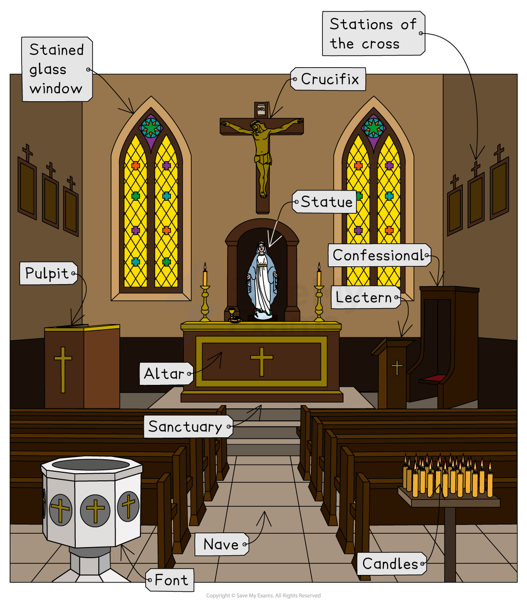

# Features of Church Buildings

## Main features of the church building

> **Spec point** — `spcpt_98JgkwM6wWyX9YtY`

## Main features of the church building

### Sanctuary

- **Catholic** churches and some **Anglican **churches are traditionally built in the **shape of a cross,** with the top of the cross facing towards the holy city of Jerusalem
- The part of the building at the top of the cross is called the **sanctuary**
- It is considered the **holiest part **of the church.
- It contains many important church features, including the **altar**
- The sanctuary is sometimes separated from the *nave* by a rail

### Altar

- This is a **table**, usually at the **front of the church,** within the **sanctuary**
- The altar is the **focal point **for services in many Christian churches, particularly Catholic churches
- The altar is where the **bread and wine** are **blessed** by the priest during the ***Eucharist***
- For this reason, some *denominations* refer to it as a **Holy Table** or **Communion Table**
- The altar is covered with a cloth, and a different coloured cloth is used in every church season
- Often, the altar is dressed with candles and a cross

### Lectern

- The **lectern** is a **stand** that the **Bible** is placed on to be read from in services
- In some churches, the lectern is in the shape of an **eagle **to represent **God’s word** flying out across the world

  - The eagle is also the symbol for John, the author of one of the four gospels
- The lectern is found in the **sanctuary**, near the altar

  - It is always in a prominent place where **everyone can see **and **hear** the **word of God**

### Pulpit

- The **pulpit** is an **elevated platform** where the minister or priest will stand to give a *sermon*
- It is also found within the **sanctuary**

### Baptistery and font

- The font is a **stone basin** used to **baptise babies** using **holy *****consecrated *****water**
- It is often placed at the **door** of a church, symbolising baptism as an event in which a Christian is **welcomed** **into God’s family**, the Church
- Some Christian denominations, such as the Baptist Church, will contain a **baptistery **instead of a font

  - This is because they practise **believers’ baptism**, where people are baptised as adults when they are old enough to commit to Christianity themselves
  - A baptistery is a **pool or tank of water** where baptism can be conducted through a process called **total immersion**
  
    - This means the person being baptised will walk down into the pool and be fully submerged in the water

***Main features of a church building***

## Representations in church

> **Spec point** — `spcpt_nR42GZKCdqJPCFKz`

## Representations in church

### Statues, images and decorations

- Many Christian churches, especially Catholic and Anglican churches, contain a range of **representations** of **religious figures or events**
- These include:

  - **Statues** of religious figures, especially Jesus, Mary or saints
  - **Stained glass windows** that depict key events in the Bible or the lives of the saints
  
    - These may represent the saint or event that the individual church is named after
  - **Paintings**, **carvings** or** tapestries** of religious figures
- These paintings, carvings or statues serve several purposes:

  - They give a **focal point for prayer**, helping the person to concentrate
  - They **educate people **about the person or event depicted
  - They **represent religious figures** or saints who can serve as a **role model** for living in **holiness **and **faithfulness** to **God**

*IMAGE REQUIRED*

***The 23-metre hand-woven “Christ in Glory” tapestry in Coventry Cathedral shows the risen Christ***

*IMAGE REQUIRED*

**Christ in Glory tapestry by Graham Sutherland in Coventry Cathedral by DeFacto is licensed under ***CC BY 4.0*

### Stations of the Cross

- The **Stations of the Cross** are found in Catholic churches
- They consist of a series of **14 images** showing the events that happened to **Jesus** on the **day of his crucifixion**
- These images are displayed on the walls of the church or chapel
- They remind Catholics of the **suffering Jesus** was willing to undertake in being crucified and dying to save them from their sins
- During **Lent**, especially on **Good Friday** of **Holy Week**, Catholics hold a service where they walk between each of the images, pausing at each one to hear a short reading, say prayers and **reflect on the events** shown

### Candles

- Candles are a common feature of Christian churches
- They help to provide a **focus for worship** and prayer, both during **services** and in **private prayer**
- Candles are used especially at **baptisms**, and special candles are used during festivals such as **Christmas** and **Easter**
- Some Christians light a candle when they say a **private prayer**, showing their **devotion** to God and their **faith** that their prayer will be heard
- Candles represent **joy, faith and hope** even in the darkest of times
- The light from the candles represents **God’s light guiding Christians** through their lives
- They are used because **Jesus** said that he was the light of the world

> **blockquote**
> “I am the light of the world. Whoever follows me will never walk in darkness, but will have the light of life.” (John 8:12)

## Differing Christian views on the church features

> **Spec point** — `spcpt_7gC5JrGQNFjXVX7X`

## Differing Christian views on the church features

- Christians have **different opinions **on the importance of the main church features
- Some Christians would argue that the **church building** itself is very **important **because it is the **house of God **

  - Therefore, the building should represent the highest quality of design as a **sign of respect** and **devotion** to God
  - The **features** inside should be **decorated** as a **sign of reverence** and **respect** for God
- Many **Catholic** and **Orthodox** churches are **highly decorated**
- Like Catholic churches, **Anglican churches** are often in the shape of a **cross**, and although they contain the same features — sanctuary, altar, pulpit, lectern and font — they are **often plainer** than Catholic churches, with **fewer statues** and **candles**

  - An Anglican church will usually have a simple **cross** displayed rather than a **crucifix**
- Many **non-conformist Christian churches** are much **plainer** and contain **fewer features** than Catholic and Anglican churches

  - The main feature is usually the **pulpit **or **lectern**, which reflects the greater importance placed on the **Bible** as the main feature of church services
- Non-conformist Christians believe that **God is present in all places**

  - His presence in church should not be regarded as special or different from His presence in someone’s house
  - Therefore, it is **not important** for the building or the furnishings to be of expensive materials or highly decorated, as this may actually **distract** people from worship and listening to God’s words
- Most Christians would agree that the **church **is primarily the** Christian people **rather than a building

  - However, the church building is important because worship would be **more difficult** without it, and it is a place where the **community** can gather and worship together

> **Worked Example**
> **Name two key features found in a Christian church**
> 
> **[2 marks]**
> 
> **Answer:**
> One key feature found in a Christian church is an altar **[1 mark]**
> 
> Another feature is a lectern **[1 mark]**

> **Exam Hint**
> Section C (evaluation questions) will ask you to evaluate the importance or significance of a belief or key feature of the religion you have studied.
> 
> For example:
> 
> Evaluate the significance of key features in church buildings for different groups of Christians.
> 
> You must refer to Christianity in your answer. Your response should consider different points of view when you evaluate the question. [8 marks]
> To get full marks in c-type questions, make sure you write clearly and consider in detail a range of points of view on the question. In this example, you would need to compare and contrast the importance of key church features for Catholic, Anglican and non-conformist Christians. Use evidence to support your views — in this case, give several examples of church features and explain their importance to different Christians.
