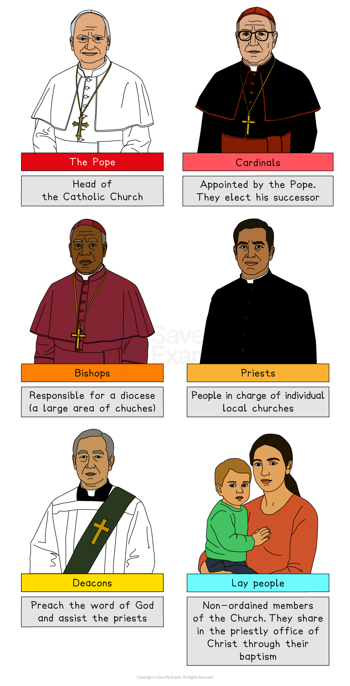

# Religious Leaders in Christianity

## The role & significance of the Pope and bishops

> **Spec point** — `spcpt_hDx6pp9CW9BnxqhH`

## The role & significance of the Pope and bishops

- There is a **hierarchy** in the **Roman Catholic Church**, which means that there are **different levels of authority** and **responsibility**
- A church hierarchy also exists in the Anglican Church. However, the Anglican Church does not accept the authority of the Pope

***The hierarchy of the Catholic Church***

### The role and significance of the Pope

- The **Pope** is the **spiritual leader** of the **Roman Catholic Church** and the **Bishop of Rome**
- Catholics see him as **God’s representative on earth**
- The Pope is viewed as the **direct successor of St Peter**, the leader of the apostles

  - This is because of the words Jesus spoke to Peter:

> **blockquote**
> “You are Peter, and on this rock I will build my church … I will give you the keys to the kingdom of heaven, and whatever you bind on earth will be bound in heaven, and whatever you loose on earth will be loosed in heaven” (Matthew 16:18–19)

- Catholics believe that these powers have been passed down in an **unbroken line **from Peter to the present day

  - They believe that **Jesus** is **present** in the **papacy **(the office of the Pope) to this day

- This is why they accept the authority of the Pope
- The current pope is Pope Leo XIV
- The papacy is a **source of authority** for Catholics, who can turn to the Pope’s teaching as well as the Bible for guidance on how to live and what to believe
- The Pope is an **important world figure** beyond the Catholic Church

  - He is the **head** of the **largest denomination** in Christianity
  - He is the **spokesperson** for the **Catholic Church** worldwide
  - He is a figure who often **speaks out **about **moral and social issues**, such as human rights and justice, poverty and environmental concerns

### The role and significance of the bishops

- The **bishops **are also seen as the **successors to the apostles**
- They are the **heads of the local churches** and are in charge of areas of the church called **dioceses**
- More **senior bishops** are known as **archbishops** and have more responsibility
- The Pope chooses **cardinals** from the archbishops

  - These men have the task of electing a new Pope when the previous Pope dies or retires
- The combined authority of the Pope and the bishops is called the **Magisterium**

  - The Magisterium has the same authority as the first apostles because of the unbroken line of command that has been passed down from Peter to today
  - This belief in the authority of the Magisterium is called **apostolic succession**

Catholics believe that the Magisterium is **guided by the Holy Spirit**

## The role & significance of priests, ministers and pastors

> **Spec point** — `spcpt_jrJqgY69GXxZgFQR`

## The role & significance of priests, ministers and pastors

- Priests, ministers and pastors are the people in charge of **individual churches**
- These people have several **roles and responsibilities, including:**

  - Leading the **Sunday service**
  - Preparing the **sermon** for the service so it teaches people about the messages contained in the readings and how they can apply those to their lives
  - Carrying out important services, such as **baptisms**, **marriages** and **funerals**
  - Visiting** the sick**, housebound and elderly and taking **Holy Communion** to them
  - Overseeing the **day-to-day running** and organisation of the church
  - Leading or organising **events and groups**, such as youth groups, Bible study groups or charity work groups
  - Taking the lead in deciding how the individual church should work in the **local community** and how it should support the **worldwide mission** of the Christian Church
  - **Representing the Christian faith** at local meetings and organisations, such as councils or school governing bodies
- In the **Catholic Church**, the priest is responsible for conducting five of the Church’s seven sacraments:

  - Baptism
  - Reconciliation
  - Eucharist
  - Marriage
  - Sacrament of the Sick

## Denominations with no ordained clergy

> **Spec point** — `spcpt_Bhmc3SfVGSh6gmhx`

## Denominations with no ordained clergy

- Some **Protestant Christian** denominations do not have ordained clergy
- These churches **share out the roles** and responsibilities of priests, ministers and pastors among the people of the church
- **Everyone** is a **layperson**, which means a non-ordained person
- The reasons for this are:

  - All **baptised** people are seen as **equal in the eyes of God**
  - There is **no special authority** given to one person over another
  - All people have the **same direct access** to **God**: They do not need to access God through a priest or religious leader
- This belief is known as the **priesthood of all believers**

  - **Jesus **is the link between people and God, not a priest or minister
- The basis of this belief is the teachings of Peter and Paul in the Bible
- St Peter said that every Christian is part of a **“royal priesthood”**:

> **blockquote**
> “But you are a chosen people, a royal priesthood, a holy nation, God’s special possession, that you may declare the praises of him who called you out of darkness into his wonderful light.” (1 Peter 2:9)

- St Paul said that the only **mediator **between God and humans is **Jesus**:

> **blockquote**
> “There is one God and one mediator between God and mankind, the man Christ Jesus” (1 Timothy 2:5)

> **Worked Example**
> Name two leadership roles in the Church
> 
> ** [2 marks]**
> 
> **Final answer:** **Answer:**
> 
> One leadership role is the Pope** [1 mark]**
> 
> Another is a priest **[1 mark}**

> **Exam Hint**
> A c-type evaluation question on this topic might ask you to consider a statement such as
> 
> “Evaluate different views on whether clergy are needed for Christian worship.”
> 
> Make a list of the reasons why some churches have clergy (priests or ministers) and others do not, and think about what your own views are on this subject.
