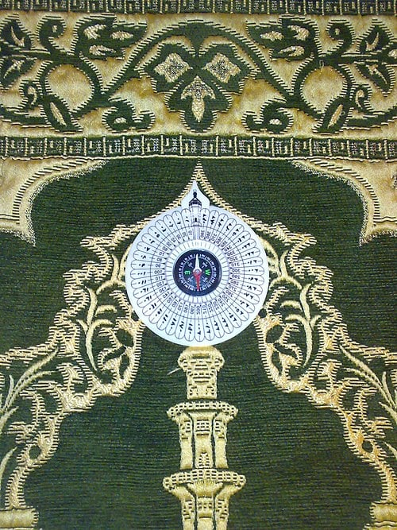

# Artefacts used in Islamic Worship

## The Qur’an and respectful treatment

> **Spec point** — `spcpt_f2SpYpsM3wpz9rdx`

## The Qur’an and respectful treatment

- The **Qur’an** is the **holy book of Islam**
- It is the **revelation of Allah** to the prophet Muhammad (pbuh)

  - It is regarded as **more important** than any other **book**
- It is treated with **great respect** and care
- When not in use, the book is kept on a **high shelf** above other books and is often **wrapped in cloths**
- Before handling it, Muslims **wash **their hands to show their respect for the word of Allah
- The Qur’an is placed on a **special stand** before being read
- When reading it, Muslims show great respect

  - They make sure they are **not speaking**, **eating or drinking**, or making any **distracting noise **while it is being recited out loud in the mosque
- Even **translations** of the Qur’an need to be treated with great care
- Although there are no specific teachings about how to handle the Qur’an in any sacred texts, all Muslims respect the importance of the text in how they handle the book

## The meaning & importance of the compass

> **Spec point** — `spcpt_pHXSMcnq669HkspQ`

## The meaning & importance of the compass

- Muslims must face the **Ka’aba** in **Makkah** for **prayer**

  - This is important because it **connects every Muslim** in the world to the spiritual centre of their faith
- When in a mosque, the **mihrab** in the** qiblah wall** helps them find the correct direction
- If a Muslim is not in a mosque for their prayer, they may use a **compass **to help them find the direction of Makkah

  - Some **prayer mats** have **built-in compasses** for this purpose
- **Apps** are available to help Muslims find the direction of prayer and remind them of prayer times

***Prayer mat with a compass***

Prayer rug with a compass by Maqivi is licensed under *CC BY 3.0*

## The meaning & importance of prayer mats

> **Spec point** — `spcpt_BdPJzbBRCqQF44Bp`

## The meaning & importance of prayer mats

- **Salah **is the duty of prayer that Muslims must perform each day

  - It has to be performed on a **clean surface**
- Although **prayer mats** are not mandatory, they are **widely used**

  - They ensure that a Muslim can pray on a clean surface, even if they are in a location where that would be difficult
  - Using a prayer mat ensures there is always a suitable space that a believer can use to **dedicate** themselves to prayer
- Prayer mats are often **decorated** with Islamic art to reflect the beauty and intricacy of Allah’s creation
- Prayer mats may include a **built-in compass **to help the person find the right direction to face **Makkah** for prayer
- In the mosque, prayer mats are not generally required, as the carpet in the prayer hall is often marked with individual spaces for each person to perform their prayer sequences

## The meaning & importance of the turbah

> **Spec point** — `spcpt_nvtHtbrgKRyy7zCZ`

## The meaning & importance of the turbah

- The **turbah** is a small **block of wood** or **earth**

  - It is also known as the **prayer stone**
- ***Shi’a Muslims*** place a turbah on the ground during prayer so that their head touches something natural when they ***prostrate*** themselves
- This reminds them that they have come **from the earth** and will return to it after death
- It also represents the **martyrdom** of the third Imam al-Husayn, the grandson of the Prophet Muhammad (pbuh)

## The meaning and importance of misbahah

> **Spec point** — `spcpt_2kDFD45kyJRb9bQW`

## The meaning and importance of misbahah

- **Misbahah** (or misbaha) are **prayer beads**

  - There are usually **99 beads** on a string: one bead to represent each of the **99 beautiful names of Allah** and the 99 short prayer sentences known as **dhikr**
- Muslims repeat the prayer sentences to help them **focus on their worship** of Allah, and holding the beads can help them **concentrate** and **calm their minds**
- Misbahah can be made from a variety of materials, including wood, natural stone or plastic
- Some Muslims choose not to use misbahah and prefer to use their fingers to count while reciting dhikr

> **Worked Example**
> Give two ways in which Muslims show respect for the Qur’an
> 
> **[2 marks]**
> 
> **Final answer:** **Answer:**
> 
> They wash before reading from the Qur’an **[1 mark]**
> 
> It is stored higher than any other book when not in use **[1 mark]**

> **Exam Hint**
> For this part of the course, you will be asked questions about how Muslims use and show respect for artefacts such as the Qur’an in worship. Later in these notes, you will delve deeper into the importance of the Qur’an and prayer for believers. Studying these topics will enable you to provide more detailed answers on why Muslims carry out the actions described here.
