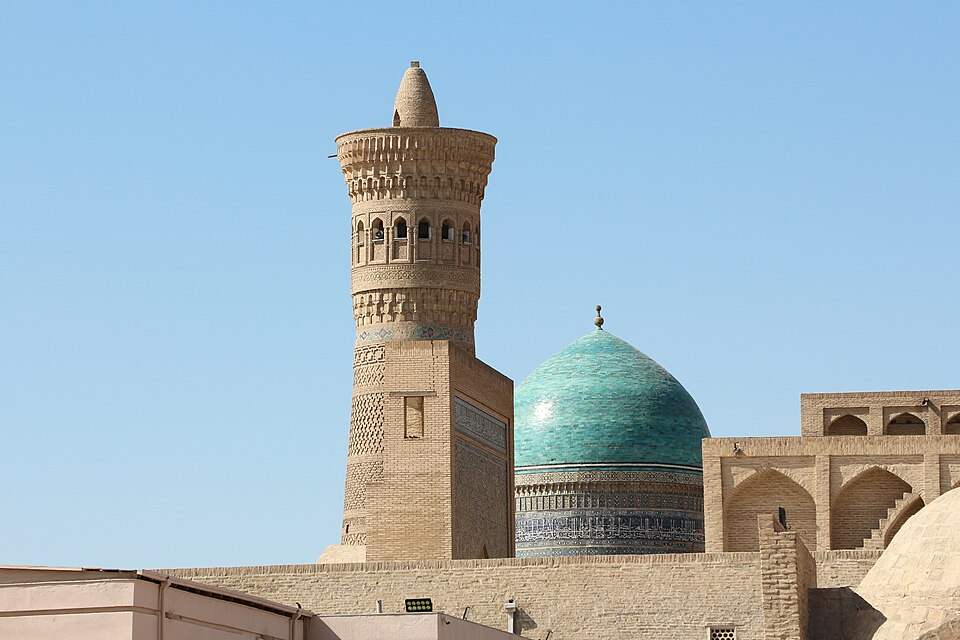
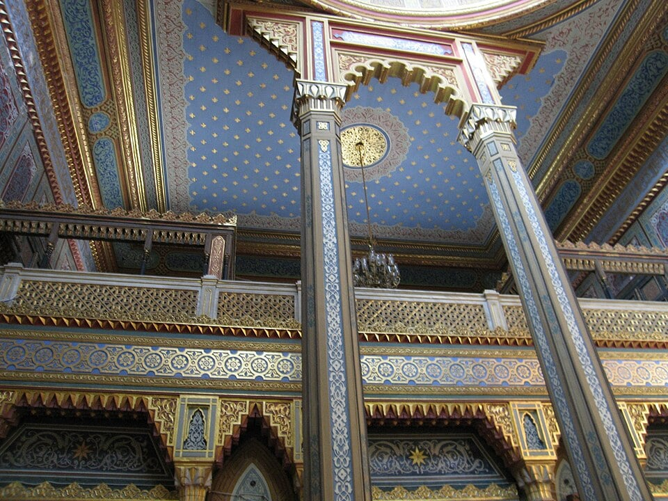

# Key features of a Mosque

## The minaret and dome

> **Spec point** — `spcpt_KcJWjkBvR9s8wxNx`

## The minaret and dome

- Mosques contain certain similar features
- The most visible features that mark them out as a place for Muslim prayer and worship are the **dome** and** minaret**
- The dome on the top of a mosque symbolises:

  - **Allah’s universe** and reminds Muslims that Allah created everything
  - That **Allah is eternal **and represents the **vault of heaven **
- The dome also has two practical purposes:

  - It is placed over the prayer hall to naturally amplify voices
  - It allows air to circulate, which is particularly helpful in countries with hot climates
- The **minaret **is a **tall tower **from which the **call to prayer** is broadcast

  - The call to prayer (known as **adhan**) begins “Allahu Akbar”, meaning “Allah is the most great”, and is the sign for Muslims to undertake **Salah**, or prayer
  - The minaret symbolises the central importance of **prayer **in a Muslim’s life
  
    - Traditionally, the **muezzin** (person who calls people to prayer) would have climbed the minaret to perform the call to prayer, but now, a recording may be broadcast

*Dome and minaret on a mosque in Bukhara, Uzbekistan*

Kalan Minaret and dome of Mir-i-Arab madrasa, Bukhara, Uzbekistan, is licensed under *CC0 1.0*

## What is the qiblah?

> **Spec point** — `spcpt_zYHX9VjPSPMKXPSN`

## What is the qiblah?

- Qiblah means “**direction**” or** **“**facing**”

  - The qiblah for Muslims is the** wall **in the mosque that** faces the Ka’aba** in the holy city of **Makkah**
- Muslims must face Makkah for prayer, and the qiblah in the mosque helps them to do so

  - The qiblah is marked with a niche, which is known as the **mihrab**
- If a Muslim is not in a mosque for their prayer, they may use a compass to help them find the direction of Makkah

  - Some prayer mats have built-in compasses for this purpose

## What are the mihrab, minbar and musalla?

> **Spec point** — `spcpt_ctNgCmHmhMZfxY5C`

## What are the mihrab, minbar and musalla?

- The **mihrab** is the niche or **alcove** in the **qiblah wall **indicating the direction of **Makkah**, allowing Muslims to know which direction to face in their prayer
- The **minbar** in the mosque is the **platform** from which the imam (priest) will preach a sermon during Friday worship

  - The minbar usually contains **three steps**
  - The imam does not go to the top step as a sign of respect and submission to Allah’s greatness
- The **musalla** is the **main prayer hall** in the mosque

  - This is a large hall that is of central importance in the mosque
  - It does not have seats, as Muslims stand or pray on the floor as a sign of equality before Allah
  - Men use the musalla for prayer or worship
  
    - Women often worship on a separate balcony at the back of the prayer hall

## The reasons for separate prayer areas for men and women

> **Spec point** — `spcpt_qQGBw7FX2t8J8Qbh`

## The reasons for separate prayer areas for men and women

- In the mosque, there are **separate prayer areas** for **men** and **women**
- Women either have their own prayer hall, are separated by a curtain or partition or more commonly, worship on a separate balcony at the back of the prayer hall
- This is because nothing should **distract** a person from** Allah** during worship

  - The Prophet Muhammad (pbuh) emphasised the importance of avoiding distractions during prayer, and Muslims follow this example
- It also allows for **dignity** and **modesty**, because prayer involves physical movements such as *prostration*

  - These movements might be uncomfortable for women if they have to perform them in the presence of men

## Architecture and calligraphy in mosques

> **Spec point** — `spcpt_C6Nk2FKj6dn6yxWB`

## Architecture and calligraphy in mosques

- Muslims **do not **have **images** or **statues** of **Allah** in a mosque or anywhere else

  - This is because they believe that they should worship only Allah and avoid **idolatry **
  - Having no statues of Allah ensures that no one worships representations of Allah
- The **Qur’an forbids this**, saying:

> **blockquote**
> “When he said to his father and his people, ‘What are these statues to which you are devoted?’ They said, ‘We found our fathers worshippers of them.’ He said, ‘You were certainly, you and your fathers, in manifest error.’” (Qur’an 21:52–54)

- There are **no representations** of** human** or animal figures in the mosque, either
- **Decorative patterns** are used to decorate the mosque instead of statues and images

  - These include ***geometrical***** designs, mosaic patterns, symbols** and **calligraphy **(beautiful handwriting)
- The patterns are often beautifully ornate to represent the **beauty of Allah’s design**, **creation **and the promise of **Paradise**
- This is known as **Islamic art **and can also be found on items such as prayer mats and ornaments

*Decorative patterns and architecture within a mosque in Turkey*

Internal decoration of the Yildiz Hamidiye Mosque in Istanbul, Turkey, *public domain*

> **Worked Example**
> **State two key features of a mosque **
> 
> **[2 marks]**
> 
> **Final answer:** **Answer:**
> 
> One key feature of a mosque is a minaret **[1 mark]**
> 
> Another is a dome **[1 mark]**

> **Exam Hint**
> You may find that some of the key vocabulary for Islam differs in spelling.
> 
> For example, Makkah is also spelt Mecca, and Qiblah is sometimes Qibla.
> 
> This is generally a result of translating these terms from Arabic. Don’t worry! The exam board allows the use of alternative spellings, and the examiners are used to seeing them. You won’t lose marks for spelling the words differently (as long as they are the correct terms, of course!).
